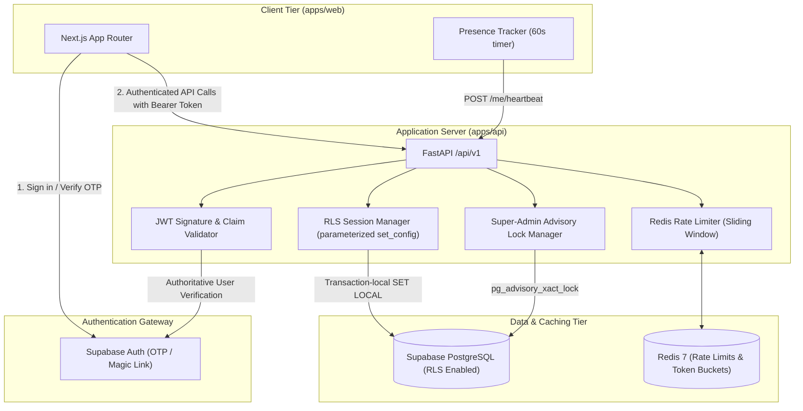

# RagBait Architecture Document

## 1. System Overview

RagBait is a collaborative, multi-user, RAG-based educational platform designed for 30–100 college students, built with strict authorization boundaries, minimal abstractions, and production-grade security.

The system is organized as a monorepo containing:
- **`apps/web`**: Next.js App Router frontend with TypeScript, Tailwind CSS, and Supabase SSR integration.
- **`apps/api`**: FastAPI backend with Python 3.12, Pydantic, asyncpg, and Redis.
- **`supabase/`**: Supabase migrations, configurations, and Row Level Security policies.
- **`docs/`**: Comprehensive system, database, security, and operational documentation.

---

## 2. Component Responsibilities

### 2.1 Frontend (`apps/web`)
- **Server Components by Default**: Pages query backend server-side and leverage SSR cookies securely via `@supabase/ssr`.
- **Client Components**: Used only for user interaction (form inputs, OTP input, confirmation dialogs, and presence tracking).
- **Authentication State Routing**: Middleware inspects session and profile state to guide users into appropriate screens:
  - `/auth/verify` for unconfirmed emails.
  - `/access/pending` for verified users awaiting admin review.
  - `/access/rejected` for rejected users.
  - `/access/contribution-required` for approved students awaiting future M2 API contribution.
  - `/admin` for approved administrators.
- **Zero Trust**: Client-side routing is strictly for UX; all authorization decisions are re-validated on the backend and database. No `service_role` credentials ever reach the client.

### 2.2 Backend API (`apps/api`)
- **Versioned Routes**: All public API endpoints reside under `/api/v1`.
- **Stateless Authentication**: Validates incoming Supabase Bearer JWTs cryptographically (iss, aud="authenticated", sub, exp).
- **Transaction-Local Database Context**: Executes all user-scoped SQL within explicit transactions using parameterized `set_config()` calls with `is_local = true`.
- **Administrative Serialization**: Uses PostgreSQL transaction advisory locks (`pg_advisory_xact_lock`) for role transitions to guarantee invariants such as preventing concurrent demotion of the last super-admin.
- **Distributed Rate Limiting**: Redis-backed sliding window / token bucket algorithm with strict fail-secure mode.
- **Structured Observability**: Structured JSON logging with request IDs, response durations, and error categorizations.

### 2.3 Database Tier (`supabase/`)
- **PostgreSQL with RLS**: All tables (`profiles`, `access_requests`, `user_presence`, `audit_logs`) have Row Level Security enabled.
- **Column-Level Permissions**: `REVOKE UPDATE ON public.profiles FROM authenticated; GRANT UPDATE (display_name) ON public.profiles TO authenticated;`.
- **Protected Triggers**: `protect_profile_roles_and_status()` is strictly `SECURITY INVOKER`, checking the real caller context and preventing unauthorized updates to `role` or `approval_status`.
- **Function Classifications**:
  - `app_private.is_admin()`: `SECURITY DEFINER SET search_path = ''` in private schema `app_private`.
  - `protect_profile_roles_and_status()`: `SECURITY INVOKER SET search_path = ''`.
  - `handle_new_user()`: `SECURITY DEFINER SET search_path = ''` (execution revoked from public).
  - `set_updated_at()`: `SECURITY INVOKER SET search_path = ''`.

---

## 3. Future Extension Points

- **M2 (Provider Credential Management & LLM Gateway)**:
  - Encryption-at-rest in a dedicated private PostgreSQL schema (`vault` or `credentials`).
  - Provider adapters (Gemini, OpenAI, OpenRouter) with unified quota and spending metrics.
- **M3 & M4 (Document Repository & Subject-Scoped RAG)**:
  - Shared knowledge base with document-level ownership.
  - Chunking, metadata preservation, and `pgvector` indexing.
- **M5 (AI Study Assistant & Exam Generator)**:
  - Streaming responses, multi-turn chat persistence, citation verification.
