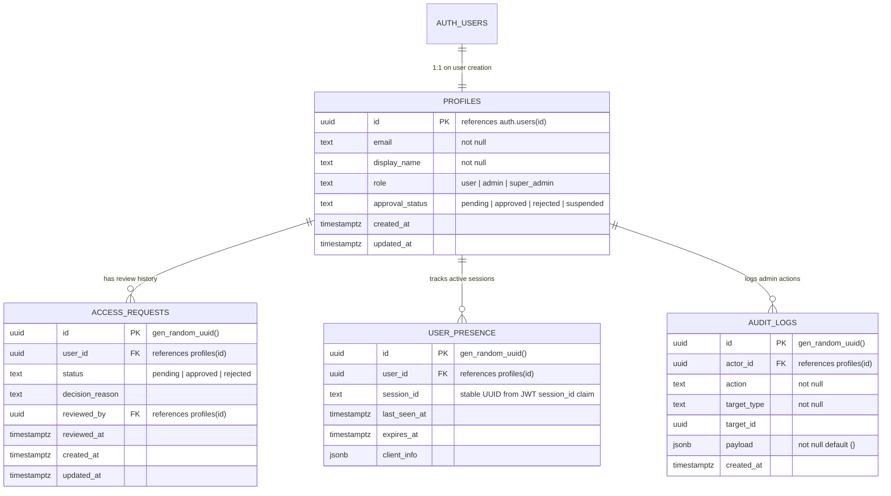

# RagBait Database Architecture & Schema Specification

## 1. Schema Diagram

---

## 2. Table Specifications & Constraints

### 2.1 `public.profiles`
- **Primary Key**: `id uuid PRIMARY KEY REFERENCES auth.users(id) ON DELETE CASCADE`.
- **Fields**:
  - `email text NOT NULL`
  - `display_name text NOT NULL`
  - `role text NOT NULL DEFAULT 'user' CHECK (role IN ('user', 'admin', 'super_admin'))`
  - `approval_status text NOT NULL DEFAULT 'pending' CHECK (approval_status IN ('pending', 'approved', 'rejected', 'suspended'))`
  - `created_at timestamptz NOT NULL DEFAULT now()`
  - `updated_at timestamptz NOT NULL DEFAULT now()`
- **Indexes**:
  - `CREATE INDEX idx_profiles_email ON public.profiles(email);`
  - `CREATE INDEX idx_profiles_role ON public.profiles(role);`
  - `CREATE INDEX idx_profiles_status ON public.profiles(approval_status);`
- **Security & Privileges**:
  - `REVOKE UPDATE ON public.profiles FROM authenticated;`
  - `GRANT UPDATE (display_name) ON public.profiles TO authenticated;`
  - Trigger `tr_protect_profile_roles_and_status` raises an exception if a non-admin attempts to modify `role` or `approval_status`.

### 2.2 `public.access_requests`
- **Primary Key**: `id uuid PRIMARY KEY DEFAULT gen_random_uuid()`.
- **Fields**:
  - `user_id uuid NOT NULL REFERENCES public.profiles(id) ON DELETE CASCADE`
  - `status text NOT NULL DEFAULT 'pending' CHECK (status IN ('pending', 'approved', 'rejected'))`
  - `decision_reason text`
  - `reviewed_by uuid REFERENCES public.profiles(id)`
  - `reviewed_at timestamptz`
  - `created_at timestamptz NOT NULL DEFAULT now()`
  - `updated_at timestamptz NOT NULL DEFAULT now()`
- **Indexes & Unique Constraints**:
  - `CREATE UNIQUE INDEX idx_access_requests_user_pending ON public.access_requests (user_id) WHERE status = 'pending';`
  - (Enforces only one active pending request while retaining all previous resolved requests for complete audit history).
  - `CREATE INDEX idx_access_requests_status ON public.access_requests(status);`

### 2.3 `public.user_presence`
- **Primary Key**: `id uuid PRIMARY KEY DEFAULT gen_random_uuid()`.
- **Fields**:
  - `user_id uuid NOT NULL REFERENCES public.profiles(id) ON DELETE CASCADE`
  - `session_id text NOT NULL` (Verified Supabase JWT `session_id` claim)
  - `last_seen_at timestamptz NOT NULL DEFAULT now()`
  - `expires_at timestamptz NOT NULL`
  - `client_info jsonb NOT NULL DEFAULT '{}'::jsonb`
- **Constraints & Indexes**:
  - `UNIQUE (user_id, session_id)`
  - `CREATE INDEX idx_presence_expires_at ON public.user_presence(expires_at);`

### 2.4 `public.audit_logs`
- **Primary Key**: `id uuid PRIMARY KEY DEFAULT gen_random_uuid()`.
- **Fields**:
  - `actor_id uuid REFERENCES public.profiles(id)`
  - `action text NOT NULL` (e.g. `user.role_change`, `user.status_change`, `access_request.decision`)
  - `target_type text NOT NULL` (`user`, `access_request`, `system`)
  - `target_id uuid`
  - `payload jsonb NOT NULL DEFAULT '{}'::jsonb`
  - `created_at timestamptz NOT NULL DEFAULT now()`
- **Indexes**:
  - `CREATE INDEX idx_audit_logs_actor_id ON public.audit_logs(actor_id);`
  - `CREATE INDEX idx_audit_logs_target_id ON public.audit_logs(target_id);`
  - `CREATE INDEX idx_audit_logs_created_at ON public.audit_logs(created_at DESC);`

---

## 3. Row Level Security (RLS) Policies

All tables enable RLS (`ALTER TABLE ... ENABLE ROW LEVEL SECURITY;`).

1. **`public.profiles`**:
   - `SELECT`: `auth.uid() = id OR app_private.is_admin(auth.uid())`
   - `UPDATE`: `auth.uid() = id` (Limited to `display_name` via column grant and protected by trigger).
2. **`public.access_requests`**:
   - `SELECT`: `auth.uid() = user_id OR app_private.is_admin(auth.uid())`
   - `INSERT`: `auth.uid() = user_id`
   - `UPDATE`: `app_private.is_admin(auth.uid())`
3. **`public.user_presence`**:
   - `SELECT`: `app_private.is_admin(auth.uid()) OR auth.uid() = user_id`
   - `INSERT / UPDATE`: `auth.uid() = user_id`
4. **`public.audit_logs`**:
   - `SELECT`: `app_private.is_admin(auth.uid())`
   - Direct client `INSERT`, `UPDATE`, `DELETE` are disallowed; written via server-side transactions.

---

## 4. Helper Functions & Security Classification

Functions follow individual privilege boundaries:
- **`app_private.is_admin(user_id uuid)`** (`SECURITY DEFINER SET search_path = ''`):
  Located in private schema `app_private` (hidden from PostgREST).
- **`public.protect_profile_roles_and_status()`** (`SECURITY INVOKER SET search_path = ''`):
  Observes caller context, distinguishing `authenticated` vs `service_role` / `postgres`.
- **`public.handle_new_user()`** (`SECURITY DEFINER SET search_path = ''`):
  Trigger on `auth.users`; execution revoked from `PUBLIC`, `anon`, `authenticated`.
- **`public.set_updated_at()`** (`SECURITY INVOKER SET search_path = ''`).
