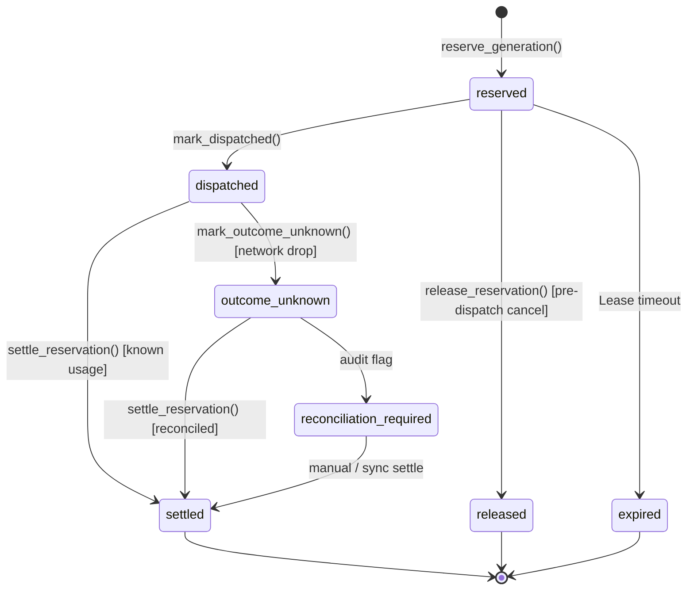

# RagBait M2.4 Implementation Plan: Admission Control, Multi-Tier Rate Limiting & Usage Ledger

## 1. Executive Summary & Objective

RagBait Milestone **M2.4** implements the distributed runtime admission control, quota reservation, concurrency lease management, and durable PostgreSQL usage ledger required before any shared cloud inference operations can proceed.

**Strict Milestone Boundary**: M2.4 is an admission-control, rate-limiting, and accounting milestone. **No real upstream provider inference is implemented or dispatched in this milestone.**

---

## 2. Existing Components to Reuse

RagBait has completed and verified Milestones M0, M1, M2.1, M2.2, and M2.3:

1. **Supabase Auth & Session Verification** (`app.core.dependencies.get_current_user`, `get_current_profile`):
   - Authenticated JWT subject (`current_user.id`) provides the trusted user identity.
   - Account status check (`approval_status == 'approved'`, role `user`/`admin`/`super_admin`) prevents unauthorized access.
2. **Provider & Model Catalog** (`public.llm_providers`, `public.llm_models`, `public.provider_quotas`):
   - M2.1 metadata provides provider status (`is_enabled`), community sharing eligibility (`allows_community_sharing`), model availability, pricing per million tokens (`input_cost_per_million_cents`, `output_cost_per_million_cents`), and published/account quotas (`provider_quotas`).
3. **Owner-Only Credential Vault** (`public.api_key_metadata`, `private.api_key_secrets`, `app.modules.credentials`):
   - Metadata provides owner ownership, credential status (`active`, `disabled`), validation status (`valid`), sharing scope (`owner_only`, `community_shared`), and configured daily/monthly request and spending caps.
4. **PostgreSQL Connection Pool & RLS Context** (`app.core.database.get_pool`, `get_user_db_session`, `get_admin_db_session`):
   - `get_user_db_session` provides transaction-local `request.jwt.claim.sub` RLS context.
   - `get_pool` / `get_admin_db_session` provides backend transactional operations.
5. **Redis Connection Management** (`app.core.redis.get_redis`, `check_redis_health`):
   - Shared async Redis client pool connecting to Redis 7.

---

## 3. Proposed New Files and Modules

```
apps/api/app/modules/admission/
├── __init__.py                 # Module exports
├── schemas.py                  # Pydantic models for admission, reservations, settlements, usage
├── errors.py                   # Typed domain exceptions (AdmissionRejectionError, LeaseExpiredError, etc.)
├── rate_limiter.py             # Distributed Redis sliding-window rate limiter with burst control
├── concurrency.py              # Distributed Redis concurrency lease manager with heartbeat renewal
├── cooldown.py                 # Redis-backed provider cooldown tracker (Retry-After parser)
├── ledger.py                   # PostgreSQL transactional budget counter & reservation repository
├── service.py                  # Orchestrator implementing the internal admission interface
└── router.py                   # User-facing read-only usage summary endpoints (GET /api/v1/me/usage)

supabase/migrations/
└── 20260204000000_m2_admission_usage_ledger.sql # Additive tables, constraints, triggers, RLS

supabase/tests/
└── m2_admission_ledger_test.sql                 # pgTAP tests for ledger immutability and RLS

apps/api/tests/
├── test_admission_rate_limiting.py              # Redis sliding-window, burst, boundary, multi-worker
├── test_admission_concurrency.py                # Concurrency lease, cap 2 user, cap 1 cred, renewal
├── test_admission_budget_ledger.py              # PostgreSQL daily/monthly request & spending limits
├── test_admission_lifecycle.py                  # State machine transitions, idempotency, unknown outcome
├── test_admission_cooldown.py                   # Cooldown scopes, Retry-After delta & HTTP-date
├── test_admission_failures.py                   # Redis/DB failure injection, fail-closed, rollbacks
└── test_admission_security.py                   # Ownership isolation, zero secrets/prompts, RLS

apps/web/
├── src/types/index.ts                           # Added UsageSummary & Reservation types
├── src/app/(protected)/credentials/usage/page.tsx # Minimal contributor usage dashboard
└── tests/UsagePage.test.tsx                     # Vitest component tests
```

---

## 4. Proposed Database Schema Changes

Additive migration: `supabase/migrations/20260204000000_m2_admission_usage_ledger.sql`

### 4.1 Table: `public.llm_usage_reservations`
Durable tracking of every admitted inference attempt across its full lifecycle.
- `id`: `uuid PRIMARY KEY DEFAULT gen_random_uuid()`
- `idempotency_key`: `text NOT NULL` (Unique constraint on `(user_id, idempotency_key)`)
- `request_id`: `text NOT NULL` (Correlation identifier)
- `user_id`: `uuid NOT NULL REFERENCES public.profiles(id) ON DELETE CASCADE`
- `credential_id`: `uuid NOT NULL REFERENCES public.api_key_metadata(id) ON DELETE CASCADE`
- `provider_id`: `text NOT NULL REFERENCES public.llm_providers(id) ON DELETE RESTRICT`
- `model_id`: `text NOT NULL REFERENCES public.llm_models(id) ON DELETE RESTRICT`
- `account_scope_id`: `text` (Optional trusted provider organization/account identifier)
- `status`: `text NOT NULL DEFAULT 'reserved'`
  - `CHECK (status IN ('reserved', 'dispatched', 'settled', 'released', 'outcome_unknown', 'reconciliation_required', 'expired'))`
- `estimated_input_tokens`: `integer NOT NULL DEFAULT 0`
- `estimated_output_tokens`: `integer NOT NULL DEFAULT 0`
- `estimated_cost_cents`: `integer NOT NULL DEFAULT 0`
- `actual_input_tokens`: `integer`
- `actual_output_tokens`: `integer`
- `actual_cost_cents`: `integer`
- `currency`: `text NOT NULL DEFAULT 'USD'`
- `pricing_snapshot`: `jsonb NOT NULL DEFAULT '{}'::jsonb`
- `lease_token`: `text`
- `lease_expires_at`: `timestamptz`
- `dispatched_at`: `timestamptz`
- `settled_at`: `timestamptz`
- `error_category`: `text`
- `created_at`: `timestamptz NOT NULL DEFAULT now()`
- `updated_at`: `timestamptz NOT NULL DEFAULT now()`

### 4.2 Table: `public.llm_usage_events`
Append-only immutable event ledger.
- `id`: `uuid PRIMARY KEY DEFAULT gen_random_uuid()`
- `reservation_id`: `uuid NOT NULL REFERENCES public.llm_usage_reservations(id) ON DELETE CASCADE`
- `event_type`: `text NOT NULL CHECK (event_type IN ('reservation_created', 'dispatch_committed', 'reservation_released', 'usage_settled', 'outcome_unknown', 'usage_reconciled', 'reservation_expired'))`
- `user_id`: `uuid NOT NULL REFERENCES public.profiles(id) ON DELETE CASCADE`
- `credential_id`: `uuid NOT NULL REFERENCES public.api_key_metadata(id) ON DELETE CASCADE`
- `tokens_delta`: `integer NOT NULL DEFAULT 0`
- `cost_cents_delta`: `integer NOT NULL DEFAULT 0`
- `currency`: `text NOT NULL DEFAULT 'USD'`
- `details`: `jsonb NOT NULL DEFAULT '{}'::jsonb`
- `created_at`: `timestamptz NOT NULL DEFAULT now()`
- **Immutability Trigger**: `BEFORE UPDATE OR DELETE ON public.llm_usage_events` raises exception `42501` to enforce append-only semantics.

### 4.3 Table: `public.llm_usage_budget_counters`
Transactional aggregates for fast, race-free row-locked capacity checks.
- `credential_id`: `uuid NOT NULL REFERENCES public.api_key_metadata(id) ON DELETE CASCADE`
- `period_type`: `text NOT NULL CHECK (period_type IN ('daily', 'monthly'))`
- `period_start`: `timestamptz NOT NULL` (Truncated to UTC day or month)
- `reserved_requests`: `integer NOT NULL DEFAULT 0`
- `dispatched_requests`: `integer NOT NULL DEFAULT 0`
- `reserved_cost_cents`: `integer NOT NULL DEFAULT 0`
- `actual_cost_cents`: `integer NOT NULL DEFAULT 0`
- `updated_at`: `timestamptz NOT NULL DEFAULT now()`
- `PRIMARY KEY (credential_id, period_type, period_start)`

### 4.4 RLS & Permissions
- Users can `SELECT` their own records: `WHERE user_id = auth.uid()`.
- Credential owners can view usage on credentials they own.
- Public / Anonymous: `REVOKE ALL`.
- Authenticated: `GRANT SELECT` (mutations performed exclusively via backend service transactions).
- Vault service role: `REVOKE ALL` (vault role does not touch usage ledger).

---

## 5. Redis Data Structures & Atomic Operation Strategy

### 5.1 Sliding-Window Rate Limiting with Burst Control
- **Algorithm**: Redis Sorted-Set (`ZSET`) Sliding Window with atomic Lua script.
- **Server Time Source**: Queries `redis.call('TIME')` within Lua to avoid multi-host clock skew.
- **Window Calculation**:
  - Score = Microsecond timestamp ($t$).
  - Value = Unique request reservation identifier.
  - Lua script:
    1. `ZREMRANGEBYSCORE key 0 (now_us - window_us)` (evicts expired timestamps).
    2. Count remaining members: `current_count = ZCARD key`.
    3. Maximum allowed capacity = `limit + burst`.
    4. If `current_count + 1 > limit + burst`: return `{0, oldest_ttl}` (rejected with Retry-After).
    5. Else: `ZADD key now_us member`, `EXPIRE key (window_seconds + 1)`, return `{1, 0}` (admitted).
- **Rate Scopes**:
  - User: `ragbait:rate:user:{user_id}` (10 RPM, burst 1)
  - Credential: `ragbait:rate:credential:{credential_id}` (5 RPM, burst 1)
  - Provider: `ragbait:rate:provider:{provider_id}`
  - Provider-Account: `ragbait:rate:account:{provider_id}:{account_scope_id}` (when verified)
  - Model: `ragbait:rate:model:{model_id}`

### 5.2 Concurrency Reservations & Leases
- **Algorithm**: Redis Hash / Sorted Set with Lease Heartbeat.
  - Active leases tracked in `ragbait:concurrency:user:{user_id}` and `ragbait:concurrency:credential:{credential_id}`.
  - Score = Lease expiration timestamp (`now + lease_duration`).
- **Atomic Concurrency Lua Script**:
  1. Remove expired leases: `ZREMRANGEBYSCORE user_key 0 now`, `ZREMRANGEBYSCORE cred_key 0 now`.
  2. Check `ZCARD user_key >= max_user_concurrency (2)` -> reject if full.
  3. Check `ZCARD cred_key >= max_cred_concurrency (1)` -> reject if full.
  4. Generate or register `lease_token`.
  5. Add `lease_token` with score `expires_at` to both keys.
  6. Set TTL on keys (`max_lifetime + 60`).
  7. Return `{1, lease_token, expires_at}`.
- **Lease Renewal**:
  - Script checks if `lease_token` exists and current time $< \text{max\_lifetime}$.
  - Extends score to `now + lease_duration`.
- **Lease Release**:
  - Removes `lease_token` from both user and credential sets idempotently.

### 5.3 Provider Cooldowns
- **Keys**: `ragbait:cooldown:{scope_type}:{scope_id}`
- Set when provider returns 429 with `Retry-After`:
  - Parses delta-seconds (integer) or HTTP-date (`RFC 7231`).
  - Clamps unreasonable values (min 1s, max 3600s).
  - `SETEX key retry_after_seconds details_json`.
  - Admission checks check `EXISTS key`; if present, returns `429` immediately without touching provider or ledger.

---

## 6. Usage Reservation Lifecycle & State Machine



### 6.1 Step-by-Step Flow
1. **Admit & Reserve (`reserve_generation`)**:
   - Check user authorization & approval status.
   - Verify credential active and valid.
   - Check cooldowns on provider, account, model, credential.
   - Atomic multi-scope Redis rate check & slot reservation.
   - Atomic Redis concurrency lease reservation.
   - Atomic PostgreSQL transaction:
     - Lock `llm_usage_budget_counters` for daily and monthly periods with `FOR UPDATE`.
     - Check `dispatched_requests + reserved_requests + 1 <= limit`.
     - Check `actual_cost_cents + reserved_cost_cents + estimated_cost_cents <= budget`.
     - Increment `reserved_requests` and `reserved_cost_cents`.
     - Insert row into `public.llm_usage_reservations` with status `'reserved'`.
     - Insert append-only event `'reservation_created'` into `public.llm_usage_events`.
   - If any step fails: rollback DB transaction, release Redis rate & concurrency slots.
2. **Commit Dispatch (`mark_dispatched`)**:
   - Transition status to `'dispatched'`.
   - Update `llm_usage_budget_counters`:
     - Decrement `reserved_requests`, increment `dispatched_requests`.
   - Record `'dispatch_committed'` in `llm_usage_events`.
   - From this point on, the attempt is permanently counted toward dispatched request quotas.
3. **Settle Usage (`settle_reservation`)**:
   - Calculate cost difference: `cost_delta = actual_cost_cents - estimated_cost_cents`.
   - Update `llm_usage_budget_counters`:
     - Decrement `reserved_cost_cents` by estimated amount.
     - Increment `actual_cost_cents` by actual amount.
   - Update reservation status to `'settled'`.
   - Release Redis concurrency lease.
4. **Release Pre-Dispatch (`release_reservation`)**:
   - Allowed only from `'reserved'` state.
   - Reverts `reserved_requests` and `reserved_cost_cents` in PostgreSQL counters.
   - Releases Redis concurrency lease and rate slot.
   - Transition status to `'released'`.
5. **Handle Ambiguous Outcome (`mark_outcome_unknown`)**:
   - When upstream network drops after dispatch commitment:
   - Status transitions to `'outcome_unknown'`.
   - Reserved spending budget is **retained conservatively** (never refunded automatically).
   - Redis concurrency lease is released so workers do not deadlock.

---

## 7. Accounting Precision & Budget Model

- **No Floating-Point Math**:
  - Token counts stored as `integer`.
  - Monetary values stored in integer **cents** (`$0.01` precision) matching M2.3 `daily_spending_limit_cents`.
- **Conservative Ceiling Estimation**:
  - $\text{Estimated Cost Cents} = \lceil \frac{\text{input\_tokens} \times \text{input\_cost\_per\_M} + \text{max\_output\_tokens} \times \text{output\_cost\_per\_M}}{1{,}000{,}000} \rceil$
  - Using integer ceiling division (`math.ceil`) guarantees we never round down or permit budget overruns.
- **Missing / Unknown Pricing**:
  - If a credential has a spending cap configured (`daily_spending_limit_cents is not None`) and model pricing is unavailable (0 or unknown), **fail closed** with `AdmissionRejectionError(code="PRICING_UNAVAILABLE")`.
  - If no spending cap is configured, allow operation with explicit `estimated_cost_cents = 0` and record `pricing_snapshot = {"mode": "unmetered"}`.

---

## 8. Failure-Handling Strategy

1. **Redis Unavailable**:
   - Fail closed immediately.
   - Return `HTTP 503 SERVICE_UNAVAILABLE` with clear diagnostic code (`"REDIS_UNAVAILABLE"`).
2. **PostgreSQL Unavailable**:
   - Fail closed immediately.
   - Return `HTTP 503 SERVICE_UNAVAILABLE` (`"DATABASE_UNAVAILABLE"`).
3. **Partial Failure Recovery**:
   - If Redis rate/concurrency succeeds but PostgreSQL transaction rolls back:
     - Invoke Lua cleanup script to release acquired rate and concurrency slots.
     - If Redis cleanup fails, the concurrency lease TTL guarantees automatic expiration within `LLM_RESERVATION_LEASE_SECONDS`.
4. **Duplicate Callbacks**:
   - Operations on `reservation_id` check current state and idempotency keys.
   - Duplicate `settle_reservation` or `release_reservation` calls are no-ops returning existing state.

---

## 9. Test Plan

1. **Rate Limiting Tests** (`test_admission_rate_limiting.py`):
   - User RPM (10 limit), Credential RPM (5 limit), Burst capacity 1.
   - Boundary-crossing requests across 60s window.
   - Multi-worker concurrent admissions respecting shared Redis counters.
   - Stricter model/provider quota takes precedence.
2. **Distributed Concurrency Tests** (`test_admission_concurrency.py`):
   - User concurrency max 2, Credential concurrency max 1.
   - Lease expiration and automatic slot reclamation.
   - Lease heartbeat renewal.
   - Stale lease token cannot release or renew a newer lease.
3. **Budget & Ledger Tests** (`test_admission_budget_ledger.py`):
   - Daily & monthly request limit exhaustion.
   - Daily & monthly spending budget exhaustion.
   - Concurrent reservations cannot collectively exceed budget (row locking).
   - Actual usage below estimate refunds unused reservation.
   - Actual usage above estimate records budget overrun.
   - Immutable usage event trigger blocks UPDATE/DELETE.
4. **Lifecycle Tests** (`test_admission_lifecycle.py`):
   - Full state machine transition matrix.
   - Dispatched attempt remains counted on simulated provider error.
   - Pre-dispatch release refunds request slot.
   - Ambiguous outcome retains spending reservation.
5. **Cooldown Tests** (`test_admission_cooldown.py`):
   - Retry-After seconds and HTTP-date parsing.
   - Provider cooldown blocks subsequent admission attempts.
   - Cooldown isolation across providers.
6. **Failure Injection Tests** (`test_admission_failures.py`):
   - Fail closed on Redis offline.
   - Fail closed on DB offline.
   - Partial failure rollback.
7. **Security & Ownership Tests** (`test_admission_security.py`):
   - User cannot query another user's usage summary.
   - Admin cannot access contributor secrets via admission endpoints.
   - Zero secrets or prompts in usage ledger or audit logs.
8. **Regression Verification**:
   - All M0, M1, M2.1, M2.2, M2.3 tests must remain 100% green.

---

## 10. Security Assumptions & Explicit Exclusions

### Assumptions
- FastAPI workers share the same Redis instance and PostgreSQL database.
- Upstream client passes verified Supabase JWT; caller identity is never taken from client request bodies.
- Credential secrets remain in the private vault and are never accessed by the admission service.

### Explicit Scope Exclusions
- **No real LLM inference**: No HTTP requests to OpenAI, Gemini, Groq, Cerebras, OpenRouter, or xAI.
- **No streaming or completions**: No `/generate` or `/chat` router in M2.4.
- **No automatic provider fallback or credential rotation**.
- **No Node Agent or local Ollama integration**.
