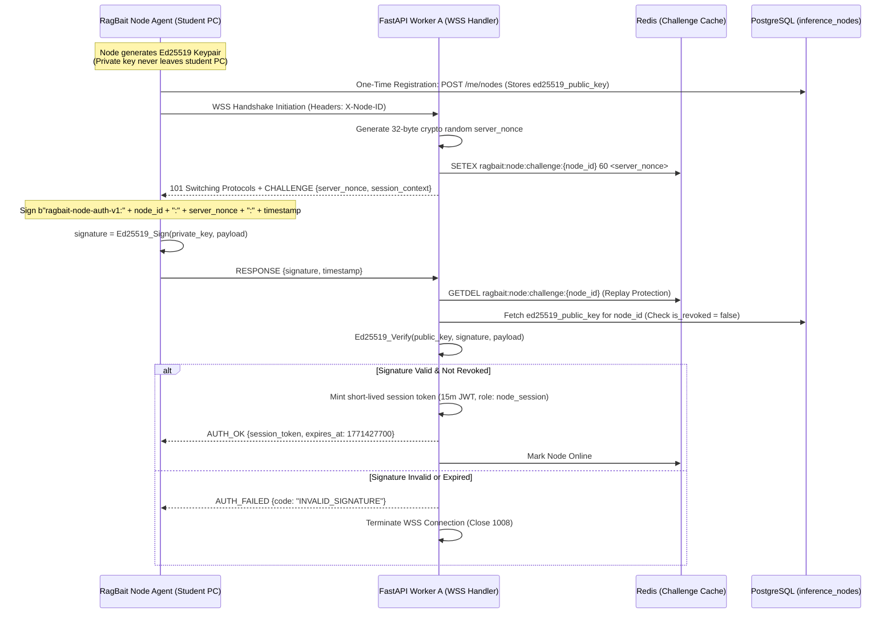
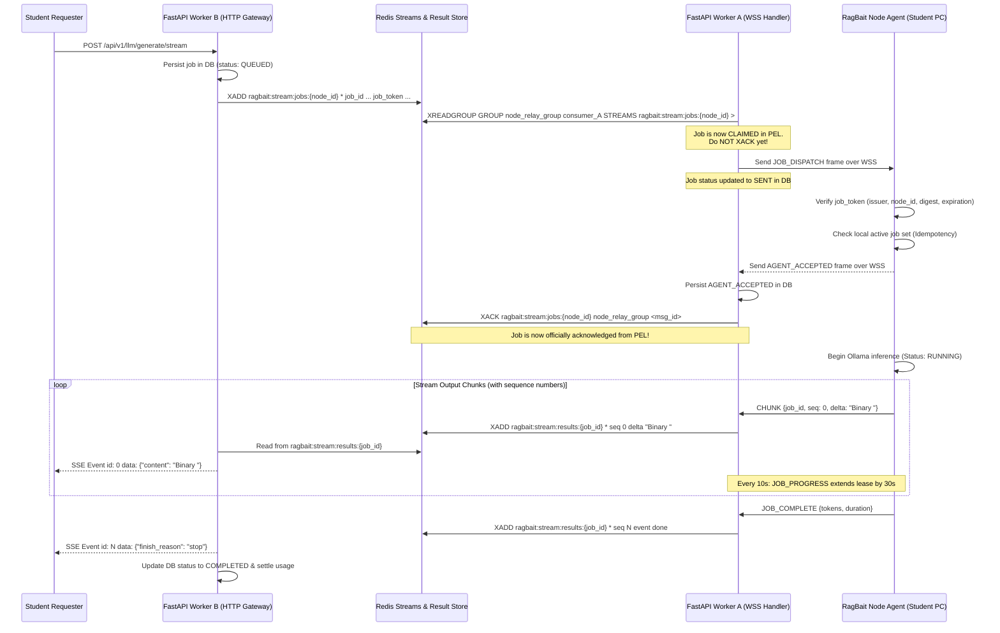
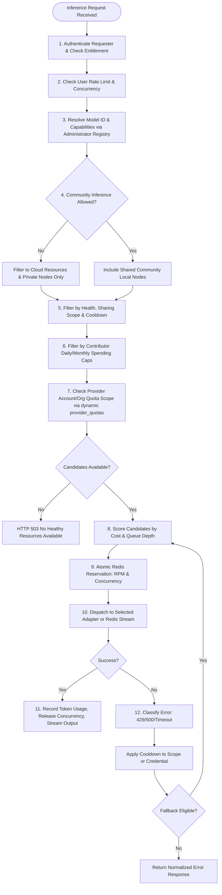

# RagBait M2 — System Architecture & Component Specification

## 1. Architectural Vision

RagBait M2 creates a **unified, multi-resource LLM Gateway** that decouples application features (such as future RAG retrieval and conversational study assistants) from physical inference providers. 

Rather than relying primarily on expensive proprietary APIs, RagBait democratizes access by orchestrating distinct tiers of compute:
1. **Free-Tier Public AI APIs**: (Google Gemini, GroqCloud, OpenRouter `:free`, Cerebras).
2. **Paid Public AI APIs**: (xAI / Grok, Administrator-Managed OpenAI Project Service Accounts).
3. **Private Local Nodes**: Individual student computers hosting Ollama for their own exclusive, private loopback use.
4. **Shared Cloud API Credential Pool**: Contributed institutional and student free-tier API keys pooled with strict quota enforcement and admission control.

> **Privacy Invariant & Authoritative Free-Tier Policy:**
> - *RagBait shares only explicitly contributed cloud credentials that are verified to operate within approved free-tier usage limits without paid fallback. Local Ollama models and all paid API resources remain private.*
> - *Every approved user must contribute at least one validated, provider-approved, verified free-tier cloud API credential (`billing_tier: "verified_free_only"`) to the RagBait shared pool before accessing AI Chat. This requirement applies even when using private local Ollama. Local models, unverified credentials, and paid API credentials do not count.*
> - *RagBait allows students to use their own locally installed Ollama models privately. These models and their computing resources are never shared with other students. Shared inference pooling is restricted to explicitly consented, provider-eligible cloud API credentials.*
> Peer local compute pooling (Mode B) has been permanently discontinued and disabled. All community node endpoints return HTTP 410 Gone.

### 1.1 Provider Shared Pooling Eligibility Matrix

| Provider | Runtime Type | Verified Account Billing API | `allows_community_sharing` | Shared Pool Eligibility | Reason / Status |
| :--- | :--- | :--- | :--- | :--- | :--- |
| **OpenRouter** | `cloud_api` | Yes (`/api/v1/auth/key` -> `is_free_tier`) | **true** | **Permitted** | Reliable non-generative inspection guarantees `is_free_tier: true` with zero-charge enforcement. |
| **Google Gemini** | `cloud_api` | No | false | Excluded | AI Studio API cannot establish absence of linked GCP billing account without full GCP Billing APIs. |
| **GroqCloud** | `cloud_api` | No | false (default) | Excluded | Groq lacks public non-generative account billing verification endpoint to prevent paid fallback. |
| **Cerebras** | `cloud_api` | No | false (default) | Excluded | Lacks account billing verification endpoint to verify zero-charge guarantee. |
| **OpenAI** | `cloud_api` | No | false | Excluded | Proprietary commercial service; paid billing risk. |
| **xAI / Grok** | `cloud_api` | No | false | Excluded | Paid commercial API. |
| **Ollama** | `local_runtime` | N/A (Local loopback) | false | Excluded (Strictly Private) | Never shared. Runs 100% locally on student hardware. |

### 1.1 Unified AI Inference Workspace & Execution Preferences

The workspace provides three distinct execution modes in a single unified conversation playground:

1. **Automatic (Recommended)** (`credential_scope: "eligible_pool"`): Cloud inference routed via user credentials and the approved shared free-tier pool.
2. **My API Keys Only** (`credential_scope: "owner_only"`): Cloud inference restricted strictly to the student's personal API keys.
3. **Private Local (This Computer)**: Direct browser-to-loopback Ollama inference (`http://127.0.0.1:11434`), 100% private and on-device.

### 1.2 Mandatory AI Chat Contribution Gate

To eliminate free-riding and ensure sustainable shared infrastructure:
- Every user (including administrators) must contribute $\ge 1$ active, validated, provider-approved, free-tier cloud credential (e.g. Gemini, Groq, OpenRouter).
- Enforced at server level via `require_chat_entitled_user` dependency across `POST /api/v1/llm/chat/completions` and `POST /api/v1/routing/preview`.
- Verified at client level before initiating direct private local loopback inference.
- Status checked via `GET /api/v1/me/chat-entitlement`. Temporary quota exhaustion (`status = 'quota_exhausted'`) does NOT revoke contributor entitlement while the key remains valid and shared.

```
┌────────────────────────────────────────────────────────────────────────────────────────┐
│                                 RagBait Web Application                                │
│                   (Next.js 15 App Router — React 19 Client Components)                  │
└───────────────────────────────────────────┬────────────────────────────────────────────┘
                                            │ HTTP / Server-Sent Events (SSE)
                                            ▼
┌────────────────────────────────────────────────────────────────────────────────────────┐
│                           FastAPI Backend Gateway (Worker B)                           │
│                                                                                        │
│   ┌─────────────────────┐   ┌───────────────────────┐   ┌──────────────────────────┐   │
│   │   JWT Auth & RLS    │──►│ Provider & Model Reg. │──►│   Admission & Routing    │   │
│   │ (Sub claim context) │   │ (Admin Lifecycle Reg) │   │   (Fairness & Scoring)   │   │
│   └─────────────────────┘   └───────────────────────┘   └─────────────┬────────────┘   │
│                                                                       │                │
│             ┌─────────────────────────────────────────────────────────┴────────┐       │
│             ▼                                                                  ▼       │
│   ┌──────────────────────────┐                               ┌─────────────────────┐   │
│   │ Cloud Provider Adapters  │                               │ Redis Streams Queue │   │
│   │ (Gemini/Groq/OpenRouter) │                               │ & Result Stream Bus │   │
│   └─────────────┬────────────┘                               └──────────┬──────────┘   │
└─────────────────┼───────────────────────────────────────────────────────┼──────────────┘
                  │ HTTPS Outbound                                        │ Redis Streams / Log
                  ▼                                                       ▼
      ┌───────────────────────┐                        ┌─────────────────────────────────┐
      │   Cloud AI Providers  │                        │ FastAPI Node Relay (Worker A)   │
      │  (Gemini, Groq, etc.) │                        │ (Reverse WSS Connection Pool)   │
      └───────────────────────┘                        └────────────────┬────────────────┘
                  ▲                                                     │ WSS (TLS 1.3 + Ed25519)
                  │                                                     ▼
      ┌───────────┴───────────┐                        ┌─────────────────────────────────┐
      │  Redis Distributed RL │                        │ RagBait Node Agent (Student PC) │
      │  (Sliding Window/GCRA)│                        │   (Ollama / vLLM on localhost)  │
      └───────────────────────┘                        └─────────────────────────────────┘
                  ▲                                                     ▲
                  │                                                     │
      ┌───────────┴─────────────────────────────────────────────────────┴────────┐
      │ PostgreSQL 17 (Supabase)                                                 │
      │ - Application DB (authenticated user sessions & public schema)           │
      │ - Isolated Vault DB Pool (ragbait_vault_service role & private schema)   │
      └──────────────────────────────────────────────────────────────────────────┘
```

---

## 2. Component Topology & Modules

The backend implementation resides within `apps/api/app/modules/`:

```
apps/api/app/modules/
├── credentials/                 # Contributor API key management & envelope encryption
│   ├── router.py                # CRUD endpoints for /api/v1/me/api-keys
│   ├── schemas.py               # Pydantic schemas for key submission and metadata
│   ├── service.py               # Vault business logic & duplicate checking
│   └── vault.py                 # AES-256-GCM envelope encryption / KMS integration (vault_pool)
├── nodes/                       # Student local inference nodes
│   ├── router.py                # Node registration & Ed25519 public key upload (/api/v1/me/nodes)
│   ├── schemas.py               # Node status & model inventory schemas
│   ├── service.py               # Node registry & heartbeat tracking
│   ├── websocket.py             # Reverse WebSocket relay handler (/api/v1/nodes/stream)
│   ├── streams.py               # Durable Redis Streams job dispatch, consumer groups, PEL
│   └── results.py               # Recoverable sequence-numbered result stream
└── llm_gateway/                 # Unified inference gateway
    ├── router.py                # Normalized endpoints (/api/v1/llm/generate, /stream)
    ├── schemas.py               # Gateway request & response contracts
    ├── registry.py              # Provider, administrator-controlled model catalog & quotas
    ├── routing/
    │   ├── selector.py          # Unified resource selection & fair-use scoring
    │   └── fallback.py          # Controlled retry & error classification
    ├── ratelimit/
    │   ├── engine.py            # Redis atomic reservation engine (RPM, concurrency, quotas)
    │   └── scopes.py            # Credential, Contributor, User & Provider-Account scopes
    ├── providers/               # Normalized provider adapters
    │   ├── base.py              # Abstract Base Provider Interface
    │   ├── gemini.py            # Google Gemini HTTP adapter (Gemini 3.8 Flash, data disclosure)
    │   ├── groq.py              # GroqCloud HTTP adapter (GPT-OSS 120B/20B, Qwen 3.8 27B)
    │   ├── openrouter.py        # OpenRouter HTTP adapter (free-tier headers & 50/1000 RPD)
    │   ├── cerebras.py          # Cerebras HTTP adapter (dual-bucket rate limits)
    │   ├── openai.py            # Admin-managed OpenAI adapter (sk-proj service account only)
    │   ├── grok.py              # xAI / Grok HTTP adapter
    │   └── local_node.py        # Local Node relay adapter via Redis Streams
    └── usage/
        └── ledger.py            # Transactional database usage recording
```

---

## 3. Administrator Model Registry & Multi-Tier Rate Limiting

### 3.1 Administrator-Controlled Model Registry
Models in `public.llm_models` are managed dynamically:
- **Statuses**: `active` (routable), `disabled` (temporarily paused), `deprecated` (existing sessions only, points to replacement), `shutdown` (retired by upstream).
- **Zero Loss of Historical Accounting**: Disabling or deprecating a model never cascades to delete historical request records in `public.llm_requests`.
- **Model Discovery Pipeline**: Automated background checks query provider `/v1/models` endpoints to detect new checkpoints; daily health checks ping active models with single-token probes. Administrators retain manual control via `/api/v1/admin/models`.

### 3.2 Common Baseline Policy for Cloud Credentials
Regardless of provider, all contributed cloud credentials in the shared pool receive a common safety envelope:
- **Baseline RPM**: Maximum **5 dispatched requests per rolling 60-second window**.
- **Max Concurrency**: Maximum **1 active dispatched request** at any moment per credential.
- **Burst Capacity**: Strict burst allowance of **1 request**.
- **Rate-Limit Cooldown**: Exponential cooldown (starting at 60s, up to 15m) upon receiving HTTP 429.
- **Daily Dispatch Cap**: Enforced by contributor-defined limits (default 500 requests/day).

### 3.3 Dynamic Provider Quota Registry (`public.provider_quotas`) & Runtime Enforcement
- **Strict Provenance Standards**: Quotas from public documentation are marked `provider_published`. Quotas confirmed via authenticated response headers or user console probes are marked `account_confirmed`.
- **Server-Controlled Account Scope**: `account_scope_id` is strictly server-controlled and populated only when authenticated response headers establish verified provenance (`account_scope_verified = true`). Unverified user-submitted scopes are strictly ignored to prevent quota/cooldown poisoning.
- **Scope Accounting**: Verified credentials belonging to the same Organization share atomic meters in Redis (`ragbait:rate:account:{provider_id}:{account_scope_id}`).
- **Enforcement Boundaries**: Enforces RPM, TPM, RPD, user/credential concurrency (cap: 2/1), and daily/monthly spending caps in exact integer microcents. TPD (Tokens Per Day) and provider-global concurrency are deferred to M2.5 runtime workers. M2.5 must implement TPD enforcement before dispatching requests against providers/models with known TPD restrictions.

---

## 4. Node Agent Protocol: Ed25519 Authentication & Reliable Delivery

### 4.1 Connection Lifecycle & Ed25519 Asymmetric Authentication



### 4.2 Reliable Job Delivery State Machine
Inference job dispatch follows an explicit, durable state machine:

$$\text{QUEUED} \longrightarrow \text{CLAIMED} \longrightarrow \text{SENT} \longrightarrow \text{AGENT\_ACCEPTED} \longrightarrow \text{RUNNING} \longrightarrow \text{COMPLETED} \mid \text{FAILED} \mid \text{CANCELLED}$$



### 4.3 Redis Stream Acknowledgement Invariants
1. **No Premature Acknowledgement**: Worker A **never** calls `XACK` merely because a frame enters an in-memory WebSocket buffer. The job remains unacknowledged in the consumer group's Pending Entries List (PEL) until the Node Agent explicitly returns `AGENT_ACCEPTED`.
2. **Idle-Time Recovery**: If Worker A crashes after claiming a job or before receiving `AGENT_ACCEPTED`, the job remains in the PEL. A supervisory background worker claims entries that have been idle for > 30s (`XAUTOCLAIM` / `XCLAIM`) and re-evaluates node health.
3. **Idempotent Node Processing**: Every job carries a unique UUID `job_id`. The Node Agent tracks active and recently finished jobs in an in-memory set (and Redis records `ragbait:job:dedup:{job_id}` with 1-hour TTL). Re-deliveries of an active or completed job return `AGENT_ACCEPTED` and are ignored without restarting inference.
4. **Controlled Bounded Retries**: If an agent accepts a job but disconnects or crashes before producing tokens, the gateway attempts **at most one fallback** to an eligible cloud provider. Jobs are never continuously retried on failing hardware. Poison-pill jobs move to `ragbait:stream:jobs:dlq`.

### 4.4 Result Streaming Recovery & Chunk De-duplication
1. **Sequence-Numbered Chunks**: Every chunk frame carries a zero-indexed sequence integer (`seq: 0, 1, 2, ...`).
2. **Durable Result Log**: Output chunks are appended to a dedicated Redis Stream `ragbait:stream:results:{job_id}` with a 10-minute TTL.
3. **Reconnection Support**: If a client SSE connection drops (e.g. WiFi switch), the client reconnects with header `Last-Event-ID: <seq>`. Worker B queries `XREAD STREAMS ragbait:stream:results:{job_id} <last_seq>` and immediately resumes streaming missing tokens without re-running inference.
4. **Duplicate Chunk Suppression**: Consumers maintain `expected_seq`. Any incoming chunk with `seq < expected_seq` is silently dropped.

---

## 5. Unified Intelligent Routing Algorithm

The gateway evaluates candidate resources through a deterministic decision pipeline:



---

## 6. Implementation Sequence (Phases M2.1 – M2.10)

1. **M2.1 — Provider/Model Registry & Dynamic Quota Catalog**:
   - Database migrations for `public.llm_providers`, `public.llm_models` (with lifecycle states and admin controls), and dynamic `public.provider_quotas`.
   - Seed data for Gemini 3.8 Flash / 3.5 Flash-Lite, Groq (GPT-OSS 120B/20B, Qwen 3.8 27B), OpenRouter (50/1000 RPD), Cerebras, OpenAI, xAI, Ollama.
   - Mandatory Gemini data-use disclosures and OpenAI project-service-account policy checks.
2. **M2.2 — Encrypted Credential Vault & Dedicated DB Service Role**:
   - Schema `private` with `private.api_key_secrets`.
   - Dedicated database role `ragbait_vault_service` with restricted grants; app role explicitly denied `USAGE` on `private`.
   - Isolated FastAPI `vault_pool` (min 1, max 3 connections).
   - AES-256-GCM envelope encryption with context-bound AAD and HMAC key fingerprinting via independent `VAULT_PEPPER_SECRET`.
3. **M2.3 — Owner-Only Credential Management**:
   - Authenticated endpoints `/api/v1/me/api-keys` (CRUD, masked key presentation, active status control, secret purge).
   - Strict cross-owner isolation: owner ID derived exclusively from verified JWT subject (`current_user.id`); uniform 404 returned for foreign or nonexistent IDs.
   - Non-generative validation probes across supported providers (Gemini, Groq, OpenRouter, Cerebras, OpenAI, xAI), verifying authentication with 0 inference tokens.
   - Community sharing policy enforcement via `public.llm_providers.allows_community_sharing` and mandatory explicit contributor consent (`shared_consent = true`, versioned timestamp).
   - Configurable daily/monthly request limits and optional daily/monthly spending caps per credential.
   - Owner-facing Next.js management interface (`/credentials`) with secret input masking, immediate in-memory wipe, live validation probes, and deletion confirmation dialog explaining cryptographic purge.
4. **M2.4 — Admission Control, Multi-Tier Rate Limiting & Usage Ledger**:
   - Multi-tier sliding window rate limiting via atomic Redis Lua scripts (`reserve_rate_slots`, `release_rate_slots`, `reconcile_rate_slots`) across user, credential, account, provider, model RPM, and model TPM scopes with microsecond precision.
   - Exact integer microcents ($10^{-6}$ cents = $10^{-8}$ USD) financial accounting: zero floating-point arithmetic drift; small generations accumulate fractional cents accurately without premature truncation.
   - Conservative ceiling rounding at budget reservation and dashboard display boundaries ($\lceil \text{microcents} / 1{,}000{,}000 \rceil$).
   - Account-level rate limits and cooldowns derived strictly from `account_scope_id` in credential metadata, preventing quota bypass across multiple credentials sharing the same provider account; unscoped credentials never fabricate artificial account scopes.
   - Token-based sliding window quotas (TPM) atomically enforced in Redis using server-side estimates and outstanding reservations, dynamically reconciled upon settlement.
   - Distributed concurrency lease management (`acquire_concurrency_lease`, `renew_concurrency_lease`, `release_concurrency_lease`) via atomic Redis `ZSET` leases (user cap: 2, credential cap: 1, 30s TTL with heartbeat renewal strictly bounded by a 300s hard maximum operation lifetime).
   - Transactional PostgreSQL budget and request accounting (`SELECT ... FOR UPDATE` on `public.llm_usage_budget_counters`) preventing overselling across concurrent workers.
   - Explicit lifecycle management with safe, idempotent `expire_reservation` and `reconcile_reservation` operations handling uncommitted lease timeouts and ambiguous post-dispatch network outcomes.
   - Durable attempt persistence in `public.llm_usage_reservations` with `(user_id, idempotency_key)` uniqueness.
   - Append-only immutable audit trail in `public.llm_usage_events` protected by trigger `tr_llm_usage_events_immutable` raising error `42501` on mutation or deletion.
   - Fail-closed error handling and automatic rollback compensation across Redis and PostgreSQL.
   - Provider cooldown tracking with `Retry-After` delta-seconds and HTTP-date parsing.
   - Read-only contributor usage summary endpoint `GET /api/v1/me/usage` and Next.js dashboard at `/credentials/usage`.
5. **M2.5 — Core Free/Low-Cost Cloud Adapters & Unified Inference Gateway**:
   - Normalized streaming (SSE) and non-streaming adapters for Google Gemini, GroqCloud, OpenRouter, and Cerebras implementing `BaseProviderAdapter`.
   - Unified Gateway API: `POST /api/v1/llm/chat/completions` supporting both SSE streaming and single JSON completions.
   - 10-step request dispatch lifecycle: auth verification -> registry validation -> credential eligibility -> conservative token estimation -> TPD & admission control reservation -> just-in-time vault decryption -> durable dispatch commitment (`mark_dispatched`) -> provider invocation -> SSE streaming with UTF-8 boundary handling -> authoritative usage extraction and exact microcent settlement.
   - Daily Token Limit (TPD) tracking in `public.llm_usage_budget_counters` (`reserved_tokens`, `actual_tokens`) with check constraints and quota enforcement.
   - Provenance tracking in `public.llm_usage_reservations`: `resolved_model_id`, `upstream_provider`, `upstream_generation_id`, and `usage_source`.
   - Strict credential security: credentials decrypted only in memory immediately before upstream dispatch, zero raw key logging, zero raw key streaming in events.
   - Dynamic routing alias resolution for `openrouter/free` recording the true resolved upstream model.
   - Cerebras and Groq usage details: reasoning tokens, cached tokens, and prompt/completion breakdowns.
6. **M2.6 — Optional Paid Provider Adapters**:
   - Metered adapters for xAI / Grok and administrator-managed OpenAI project-scoped service accounts (`sk-proj-...`).
7. **M2.7 — Private Local Inference with Ollama (Mode A)**:
   - Direct Browser-to-Local Loopback Architecture: Client browser connects directly to `http://127.0.0.1:11434` via native fetch API.
   - Zero Cloud Backend Relay: Completely bypasses the cloud FastAPI backend, Supabase database, Redis queue, and public network. Prompts and completions never leave the user's machine.
   - Fixed Loopback Isolation: Hardcoded to `http://127.0.0.1:11434` with `credentials: "omit"` and `redirect: "error"`. No cookies or JWTs sent to Ollama daemon.
   - Native Ollama REST & NDJSON Streaming: Robust client-side parser handling split chunks, multibyte UTF-8 codepoints across boundaries, and `AbortController` cancellation. Safely ignores internal reasoning/thinking tokens (Qwen 3, DeepSeek R1) to deliver clean, user-facing completions without raw thinking exposure.
   - Modern Chrome Local Network Access (LNA): Type-safe `targetAddressSpace: "loopback"` declaration, explicit user-gesture requirement when permission is `prompt`, and Site Settings remediation for `denied`.
   - Zero Persistence & Non-Billable: Ephemeral in-memory React state only; no database tables, no cloud ledger deductions, and no contributor credit attribution.
   - Protected Next.js Route (`/local-inference`): Full-featured playground with live connection state, local model discovery, parameter drawer (system prompt, temperature), prompt streaming, and on-device token throughput telemetry (tokens/sec, prompt/eval counts).
   - Multi-Platform Setup Documentation: Comprehensive guide (`docs/M2_7_OLLAMA_SETUP.md`) for Windows, macOS, and Linux `OLLAMA_ORIGINS` CORS configuration and `OLLAMA_NO_CLOUD=1` local-only enforcement.
8. **M2.8 — Community-Shared Local Nodes (Mode B)**:
   - Ed25519 asymmetric handshake (`CHALLENGE`, `RESPONSE`, `AUTH_OK`) with Redis single-use nonce.
   - Server-signed job authorization tokens (`job_token`).
   - Durable job delivery via Redis Streams (`ragbait:stream:jobs:{node_id}`) with explicit `AGENT_ACCEPTED` before `XACK`.
   - Sequence-numbered recoverable result streaming (`ragbait:stream:results:{job_id}`).
9. **M2.9 — Unified Intelligent Routing & Anti-Amplification Engine**:
   - Endpoints `/api/v1/llm/generate` and `/api/v1/llm/generate/stream`.
   - Privacy-aware resource selection, cost scoring, and single-fallback circuit breaking.
10. **M2.10 — Verification & Security Hardening**:
    - Comprehensive test suite covering credential isolation, envelope encryption, Ed25519 challenge-response replays, concurrency races, streaming reconnections, fallback behavior, and mock provider integration.
