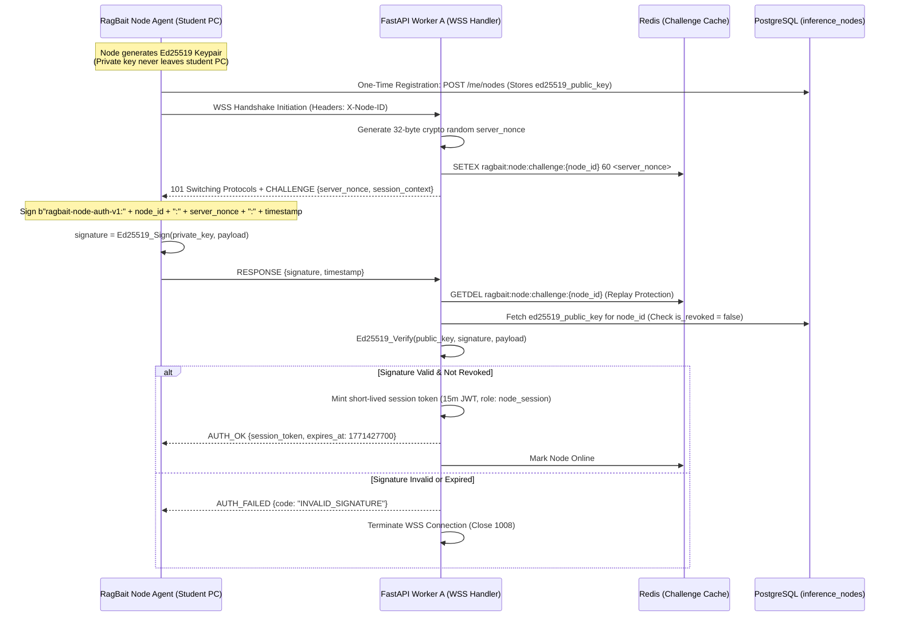

# RagBait M2 — Security, Encryption & Privacy Specification

## 1. Security Architecture & Threat Boundaries

RagBait M2 introduces two sensitive operational boundaries:
1. **Third-Party AI Credentials**: Protecting contributor API keys against exfiltration, misuse, unauthorized disclosure, and lateral database compromise.
2. **Community Local Nodes**: Preventing unauthorized access, SSRF, prompt snooping, replay attacks, or arbitrary code execution across student-hosted compute.

---

## 2. Explicit Key Hierarchy & Envelope Encryption

Plaintext API keys are **never** persisted to disk, stored in the database, logged, or returned across API boundaries after creation.

```
+---------------------------------------------------------------------------------------------------------+
|                                      ENVELOPE ENCRYPTION HIERARCHY                                      |
|                                                                                                         |
|  [Raw API Key] ─────────────────► AES-256-GCM Encrypt ──────────────────► [Ciphertext + Auth Tag]      |
|                                         ▲                                                               |
|                                         │                                                               |
|                              [Ephemeral 256-bit DEK]                                                    |
|                                         │                                                               |
|                                         ▼                                                               |
|  [Master KEK] ──────────────────► AES-256-GCM Wrap ────────────────────► [Encrypted DEK + Wrap Tag]    |
|  (Production: KMS HSM)                  ▲                                                               |
|  (Dev: HKDF-derived KEK)                │                                                               |
|                                         │                                                               |
|                              [Context-Bound AAD]                                                        |
|                    ("owner_id:credential_id:provider:version")                                          |
+---------------------------------------------------------------------------------------------------------+
```

### 2.1 The Two-Tier Key Hierarchy
1. **Data Encryption Key (DEK)**:
   - A unique, cryptographically secure random 256-bit key (`os.urandom(32)`) generated per credential.
   - Encrypts the raw API key using **AES-256-GCM** with a unique 96-bit (12-byte) initialization vector (nonce) and 128-bit authentication tag.
2. **Key Encryption Key (KEK / Master Key)**:
   - Dedicated master key held outside the database.
   - **Production Mode**: Managed via Cloud KMS (Google Cloud KMS or AWS KMS) using an HSM-backed symmetric key (`AES-256`). The KMS handles DEK wrapping and unwrapping operations.
   - **Local Development Mode**:
     - Master key secret supplied via `VAULT_MASTER_KEY` environment variable (at least 32 characters).
     - An authenticated 256-bit KEK is derived using **HKDF-SHA256** (`cryptography.hazmat.primitives.kdf.hkdf.HKDF`) with salt and application info `ragbait-m2-vault-kek-v1`.
     - **Important**: HKDF is strictly a Key Derivation Function. The wrapping algorithm is **authenticated AES-256-GCM**, which encrypts the DEK with its own distinct 96-bit nonce and 128-bit authentication tag (`wrapped_dek`, `dek_nonce`, `dek_auth_tag`).

### 2.2 Authenticated Additional Data (AAD) Context Binding
To prevent ciphertext transplant attacks (where an attacker swaps ciphertexts across records, providers, or users), RagBait separates context binding into distinct authenticated additional data strings:

1. **Payload AAD (Bound to Payload AES-256-GCM)**:
   $$\text{Payload AAD} = \text{"payload:owner:"} \parallel \text{owner\_id} \parallel \text{":cred:"} \parallel \text{credential\_id} \parallel \text{":prov:"} \parallel \text{provider\_id} \parallel \text{":v:"} \parallel \text{data\_encryption\_version}$$
   - Binds payload ciphertext directly to the owner, credential, provider, and payload encryption algorithm version.

2. **Wrapping AAD (Bound to DEK Key Wrapping AES-256-GCM)**:
   $$\text{Wrapping AAD} = \text{"wrap:owner:"} \parallel \text{owner\_id} \parallel \text{":cred:"} \parallel \text{credential\_id} \parallel \text{":prov:"} \parallel \text{provider\_id} \parallel \text{":kek\_v:"} \parallel \text{kek\_version} \parallel \text{":ctx\_v:"} \parallel \text{wrapping\_context\_version}$$
   - Binds the wrapped DEK to the credential metadata, master KEK version, and wrapping context version.
   - **Crucial Security Invariant**: When rotating master KEKs via `rewrap_credential_dek`, **only the DEK is rewrapped** using the new KEK and new Wrapping AAD. The underlying payload ciphertext and nonce are never decrypted or re-encrypted during KEK rotation.

### 2.3 Independent Keyed HMAC Fingerprint Pepper
- To detect duplicate credentials without revealing the plaintext key or storing unsalted hashes:
$$\text{Fingerprint} = \text{HMAC-SHA256}(\text{VAULT\_PEPPER\_SECRET}, \text{raw\_key})$$
- `VAULT_PEPPER_SECRET` is completely separate from `VAULT_MASTER_KEY` and validated to be at least 32 decoded bytes.
- Stored as `key_fingerprint` with a unique index `(provider_id, key_fingerprint)`.

### 2.4 Backup Retention, Storage Realities & Cryptographic Key Destruction

RagBait distinguishes carefully between storage lifecycle policies and cryptographic invalidation:

1. **Active Revocation & Deletion**:
   - Deleting a credential immediately purges the active record from PostgreSQL (`public.api_key_credentials` cascades to `private.api_key_secrets`).
   - Flushes cached decrypted credentials and connection state from Redis and process memory. The credential can no longer be dispatched.
2. **Backup & WAL Retention Lifecycle**:
   - **Write-Ahead Log (WAL) Retention**: WAL archives for point-in-time recovery are retained for **7 days**.
   - **Database Snapshot Retention**: Full database backups are retained on a **30-day lifecycle schedule**.
   - **Snapshot Expiry vs Physical Overwrite**: After 30 days, backup snapshots reach their retention limit and are marked for deletion by cloud storage lifecycle rules. Physical block overwrite depends on the underlying cloud storage provider's garbage collection; RagBait does not falsely claim immediate physical disk zeroing.
3. **Cryptographic Key Destruction (True Invalidation)**:
   - Because ciphertexts and wrapped DEKs remain in 30-day backup snapshots, true forward secrecy is achieved cryptographically:
     - **Master KEK Rotation**: When the master KEK is rotated, all active DEKs in `private.api_key_secrets` are rewrapped under `kek_version = kek_version + 1`.
     - **Decommissioning Old KEK**: The old KEK is destroyed. Once the old KEK is gone, historical backups containing DEKs wrapped under that KEK become permanently and mathematically undecryptable, regardless of physical backup storage persistence.
4. **Disaster Recovery**:
   - **Compromise of Master KEK**:
     1. Rotate KMS key or cycle `VAULT_MASTER_KEY`.
     2. Immediately mark all credentials `revoked` in `public.api_key_metadata`.
     3. Truncate `private.api_key_secrets`.
     4. Notify contributors to generate fresh keys in their provider dashboards.
   - **Loss of Master KEK**: Stored credentials become unrecoverable (no backdoors). Contributors re-enter keys; metadata is preserved.

---

## 3. Vault Access Isolation & Process Boundary

A private PostgreSQL schema alone does not provide sufficient isolation if the application connection pool connects with broad permissions. RagBait enforces database role isolation:

```
[General FastAPI Handlers]                        [Isolated Gateway Credential Service]
 (Users, Access, Presence, Admin)                  (Vault Encrypt / Decrypt Only)
             │                                                         │
             ▼                                                         ▼
[Standard Connection Pool: app_pool]               [Restricted Connection Pool: vault_pool]
 (Role: authenticated / ragbait_app)                (User: ragbait_vault_user -> Role: ragbait_vault_service)
             │                                                         │
             ├──────────────────────────┐                              │
             ▼                          ▼                              ▼
    public.profiles           public.api_key_metadata        private.api_key_secrets
    (SELECT, UPDATE name)     (RLS: owner_id = auth.uid())   (SELECT, INSERT, UPDATE, DELETE)
             │                          │                              ▲
             │                          │                              │
             x NO ACCESS                x NO ACCESS                    │ (Exclusive Access)
             └──────────────────────────┴──────────────────────────────┘
```

### 3.1 Dedicated Least-Privilege Database Role
1. **`ragbait_vault_service` Capability Role (`NOLOGIN`, `NOBYPASSRLS`)**:
   - Defined in database migrations as a pure permission-holding capability role. Never has a login password.
   - Granted `USAGE` on schema `private`.
   - Granted `SELECT, INSERT, UPDATE, DELETE` on `private.api_key_secrets`.
   - Has zero privileges to modify database schema, read `public.profiles`, or inspect audit logs.
2. **Provisioned Vault Login User (`ragbait_vault_user`)**:
   - Provisioned out-of-band via `scripts/provision_vault_user.py` (for production/staging) or `supabase/roles.sql` (for local development).
   - Granted membership in `ragbait_vault_service`, inheriting vault permissions while maintaining `NOBYPASSRLS`.
   - Database passwords are generated uniquely per environment and kept in cloud secret managers; never committed to source code or migrations.
3. **Standard Application Role (`authenticated` / `ragbait_app`)**:
   - `REVOKE ALL ON SCHEMA private FROM authenticated, anon, PUBLIC;`
   - Has **NO USAGE** on schema `private` and **NO ACCESS** to `private.api_key_secrets`.
   - If an ordinary API handler or route has an injection vulnerability, it cannot read the vault.
4. **Dedicated Restricted Connection Pool (`vault_pool`)**:
   - FastAPI maintains a separate, minimal connection pool (size 1–3 connections) authenticated as `ragbait_vault_user`.
   - This pool is invoked **only** within `apps/api/app/modules/credentials/vault.py` during encryption/decryption routines.

### 3.2 Honest Process-Level Security Boundary & Hardening Recommendation
> [!WARNING]
> **Process-Level Security Boundary**: Because FastAPI runs in a monolithic process space, the Python runtime memory holds both connection credentials and pools (`app_pool` and `vault_pool`). An application-level Remote Code Execution (RCE) or arbitrary memory-read vulnerability in any endpoint could theoretically read the `ragbait_vault_service` connection credentials or inspect in-memory plaintext keys.
> 
> **Internal Encapsulation**:
> - The `vault_pool` is strictly private to `apps/api/app/modules/credentials/vault.py`.
> - It is **never** exported, shared, or imported by general route handlers or middleware.
> - Plaintext keys are cleared from local Python variables immediately after use.
> 
> **Future Deployment Hardening Recommendation**:
> - In higher-threat environments, vault operations should be extracted into a dedicated, isolated microservice or local sidecar process communicating over a restricted Unix domain socket with mutual authentication. For the initial 30–100 college student deployment, maintaining the dedicated database role and strictly encapsulated internal pool prevents SQL-level privilege escalation without premature microservice complexity.

### 3.3 Credential Ownership & Cross-Owner Isolation (M2.3 Invariants)
1. **Authenticated Principal Derivation**:
   - The owner identifier is derived strictly and exclusively from the cryptographically verified JWT subject (`current_user.id`).
   - Request payloads cannot supply or override `owner_id`.
2. **Cross-Owner Isolation**:
   - Every lookup (`GET`, `PATCH`, `POST /validate`, `POST /enable`, `POST /disable`, `DELETE`) includes `AND owner_id = :owner_id`.
   - Access attempts to credentials owned by other users or non-existent IDs return an identical HTTP `404 Not Found`, giving zero information about whether a credential exists.
   - Platform administrators and super administrators cannot query, validate, enable, disable, or decrypt other contributors' API keys through management endpoints.
3. **Non-Generative Validation Probes**:
   - Probes against provider APIs strictly target metadata, account status, or model listing endpoints (0 inference tokens consumed).
   - Generative endpoints (`/chat/completions`, `/generateContent`) are strictly prohibited during validation to avoid unexpected token charges or quota consumption.
   - Network timeouts (8 seconds) and strict redirect following disabling prevent SSRF during validation probes.
4. **Community Sharing Eligibility & Consent**:
   - Community pooling requires explicit contributor opt-in (`shared_consent = true`).
   - Provider-level sharing eligibility is checked against `public.llm_providers.allows_community_sharing`. Ineligible providers (e.g. Gemini with terms restrictions, paid accounts with variable billing) are blocked from community pooling.
5. **Secret Sanitization & Masking**:
   - Raw keys are stripped of whitespace and masked upon input (preserving prefix and trailing 4 characters, e.g. `gsk_...7890`).
   - Raw keys are never serialized in API responses or logged in `public.audit_logs`.
   - Frontend state clears the raw API key immediately following submission.

---

## 4. Node Agent Authentication via Ed25519 Asymmetric Cryptography

Symmetric HMAC hashes cannot be verified if the server does not store the raw secret. RagBait implements **Ed25519 asymmetric public-key authentication** for all student inference nodes:



### 4.1 Handshake Steps & Cryptographic Invariants
1. **Client-Side Key Generation**:
   - The Node Agent generates an Ed25519 keypair (`cryptography.hazmat.primitives.asymmetric.ed25519.Ed25519PrivateKey.generate()`).
   - The private key is saved locally in the student's protected configuration directory with strict filesystem permissions (`0600`).
   - The private key is **never transmitted over the network and never stored on the server**.
2. **One-Time Registration**:
   - Contributor registers the node via authenticated endpoint `POST /api/v1/me/nodes` supplying `node_name`, `device_specs`, and the base64-encoded `ed25519_public_key`.
   - The server stores the public key in `public.inference_nodes.ed25519_public_key`.
3. **Challenge Nonce & Replay Prevention**:
   - Server generates a 32-byte cryptographically secure hex nonce `server_nonce`.
   - Nonce is cached in Redis with a **60-second TTL** under key `ragbait:node:challenge:{node_id}`.
   - Nonce is consumed atomically via Redis `GETDEL`. Even if intercepted, a signature cannot be replayed.
4. **Context-Bound Signature**:
   - The agent signs:
     $$\text{payload} = \text{"ragbait-node-auth-v1:"} \parallel \text{node\_id} \parallel \text{":"} \parallel \text{server\_nonce} \parallel \text{":"} \parallel \text{timestamp}$$
   - Verified on the server using `public_key.verify(signature, payload)`.
5. **Key Rotation & Immediate Revocation**:
   - Contributor can rotate keys via `PUT /api/v1/me/nodes/{id}/key`.
   - Node can be immediately revoked via `PATCH /api/v1/me/nodes/{id}` (`is_revoked = true`), instantly severing active WebSocket sessions and blocking subsequent handshakes.

### 4.2 Server-Signed Job Authorization Tokens
When the gateway dispatches a job to a node, the frame includes a short-lived **server-signed job authorization token** (`job_token`):
- **Issuer**: `"ragbait-gateway"`.
- **Target Node**: `node_id`.
- **Job ID**: `job_id`.
- **Allowed Operation**: `"inference"`.
- **Payload Digest**: $\text{SHA-256}(\text{canonical\_json}(\text{messages}, \text{parameters}))$.
- **Expiration**: Ephemeral timestamp (e.g. 60 seconds from dispatch).
- The Node Agent independently verifies the gateway's signature and payload digest before initiating local inference, ensuring only legitimate platform dispatches consume student GPU/CPU.

---

## 5. Dual-Consent Community Inference Privacy Model

```
                  ┌──────────────────────────────────────────────────┐
                  │ Does Contributor Allow Sharing for this Model?   │
                  └─────────────────────────┬────────────────────────┘
                                            │ YES
                                            ▼
                  ┌──────────────────────────────────────────────────┐
                  │ Does Requester Consent to Community Inference?   │
                  └─────────────────────────┬────────────────────────┘
                                            │ YES
                                            ▼
                  ┌──────────────────────────────────────────────────┐
                  │ Eligible for Local Community Node Execution      │
                  └──────────────────────────────────────────────────┘
```

1. **Contributor Consent**: Node owner explicitly enables community sharing per model (`inference_node_models.is_shared = true`).
2. **Requester Consent**: Requester toggles `allow_community_nodes = true` in their AI Preferences.
3. **Revocation**: Contributor or requester can toggle off consent at any time; routing adapts within milliseconds via Redis cache invalidation.

---

## 6. Admission Control, Rate Limiting & Usage Ledger Security (M2.4)

### 6.1 Fail-Closed Policy
Admission control strictly adheres to a **fail-closed** security posture:
- **Redis Outage**: If Redis becomes unreachable, `reserve_rate_slots` and `acquire_concurrency_lease` raise HTTP 503 (`SERVICE_UNAVAILABLE`). No requests are admitted unmetered.
- **PostgreSQL Outage**: If the database pool is exhausted or unreachable, budget locking fails immediately and acquired Redis rate slots and concurrency leases are rolled back.
- **Missing Pricing Metadata**: If a non-free model has zero or missing pricing, admission is rejected with HTTP 422 to prevent unmetered spending against contributor budgets.

### 6.2 Data Minimization & Secret Isolation
The admission and accounting subsystems are strictly decoupled from credential decryption and prompt generation:
- Tables `public.llm_usage_reservations`, `public.llm_usage_events`, and `public.llm_usage_budget_counters` contain **no** credential secrets, API keys, decrypted payloads, user prompts, system instructions, or completion texts.
- Only technical accounting metadata is stored: UUID references, model identifiers, token quantities, integer cost cents, duration milliseconds, and provider HTTP status codes.
- The dedicated vault database role (`ragbait_vault_service`) is explicitly denied permissions on the usage ledger tables, preserving defense-in-depth isolation.

### 6.3 Immutable Audit Logging
Historical usage accounting is safeguarded against manipulation:
- Table `public.llm_usage_events` is append-only.
- The PostgreSQL trigger `tr_llm_usage_events_immutable` intercepts any direct `UPDATE` or `DELETE` statements and raises SQLSTATE `42501` (`insufficient_privilege`), ensuring audit durability even in the event of administrative error.

### 6.4 Concurrency Isolation & Race Protection
- **Distributed Concurrency Leases**: Redis `ZSET` leases guarantee hard bounds on simultaneous operations (user cap: 2, credential cap: 1) with atomic Lua evaluation. Dead worker leases expire automatically after 30 seconds unless renewed by a live heartbeat.
- **Pessimistic Row Locking**: All budget and request limit checks execute inside database transactions holding row-level `SELECT ... FOR UPDATE` locks on `public.llm_usage_budget_counters`. This prevents race conditions, overselling, and budget overdrafts across horizontally scaled API replicas.
- **Two-Phase Compensation**: In the event of a database transaction failure or cancellation prior to dispatch, acquired Redis rate slots and concurrency leases are automatically released via atomic Lua compensation scripts.

### 6.5 Financial Precision & Exact Subunit Accounting
- **Integer Microcents Arithmetic**: The ledger operates strictly in integer microcents ($10^{-6}$ cents = $10^{-8}$ USD), eliminating floating-point rounding drift and truncation vulnerabilities. Small generations accumulate fractional cents accurately.
- **Conservative Ceiling Bounds**: Ceiling rounding ($\lceil \text{microcents} / 1{,}000{,}000 \rceil$) is applied strictly at budget reservation and UI display boundaries, guaranteeing that reservations never under-reserve financial resources.

### 6.6 Trusted Account-Scope Derivation & Anti-Bypass
- **Strict Server-Side Derivation**: Account scope identity is derived strictly from `account_scope_id` in `public.api_key_metadata`, verified by the trusted backend. Client-supplied account overrides are rejected.
- **No Identity Fabrication**: If a provider or credential does not expose account identity, the system does not fabricate or guess one.
- **Shared Quota Enforcement**: Multiple credentials sharing the same `account_scope_id` are subject to a shared Redis sliding-window bucket, preventing users or organizations from bypassing provider account rate limits by rotating API keys.

### 6.7 Hard Operation Lifetime Bound (300s Max)
- **Zombie Process Elimination**: Concurrency lease renewals are constrained by a hard maximum lifetime (`LLM_MAX_RESERVATION_LIFETIME_SECONDS = 300s`). Even with valid lease tokens, renewals beyond 300 seconds are rejected with `max_lifetime_exceeded`, evicting the lease from Redis and preventing runaway workers from permanently exhausting concurrency pools.

---

## 7. LLM Gateway & Provider Dispatch Security (M2.5)

### 7.1 Just-in-Time Decryption & In-Memory Key Hygiene
- Decryption of contributor API credentials occurs strictly **just-in-time** immediately before upstream dispatch via the isolated vault connection pool.
- Decrypted keys are held in volatile memory only for the duration of the HTTP connection and are never persisted, cached in Redis, written to disk, or passed into child threads or tasks.
- The vault connection pool maintains minimal pool sizing (min 1, max 3) and strictly limits privileges to `private.api_key_secrets` and `public.api_key_metadata`.

### 7.2 Zero Secret Leakage in Logs, Events, and Streaming Payloads
- Raw API keys, authorization headers (`Authorization: Bearer ...`, `x-goog-api-key: ...`), decrypted tokens, and prompt contents are strictly scrubbed from application logs, error traces, and exception messages.
- Server-Sent Events (SSE) stream payloads (`generation_started`, `text_delta`, `usage`, `generation_completed`, `generation_error`) contain only public metadata, UUIDs, model identifiers, token delta/aggregates, and sanitized error messages.
- The unified completion JSON response never returns provider API keys or internal authorization headers.

### 7.3 Upstream Network Security & SSRF Protection
- Outbound gateway HTTP requests use a dedicated, hardened `httpx.AsyncClient` with a strict compile-time host allowlist (`ALLOWED_UPSTREAM_HOSTS`):
  - `generativelanguage.googleapis.com`
  - `api.groq.com`
  - `openrouter.ai`
  - `api.cerebras.ai`
  - `api.openai.com`
  - `api.x.ai`
- HTTP redirects are disabled (`follow_redirects=False`) to prevent open redirect vulnerabilities or internal network scanning.
- Strict connection and read timeouts (connect: 15s, read: 60s, stream timeout: 300s) prevent slowloris-style denial-of-service on worker threads.

### 7.4 Multi-Tenant Authorization & Community Sharing Policy Gate
- **Authentication & Approval Gate**: Requesters must be authenticated Supabase principals with `role = 'user'`, `account_status = 'active'`, and `approval_status = 'approved'`. Suspended or unapproved accounts are blocked at HTTP 403.
- **Owner-Only Isolation**: Users cannot execute inference using credentials belonging to other users unless the credential was explicitly created with `sharing_scope = 'community_shared'` and `shared_consent = True`.
- **Administrative Policy Gate**: Even when a contributor grants community consent, dispatch through community credentials is blocked if the administrator has disabled `allows_community_sharing` for that provider in `public.llm_providers`.
- **Active & Validated Credential State**: Only credentials in `status = 'active'` and `validation_status = 'valid'` are admitted for inference dispatch.

### 7.5 Pre-Dispatch Durable Commitment
- To prevent free inference bypass or phantom generations, the gateway atomically commits dispatch state (`mark_dispatched`) in `public.llm_usage_reservations` before initiating upstream network requests.
- If a client disconnects or an upstream network error occurs after dispatch commitment, the reservation record persists and can be settled or reconciled accurately by the sweeper, preserving accounting integrity.

---

## 8. Private Local Inference & Loopback Security (M2.7)

### 8.1 Zero Exfiltration & Data Privacy Boundary
- **Direct Loopback Execution**: In M2.7, private local inference requests originate in the user's browser runtime and terminate strictly at `http://127.0.0.1:11434`.
- **Zero Cloud Intermediary**: Prompts, system instructions, and completion tokens never traverse the public internet, never hit the cloud FastAPI backend, and are never written to server logs, PostgreSQL tables, or Redis instances.
- **Ephemeral In-Memory State**: Prompts and assistant outputs reside exclusively in the volatile React component memory during the active session. They are not saved to `localStorage`, `sessionStorage`, or `IndexedDB`.

### 8.2 Fixed Loopback Endpoint & SSRF Elimination
- **Strictly Hardcoded URL**: The target address is compile-time fixed to `http://127.0.0.1:11434` (`OLLAMA_BASE_URL`).
- **No User Override**: No UI setting, configuration file, URL search parameter, or API payload can alter the host, port, or protocol. This eliminates SSRF, DNS rebinding risks, and unauthorized scanning of local or intranet IP ranges.

### 8.3 Credential and Cookie Isolation
- **`credentials: "omit"`**: Every loopback fetch explicitly omits credentials. Browsers will not attach Supabase authentication cookies, session cookies, or cached basic auth credentials to requests sent to `127.0.0.1:11434`.
- **`redirect: "error"`**: Disallows HTTP redirects, ensuring an attacker-controlled service or malicious script cannot redirect a loopback request to an external origin or internal resource.
- **No Token Transmission**: The `OllamaClient` does not attach `Authorization: Bearer <JWT>` or any user identity headers to local requests.

### 8.4 Cross-Origin Resource Sharing (`OLLAMA_ORIGINS`) Boundaries
- **CORS Protection**: Modern web browsers prevent cross-origin fetches from web origins (`http://localhost:3000` or production domain) to `127.0.0.1` unless the local Ollama daemon explicitly allows the origin via `OLLAMA_ORIGINS`.
- **Strict Origin Whitelisting**: RagBait documentation expressly instructs users to configure exact domain origins and forbids wildcard (`*`) configurations in production or multi-user environments.

### 8.5 Client-Side Abort & Resource Management
- **Immediate Cancellation**: Every generation request is tied to a standard DOM `AbortController`. When the user clicks "Stop" or navigates away, the underlying HTTP stream and reader are immediately closed, freeing GPU and CPU compute on the student's hardware.

### 8.6 Modern Chrome Local Network Access (LNA) & Address Space Declaration
- **`targetAddressSpace: "loopback"`**: In accordance with the W3C Local Network Access specification, all local loopback requests declare `targetAddressSpace: "loopback"`.
- **User Gesture Enforcement**: When the browser permission state for `"loopback-network"` is `"prompt"`, RagBait never initiates background or automatic loopback fetches on page load. A user gesture (clicking "Connect to Local Ollama") is strictly required before the first local network request is dispatched.
- **Secure Context Enforcement**: Loopback access is restricted to secure top-level contexts (`HTTPS` or localhost development).

### 8.7 Reasoning / Thinking Token Isolation
- **Non-Exposure of Raw Reasoning**: Chunks containing internal model reasoning (e.g. `message.thinking` from reasoning-capable local models such as Qwen 3 or DeepSeek R1) are strictly ignored during stream processing.
- **Zero Logging or Storage of Thinking**: Internal thinking deltas are neither saved into conversation memory, rendered into the DOM, nor forwarded to telemetry or logs. Only user-facing `message.content` tokens are rendered.

### 8.8 Local-Only Enforcement & Cloud Model Disclosures
- **Ollama Cloud Routing Boundary**: Standard Ollama distributions may allow proxying or routing queries to cloud-hosted models if configured.
- **Strict Local Execution Policy**: RagBait explicitly documents that users desiring 100% offline privacy must configure Ollama with `OLLAMA_NO_CLOUD=1` and `disable_ollama_cloud: true`. Because Ollama's local `/api/tags` endpoint does not provide a standardized `remote` indicator, RagBait discloses this limitation and instructs users to bind Ollama strictly to loopback and disable cloud fallback.


