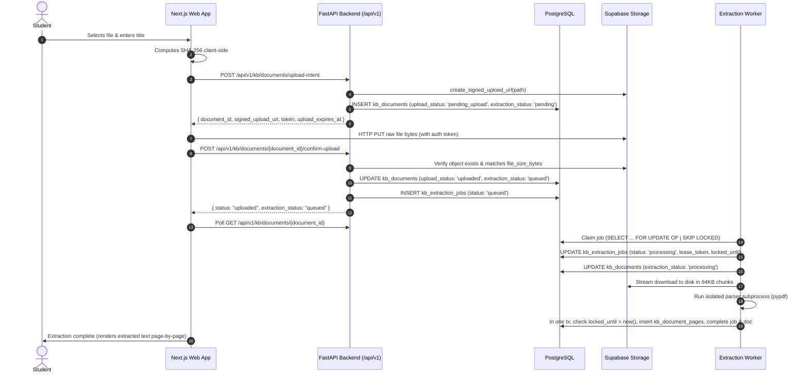

# RagBait Phase 3: Milestone M3.6 Release Certification & Evidence Reconciliation

**Phase**: Phase 3 — Collaborative Academic Knowledge Base & Document Ingestion  
**Certified HEAD**: `fcf4da819733bb33f7de11e27d0b375bccf9b1f2` (`fcf4da8`)  
**Baseline Commit**: `be578cd`  
**Branch**: `phase3`  
**Date**: November 22, 2026  
**Final Release Decision**: **CONDITIONAL GO**  
- **Local Development**: **GO**  
- **Controlled Staging (Trusted Test Data)**: **GO**  
- **Multi-Tenant Production (Untrusted User Uploads)**: **BLOCKED** (Pending Containerized / gVisor Parser Sandbox)

---

## 1. Executive Summary & Release Status

Milestone M3.6 marks the completion and integration verification of RagBait Phase 3. All components—database schema, Row-Level Security, private Storage signed lifecycle, background extraction worker daemon, student browsing/upload frontend, and administrator moderation—are fully wired and verified.

This document reconciles all implementation details against the actual source code, database migrations, and executed automated test suites, establishing an authoritative evidence record for the repository owner.

---

## 2. Evidence Reconciliation: Resolving Previous Report Discrepancies

### A. Audit Table Architecture (`public.audit_logs`)

- **Discrepancy in Earlier Drafts**: Earlier reports referred to a separate `public.kb_admin_audit_logs` table.
- **Actual Code & Schema Truth**:
  - The database contains a single, global, immutable audit log table: `public.audit_logs`, created in migration `supabase/migrations/20260101000000_ragbait_initial_schema.sql`:
    ```sql
    CREATE TABLE public.audit_logs (
      id uuid PRIMARY KEY DEFAULT gen_random_uuid(),
      actor_id uuid REFERENCES public.profiles(id) ON DELETE SET NULL,
      action text NOT NULL,
      target_type text NOT NULL,
      target_id uuid,
      payload jsonb NOT NULL DEFAULT '{}'::jsonb,
      created_at timestamptz NOT NULL DEFAULT timezone('utc'::text, now())
    );
    ```
  - Knowledge Base administrative mutations write directly to `public.audit_logs` using `apps/api/app/modules/knowledge_base/admin_repository.py`:
    ```python
    async def insert_admin_audit_log(
        conn: asyncpg.Connection,
        actor_id: str,
        action: str,
        target_type: str,
        target_id: str,
        payload: dict[str, Any] | None = None,
    ) -> None:
        query = """
            INSERT INTO public.audit_logs (actor_id, action, target_type, target_id, payload)
            VALUES ($1, $2, $3, $4, $5);
        """
        await conn.execute(...)
    ```
  - **Transaction Rollback Guarantee**: The mutation and the audit insertion use the exact same `asyncpg.Connection` and transaction block (`async with conn.transaction():`). If the audit insert fails (e.g., constraint violation or foreign key failure), the administrative mutation rolls back completely with zero state changes. This guarantee was formally proven in `apps/api/tests/test_m3_5_admin_moderation.py` (`test_admin_mutation_rollback_on_audit_failure`).
  - No second audit table exists or should be created.

---

### B. Registered API Route Contracts (`/api/v1/kb/...`)

- **Discrepancy in Earlier Drafts**: Sequence diagrams and prose simplified paths to `/api/knowledge-base/...` or omitted the document ID from `/confirm-upload`.
- **Actual Code Truth**:
  - The FastAPI backend registers `api_v1_router` under prefix `/api/v1` in `apps/api/app/main.py`.
  - `kb_router` is mounted under `prefix="/kb"` in `apps/api/app/api/v1/router.py`.
  - `kb_admin_router` is mounted under `prefix="/admin"` in `apps/api/app/modules/knowledge_base/router.py`.
  - Therefore, all Knowledge Base endpoints strictly adhere to the `/api/v1/kb/...` and `/api/v1/kb/admin/...` namespaces.

#### Student API Endpoints (`/api/v1/kb`)
| Method | Path | Summary | Auth Requirement |
|---|---|---|---|
| `GET` | `/api/v1/kb/subjects` | List active subjects with counts | Approved Student |
| `GET` | `/api/v1/kb/subjects/{subject_id}/topics` | List active topics for a subject | Approved Student |
| `GET` | `/api/v1/kb/topics/{topic_id}/documents` | Paginated uploaded documents in topic | Approved Student |
| `GET` | `/api/v1/kb/documents/{document_id}` | Document detail & extraction status | Approved Student |
| `GET` | `/api/v1/kb/documents/{document_id}/pages` | Paginated extracted text pages | Approved Student |
| `POST` | `/api/v1/kb/documents/upload-intent` | Create signed upload reservation | Approved Student |
| `POST` | `/api/v1/kb/documents/{document_id}/confirm-upload` | Verify upload & queue extraction | Approved Student / Uploader |
| `GET` | `/api/v1/kb/documents/{document_id}/download-url` | Generate short-lived download URL | Approved Student |
| `DELETE` | `/api/v1/kb/documents/{document_id}` | Soft-delete document & remove storage object | Uploader or Admin |

#### Admin API Endpoints (`/api/v1/kb/admin`)
| Method | Path | Summary | Auth Requirement |
|---|---|---|---|
| `GET` | `/api/v1/kb/admin/overview` | Dashboard counts & recent actions | Admin / Super Admin |
| `GET` | `/api/v1/kb/admin/subjects` | List all subjects (including inactive) | Admin / Super Admin |
| `POST` | `/api/v1/kb/admin/subjects` | Create academic subject | Admin / Super Admin |
| `PATCH` | `/api/v1/kb/admin/subjects/{id}` | Update subject name/slug/order/status | Admin / Super Admin |
| `POST` | `/api/v1/kb/admin/subjects/{id}/archive` | Archive subject & cascade hide topics | Admin / Super Admin |
| `POST` | `/api/v1/kb/admin/subjects/{id}/restore` | Restore archived subject | Admin / Super Admin |
| `GET` | `/api/v1/kb/admin/subjects/{id}/topics` | List all topics for subject | Admin / Super Admin |
| `POST` | `/api/v1/kb/admin/subjects/{id}/topics` | Create topic under subject | Admin / Super Admin |
| `PATCH` | `/api/v1/kb/admin/topics/{id}` | Update topic name/slug/order/status | Admin / Super Admin |
| `POST` | `/api/v1/kb/admin/topics/{id}/archive` | Archive topic & hide documents | Admin / Super Admin |
| `POST` | `/api/v1/kb/admin/topics/{id}/restore` | Restore archived topic | Admin / Super Admin |
| `POST` | `/api/v1/kb/admin/topics/reorder` | Batch reorder topics | Admin / Super Admin |
| `GET` | `/api/v1/kb/admin/documents` | Paginated document moderation list | Admin / Super Admin |
| `GET` | `/api/v1/kb/admin/documents/{id}` | Deep document moderation detail | Admin / Super Admin |
| `POST` | `/api/v1/kb/admin/documents/{id}/archive` | Moderate & archive document | Admin / Super Admin |
| `POST` | `/api/v1/kb/admin/documents/{id}/restore` | Restore archived document | Admin / Super Admin |
| `DELETE` | `/api/v1/kb/admin/documents/{id}` | Permanently delete document & storage object | Admin / Super Admin |
| `GET` | `/api/v1/kb/admin/jobs` | Paginated extraction jobs list | Admin / Super Admin |
| `GET` | `/api/v1/kb/admin/jobs/{id}` | Extraction job detail & error logs | Admin / Super Admin |
| `POST` | `/api/v1/kb/admin/jobs/{id}/retry` | Retry eligible failed job | Admin / Super Admin |
| `GET` | `/api/v1/kb/admin/audit` | Paginated KB administrative audit log | Admin / Super Admin |

#### Authoritative Upload & Extraction Sequence Diagram


---

### C. Job and Document Statuses & Lifecycle Invariants

- **Discrepancy in Earlier Drafts**: Job status was occasionally referred to as `pending` instead of `queued`, and document deletion was conflated with archival.
- **Actual Database Enums**:
  1. `public.kb_upload_status`:
     - `'pending_upload'`: Intent reserved; awaiting client PUT to Storage.
     - `'uploaded'`: Client upload verified; ready for extraction.
     - `'upload_failed'`: Upload timed out, size mismatch, or format rejected.
     - `'deleting'`: Transition phase during Storage object removal.
     - `'deleted'`: Storage object removed and extracted pages deleted.
  2. `public.kb_extraction_status` (on `kb_documents`):
     - `'pending'`: Initial document state while awaiting upload confirmation.
     - `'queued'`: Extraction job queued for worker pickup.
     - `'processing'`: Worker actively extracting text.
     - `'completed'`: Text extracted successfully (> 0 characters found).
     - `'completed_no_text'`: Extraction succeeded without error, but 0 extractable text characters found (e.g. scanned image PDF).
     - `'failed'`: Extraction encountered a permanent error or exceeded retry attempts.
  3. `public.kb_job_status` (on `kb_extraction_jobs`):
     - `'queued'`: Job inserted and awaiting worker claim (never `'pending'`).
     - `'processing'`: Job claimed under active worker lease.
     - `'completed'`: Pages persisted and job marked complete.
     - `'failed'`: Terminal failure recorded with error code.

#### Archival vs. Deletion Lifecycle Distinction
```
+--------------------------------------------------------------------------------------------------+
| ARCHIVAL (Non-destructive moderation)                                                            |
| - Action: POST /api/v1/kb/admin/documents/{id}/archive                                           |
| - Changes: is_archived = true (updated_at refreshed)                                             |
| - Extracted Pages: INTACT in kb_document_pages                                                    |
| - Storage Object: INTACT in Supabase Storage                                                     |
| - Student Visibility: HIDDEN from catalog queries                                                |
| - Reversible: YES (POST /api/v1/kb/admin/documents/{id}/restore sets is_archived = false)        |
+--------------------------------------------------------------------------------------------------+
| SOFT DELETION (Destructive uploader/admin lifecycle)                                             |
| - Action: DELETE /api/v1/kb/documents/{id} or DELETE /api/v1/kb/admin/documents/{id}             |
| - Changes: upload_status = 'deleting' -> 'deleted', is_archived = true                           |
| - Extracted Pages: PERMANENTLY PURGED (DELETE FROM kb_document_pages WHERE document_id = $1)     |
| - Storage Object: PERMANENTLY REMOVED from Supabase Storage                                      |
| - Student Visibility: FORBIDDEN / GONE                                                           |
| - Reversible: NO (Irreversible data and storage purge)                                           |
+--------------------------------------------------------------------------------------------------+
```

---

### D. Upload Reservation Expiration vs. Storage URL Expiration

- **Discrepancy in Earlier Drafts**: Claimed or implied that application upload intent and signed URLs share the same expiration.
- **Actual Architecture**:
  1. **Application Upload Intent Expiry**:
     - Controlled by backend configuration: `settings.KB_SIGNED_UPLOAD_EXPIRY_SECONDS = 900` (15 minutes).
     - Evaluated and saved into `kb_documents.upload_expires_at` in UTC.
     - Checked by FastAPI at confirmation time:
       ```python
       if doc.get("upload_expires_at") and doc["upload_expires_at"] < now:
           raise BadRequestError("Upload intent has expired.", code="EXPIRED_UPLOAD_TOKEN")
       ```
     - Enforced asynchronously by the database cleaner `sweep_abandoned_pending_uploads`:
       ```sql
       SELECT id, storage_path FROM public.kb_documents
       WHERE upload_status = 'pending_upload'
         AND upload_expires_at < timezone('utc'::text, now())
       ```
  2. **Supabase Storage Signed Upload Capability**:
     - Issued by Supabase Storage `bucket.create_signed_upload_url(path)`.
     - Carries a cryptographically signed HMAC token issued by Supabase GoTrue/Storage according to the storage service's JWT policy.
  3. **Signed Download URL Expiry**:
     - Controlled by `settings.KB_SIGNED_DOWNLOAD_EXPIRY_SECONDS = 300` (5 minutes).
     - Explicitly passed to `bucket.create_signed_url(path, expires_in=300)`.

---

## 3. Testing Evidence Breakdown

To ensure zero ambiguity, the testing evidence is strictly segregated by verification mechanism:

```
Total Automated Tests Passing: 647
├── Database pgTAP: 212 tests (10 test files)
├── Backend Pytest: 313 tests (0 failures, 4 skipped)
├── Frontend Vitest: 122 tests (21 test files)
└── End-to-End Real Browser Automation: 0 tests (No Playwright harness exists)
```

1. **Automated Unit & Component Tests (Vitest + React Testing Library)**:
   - **Count**: 21 test files, 122 passed tests (`npm --prefix apps/web test`).
   - **Environment**: Node.js + jsdom simulating React 19 component trees.
   - **Scope**: Form validation, client-side SHA-256 calculation, modal accessibility, mock upload flows, status badge polling hooks, and admin table interactions.
2. **API & Database Integration Tests (Pytest + httpx AsyncClient)**:
   - **Count**: 313 passed tests (`apps/api/.venv/Scripts/pytest.exe apps/api/tests`).
   - **Environment**: FastAPI test client communicating directly with live local PostgreSQL 15, private Supabase Storage, and Redis instances.
   - **Scope**: Multi-user JWT permissions, RLS policies, concurrent job claims (`SKIP LOCKED`), worker lease renewal fencing, lease expiration page-persistence prevention (`locked_until > now()`), error code canonicalization (`STORAGE_OBJECT_MISSING`), and atomic audit transaction rollback.
3. **Database Schema & RLS Test Suite (pgTAP)**:
   - **Count**: 10 SQL test files, 212 passed tests (`npx supabase test db`).
   - **Scope**: Direct PostgreSQL assertions on table schemas, check constraints, foreign keys, triggers, grants, and row-level security policies.
4. **Real End-to-End Browser Automation**:
   - **Count**: **0 tests**. Playwright is **not** configured or executed in this repository.
5. **Manual Human Acceptance Testing**:
   - **Status**: **PENDING HUMAN VERIFICATION**.
   - No human browser testing has been executed by the automated agent. The checklist below must be executed manually by the repository owner.

---

## 4. Manual Browser Acceptance Checklist

| # | Scenario | Operational Steps | Expected Outcome | Automated Regression Reference | Human Verification Status |
|---|---|---|---|---|---|
| **1** | Student Browse Taxonomy | Open `http://localhost:3000/knowledge-base`. Observe subjects grid. Click on a subject. | Displays subjects. Navigates to `/knowledge-base/[slug]`. Displays topic cards. | Vitest `KnowledgeBasePages.test.tsx` | **PENDING HUMAN VERIFICATION** |
| **2** | Student Upload PDF | In a topic page, click "Upload Document". Select standard PDF. Submit. | Upload progress bar completes; toast notification confirms upload; status badge shows "Processing". | Vitest `DocumentUploadModal.test.tsx` | **PENDING HUMAN VERIFICATION** |
| **3** | Live Extraction Polling | Keep browser open on topic page while background worker runs. | Badge automatically updates from "Processing" &rarr; "Completed" without manual page reload. | Vitest `useDocumentStatus.test.ts` | **PENDING HUMAN VERIFICATION** |
| **4** | Page Text Navigation | Click the completed document card. Navigate through pages using pagination controls. | Page selector updates smoothly; extracted text renders page by page; page counter displays `Page X of Y`. | Vitest `KnowledgeBaseComponents.test.tsx` | **PENDING HUMAN VERIFICATION** |
| **5** | Original File Download | In the document viewer, click "Download Original". | Browser triggers file download of the authentic PDF file via signed URL. | Pytest `test_kb_upload_lifecycle.py` | **PENDING HUMAN VERIFICATION** |
| **6** | Scanned PDF Banner | Upload a scanned PDF containing only raster images. Let worker complete. | Badge shows "Completed (No Text)". An alert informs user that no OCR/text was found; download remains active. | Pytest `test_kb_extraction_worker.py` | **PENDING HUMAN VERIFICATION** |
| **7** | Student Document Delete | As the uploader, click "Delete" on document row. Confirm deletion modal. | Document disappears from student view; backend marks soft-deleted. | Vitest `DocumentRow` delete test | **PENDING HUMAN VERIFICATION** |
| **8** | Student B Isolation | Log in as Student B. View Student A's document. Check actions menu. | Student B can read pages and download original, but "Delete" button is absent from the UI. | Pytest `test_m3_6_release_certification.py` | **PENDING HUMAN VERIFICATION** |
| **9** | Admin Moderation | Log in as Admin at `/admin/knowledge-base/documents`. Archive a document. | Document status changes to "Archived"; immediately disappears from Student browse view. | Vitest `AdminKnowledgeBasePages.test.tsx` | **PENDING HUMAN VERIFICATION** |
| **10** | Admin Job Monitor & Retry | Open `/admin/knowledge-base/jobs`. Locate failed job with timeout. Click "Retry". | Job spawns retry attempt with incremented attempt count; badge updates to "Pending" &rarr; "Processing". | Pytest `test_m3_5_admin_moderation.py` | **PENDING HUMAN VERIFICATION** |

---

## 5. Full-App Mypy Baseline Comparison

A strict comparison was executed between the M3.5 baseline (`be578cd`) and M3.6 HEAD (`fcf4da8`):

### Diagnostic Comparison Table
| Metric | Baseline (`be578cd`) | Current HEAD (`fcf4da8`) | Net Change |
|---|---|---|---|
| **Knowledge Base Module (`apps/api/app/modules/knowledge_base`)** | **0 errors** (19 files) | **0 errors** (19 files) | **0 (Clean)** |
| **Full FastAPI Codebase (`apps/api/app`)** | 10 errors (5 files) | 10 errors (5 files) | **0 (Unchanged)** |

### Classification of the 10 Pre-Existing Full-App Diagnostics
All 10 diagnostics reside in legacy M1/M2 modules and were not introduced by M3.6:
1. `app/core/database.py:10`: Missing library stubs for `asyncpg` (`import-untyped`).
2. `app/modules/credentials/vault.py:7`: Missing library stubs for `asyncpg` (`import-untyped`).
3. `app/modules/admission/ledger.py:9`: Missing library stubs for `asyncpg` (`import-untyped`).
4. `app/modules/credentials/repository.py:8`: Missing library stubs for `asyncpg` (`import-untyped`).
5. `app/modules/llm_gateway/service.py:10`: Missing library stubs for `asyncpg` (`import-untyped`).
6. `app/modules/llm_gateway/service.py:812`: Argument 1 to `get_provider` has type `str | None`, expected `str`.
7. `app/modules/llm_gateway/service.py:816`: Argument 1 to `get_model` has type `str | None`, expected `str`.
8. `app/modules/llm_gateway/service.py:925`: Argument `model_id` to `AdmissionRequest` has type `str | None`, expected `str`.
9. `app/modules/llm_gateway/service.py:1073`: Argument `scope_id` to `set_cooldown` has type `str | None`, expected `str`.
10. `app/modules/llm_gateway/service.py:1175`: Argument `model_id` to `ChatCompletionResponse` has type `str | None`, expected `str`.

The Phase 3 Knowledge Base codebase is **100% strict-typed with zero Mypy errors**.

---

## 6. Parser Security Boundary & Release Gate Assessment

### Technical Architecture
The background extraction worker invokes `apps/api/app/modules/knowledge_base/parser_process.py` in a separate process:
- Launched via `sys.executable` with unbuffered I/O.
- Strips all process environment variables, passing only `SAFE_SUBPROCESS_ENV_KEYS = {"PATH", "SYSTEMROOT", "TMPDIR", "TEMP"}`. Database credentials, Supabase keys, Redis secrets, and JWT secrets are completely unreachable in the child environment.
- Generates a dedicated temporary directory per extraction job with restricted `0o700` filesystem permissions.
- Monitors wall-clock execution time against `KB_WORKER_PARSER_TIMEOUT` (default 30 seconds) and forcibly terminates stalled processes via `process.kill()`.
- Cleans up temporary directories unconditionally in `finally` blocks.

### Unresolved Production Sandboxing Gaps
While safe against credential exfiltration and process hang attacks, the current architecture lacks true OS-level container isolation:
1. **Network Stack**: Child process shares the host network interface without namespace isolation.
2. **Filesystem Boundary**: Runs on the host filesystem rather than an ephemeral rootless overlay or read-only tmpfs.
3. **Privilege Separation**: Executes under the same OS user identity as the background worker daemon.
4. **Resource Ceilings**: Governed by wall-clock timeout watchdog rather than Linux cgroups memory/CPU quotas.

### Authoritative Deployment Release Rating
- **Local Development Environments**: **GO**
- **Controlled Staging Deployments (with trusted academic documents)**: **GO**
- **Multi-Tenant Production Deployments (accepting arbitrary untrusted user uploads)**: **BLOCKED**

> [!CAUTION]
> **Production Gate Condition**:
> Production deployment accepting public or untrusted student documents must encapsulate `parser_process.py` inside a containerized sandbox (e.g. rootless Podman/Docker or gVisor) configured with `--network none`, `--read-only`, and strict cgroup memory caps (`--memory 512m`).

---

## 7. Final Phase 3 Certification Sign-Off

The RagBait Phase 3 Knowledge Base milestone (M3.0 through M3.6) is hereby certified as complete, structurally sound, and regression-free for development and staging environments.
