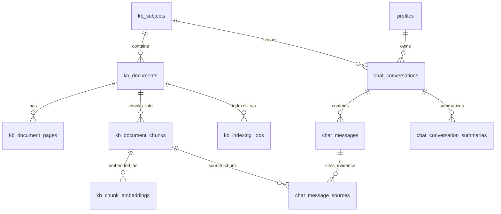

# RagBait Phase 4 — Data Model and Migration Design

**Document Version:** 1.1.0 (Remediated Baseline)  
**Phase:** Phase 4 — AI Study Assistant and Retrieval-Augmented Generation (RAG)  
**Date:** November 22, 2026  
**Status:** Approved Schema Design (Planning Only — No Active Migrations Executed in M4.0)  

---

## 1. Logical Data Architecture & Entity Relationships

Phase 4 introduces 7 new database tables partitioned across three logical domains:
1. **RAG Indexing & Chunking**: `kb_document_chunks`, `kb_chunk_embeddings`, `kb_indexing_jobs`
2. **Chat Persistence**: `chat_conversations`, `chat_messages`
3. **Evidence & Context Memory**: `chat_message_sources`, `chat_conversation_summaries`



---

## 2. Table Specifications & Proposed DDL

### 2.1 Domain 1: RAG Indexing & Chunking

#### `public.kb_document_chunks`
Stores deterministic text chunks created from extracted document pages, preserving physical page provenance.
- **Sizing Invariant**: Target 350–400 tokens; hard ceiling $\le 420$ tokens (guaranteeing $\le 424$ tokens total embedding input with `"passage: "` prefix and special tokens).
```sql
CREATE TABLE public.kb_document_chunks (
    id uuid PRIMARY KEY DEFAULT gen_random_uuid(),
    document_id uuid NOT NULL REFERENCES public.kb_documents(id) ON DELETE CASCADE,
    chunk_index integer NOT NULL,
    page_number_start integer NOT NULL,
    page_number_end integer NOT NULL,
    raw_text text NOT NULL,
    character_count integer NOT NULL,
    token_count integer NOT NULL,
    content_hash text NOT NULL,
    chunking_version integer NOT NULL DEFAULT 1,
    created_at timestamptz NOT NULL DEFAULT timezone('utc'::text, now()),
    CONSTRAINT uq_document_chunk_index UNIQUE (document_id, chunk_index, chunking_version),
    CONSTRAINT chk_chunk_token_ceiling CHECK (token_count <= 420)
);

CREATE INDEX idx_kb_chunks_doc_id ON public.kb_document_chunks (document_id);
CREATE INDEX idx_kb_chunks_pages ON public.kb_document_chunks (document_id, page_number_start, page_number_end);
-- GIN Index for PostgreSQL Full-Text Search in Hybrid Retrieval (native PostgreSQL core)
CREATE INDEX idx_kb_chunks_fts ON public.kb_document_chunks USING gin (to_tsvector('english', raw_text));
```

#### `public.kb_chunk_embeddings`
Stores dense float vector representations generated for document chunks.
```sql
CREATE TABLE public.kb_chunk_embeddings (
    id uuid PRIMARY KEY DEFAULT gen_random_uuid(),
    chunk_id uuid NOT NULL REFERENCES public.kb_document_chunks(id) ON DELETE CASCADE,
    model_id text NOT NULL DEFAULT 'intfloat/multilingual-e5-small',
    model_version text NOT NULL DEFAULT '1.0.0',
    dimensions integer NOT NULL DEFAULT 384,
    embedding extensions.vector(384) NOT NULL,
    created_at timestamptz NOT NULL DEFAULT timezone('utc'::text, now()),
    CONSTRAINT uq_chunk_model_embedding UNIQUE (chunk_id, model_id, model_version)
);

CREATE INDEX idx_kb_embeddings_chunk_id ON public.kb_chunk_embeddings (chunk_id);
-- HNSW Cosine Index for pgvector 0.8.2 (evaluated against exact scan in M4.3)
CREATE INDEX idx_kb_embeddings_hnsw ON public.kb_chunk_embeddings 
USING hnsw (embedding extensions.vector_cosine_ops) 
WITH (m = 16, ef_construction = 64);
```

#### `public.kb_indexing_jobs`
Durable background indexing queue with lease tokens and crash recovery, decoupled from extraction.
```sql
CREATE TYPE public.kb_indexing_job_status AS ENUM (
    'queued',
    'processing',
    'completed',
    'failed'
);

CREATE TABLE public.kb_indexing_jobs (
    id uuid PRIMARY KEY DEFAULT gen_random_uuid(),
    document_id uuid NOT NULL REFERENCES public.kb_documents(id) ON DELETE CASCADE,
    status public.kb_indexing_job_status NOT NULL DEFAULT 'queued',
    worker_id text,
    lease_token uuid,
    attempts integer NOT NULL DEFAULT 0,
    max_attempts integer NOT NULL DEFAULT 3,
    scheduled_at timestamptz NOT NULL DEFAULT timezone('utc'::text, now()),
    locked_until timestamptz,
    error_code text,
    error_message text,
    retry_count integer NOT NULL DEFAULT 0,
    created_at timestamptz NOT NULL DEFAULT timezone('utc'::text, now()),
    updated_at timestamptz NOT NULL DEFAULT timezone('utc'::text, now())
);

CREATE INDEX idx_kb_idx_jobs_claim ON public.kb_indexing_jobs (status, scheduled_at) 
WHERE status = 'queued';
CREATE INDEX idx_kb_idx_jobs_doc_id ON public.kb_indexing_jobs (document_id);
```

---

### 2.2 Domain 2: Chat Persistence

#### `public.chat_conversations`
Persistent user conversation threads, strictly bound to an academic subject.
```sql
CREATE TYPE public.chat_conversation_status AS ENUM (
    'active',
    'archived',
    'deleted'
);

CREATE TABLE public.chat_conversations (
    id uuid PRIMARY KEY DEFAULT gen_random_uuid(),
    user_id uuid NOT NULL REFERENCES public.profiles(id) ON DELETE CASCADE,
    subject_id uuid NOT NULL REFERENCES public.kb_subjects(id) ON DELETE RESTRICT,
    title text NOT NULL,
    status public.chat_conversation_status NOT NULL DEFAULT 'active',
    message_count integer NOT NULL DEFAULT 0,
    created_at timestamptz NOT NULL DEFAULT timezone('utc'::text, now()),
    updated_at timestamptz NOT NULL DEFAULT timezone('utc'::text, now())
);

CREATE INDEX idx_chat_conv_user_subject ON public.chat_conversations (user_id, subject_id, status);
CREATE INDEX idx_chat_conv_updated_at ON public.chat_conversations (user_id, updated_at DESC);
```

#### `public.chat_messages`
Individual messages within a conversation with sequential monotonic ordering.
```sql
CREATE TYPE public.chat_message_role AS ENUM (
    'user',
    'assistant',
    'system'
);

CREATE TYPE public.chat_message_status AS ENUM (
    'pending',
    'streaming',
    'completed',
    'failed',
    'cancelled'
);

CREATE TABLE public.chat_messages (
    id uuid PRIMARY KEY DEFAULT gen_random_uuid(),
    conversation_id uuid NOT NULL REFERENCES public.chat_conversations(id) ON DELETE CASCADE,
    sequence_number integer NOT NULL,
    role public.chat_message_role NOT NULL,
    content text NOT NULL DEFAULT '',
    status public.chat_message_status NOT NULL DEFAULT 'completed',
    generation_request_id text,
    idempotency_key text,
    model_id text,
    provider_id text,
    token_usage jsonb NOT NULL DEFAULT '{}'::jsonb,
    finish_reason text,
    error_message text,
    created_at timestamptz NOT NULL DEFAULT timezone('utc'::text, now()),
    updated_at timestamptz NOT NULL DEFAULT timezone('utc'::text, now()),
    CONSTRAINT uq_conversation_sequence UNIQUE (conversation_id, sequence_number)
);

CREATE INDEX idx_chat_messages_conv_seq ON public.chat_messages (conversation_id, sequence_number ASC);
CREATE INDEX idx_chat_messages_idempotency ON public.chat_messages (conversation_id, idempotency_key) 
WHERE idempotency_key IS NOT NULL;
```

---

### 2.3 Domain 3: Evidence & Context Memory

#### `public.chat_message_sources`
Immutable evidence snapshot capturing the exact chunks and physical pages supplied to the LLM.
- **Evidence State Distinction**:
  - `included_in_context = true`: The passage was selected by the context budget manager and included in the `<study_context_evidence>` block.
  - `referenced_in_answer = true`: The assistant explicitly referenced this source using an inline citation token like `[S1]`.
```sql
CREATE TABLE public.chat_message_sources (
    id uuid PRIMARY KEY DEFAULT gen_random_uuid(),
    message_id uuid NOT NULL REFERENCES public.chat_messages(id) ON DELETE CASCADE,
    citation_key text NOT NULL, -- e.g. 'S1', 'S2'
    chunk_id uuid NOT NULL REFERENCES public.kb_document_chunks(id) ON DELETE CASCADE,
    document_id uuid NOT NULL REFERENCES public.kb_documents(id) ON DELETE CASCADE,
    document_title_snapshot text NOT NULL,
    page_number_start integer NOT NULL,
    page_number_end integer NOT NULL,
    excerpt text NOT NULL,
    relevance_score double precision NOT NULL,
    content_hash text NOT NULL,
    included_in_context boolean NOT NULL DEFAULT true,
    referenced_in_answer boolean NOT NULL DEFAULT false,
    created_at timestamptz NOT NULL DEFAULT timezone('utc'::text, now()),
    CONSTRAINT uq_msg_citation_key UNIQUE (message_id, citation_key)
);

CREATE INDEX idx_msg_sources_msg_id ON public.chat_message_sources (message_id);
CREATE INDEX idx_msg_sources_doc_id ON public.chat_message_sources (document_id);
```

#### `public.chat_conversation_summaries`
Asynchronous map-reduce summary representing older conversation context with optimistic concurrency sequence control.
```sql
CREATE TABLE public.chat_conversation_summaries (
    id uuid PRIMARY KEY DEFAULT gen_random_uuid(),
    conversation_id uuid NOT NULL REFERENCES public.chat_conversations(id) ON DELETE CASCADE,
    summary_text text NOT NULL,
    compacted_through_sequence integer NOT NULL,
    token_count integer NOT NULL,
    created_at timestamptz NOT NULL DEFAULT timezone('utc'::text, now()),
    updated_at timestamptz NOT NULL DEFAULT timezone('utc'::text, now()),
    CONSTRAINT uq_conv_summary UNIQUE (conversation_id)
);

CREATE INDEX idx_conv_summaries_conv_id ON public.chat_conversation_summaries (conversation_id);
```

---

## 3. Row-Level Security (RLS) & Authoritative Grant Policies

All user-facing tables are protected with strict PostgreSQL Row-Level Security policies.

### 3.1 `chat_conversations` RLS
```sql
ALTER TABLE public.chat_conversations ENABLE ROW LEVEL SECURITY;

-- Students can view only their own active/archived conversations
CREATE POLICY p_chat_conv_select ON public.chat_conversations
    FOR SELECT TO authenticated
    USING (user_id = auth.uid() AND status != 'deleted');

-- Students can insert conversations owned by themselves
CREATE POLICY p_chat_conv_insert ON public.chat_conversations
    FOR INSERT TO authenticated
    WITH CHECK (user_id = auth.uid());

-- Students can update their own conversations (title, status)
CREATE POLICY p_chat_conv_update ON public.chat_conversations
    FOR UPDATE TO authenticated
    USING (user_id = auth.uid())
    WITH CHECK (user_id = auth.uid());
```

### 3.2 `chat_messages` RLS
```sql
ALTER TABLE public.chat_messages ENABLE ROW LEVEL SECURITY;

-- Users can view messages belonging to their authorized conversations
CREATE POLICY p_chat_msg_select ON public.chat_messages
    FOR SELECT TO authenticated
    USING (
        EXISTS (
            SELECT 1 FROM public.chat_conversations c
            WHERE c.id = chat_messages.conversation_id
              AND c.user_id = auth.uid()
              AND c.status != 'deleted'
        )
    );

-- Users can insert messages only into their own conversations
CREATE POLICY p_chat_msg_insert ON public.chat_messages
    FOR INSERT TO authenticated
    WITH CHECK (
        EXISTS (
            SELECT 1 FROM public.chat_conversations c
            WHERE c.id = chat_messages.conversation_id
              AND c.user_id = auth.uid()
        )
    );
```

### 3.3 `chat_message_sources` RLS
```sql
ALTER TABLE public.chat_message_sources ENABLE ROW LEVEL SECURITY;

-- Sources are readable only if the user owns the parent message's conversation
CREATE POLICY p_chat_sources_select ON public.chat_message_sources
    FOR SELECT TO authenticated
    USING (
        EXISTS (
            SELECT 1 FROM public.chat_messages m
            JOIN public.chat_conversations c ON c.id = m.conversation_id
            WHERE m.id = chat_message_sources.message_id
              AND c.user_id = auth.uid()
        )
    );
```

### 3.4 Internal Indexing & Embeddings Protection
`kb_document_chunks`, `kb_chunk_embeddings`, and `kb_indexing_jobs` are internal system tables. They are queried by backend services via the dedicated service-role / backend asyncpg connection pool. They are NOT directly exposed through the Supabase Data API (PostgREST) to untrusted anonymous clients.

---

## 4. Migration Execution Plan (Phase 4 Milestones)

| Milestone | Migration Filename | Description |
| :--- | :--- | :--- |
| **M4.1** | `20260301000000_m4_1_chat_persistence.sql` | Creates `chat_conversations`, `chat_messages`, enums, indexes, and RLS policies. |
| **M4.2** | `20260302000000_m4_2_chunking_and_indexing.sql` | Creates `kb_document_chunks` (with 420-token ceiling check), `kb_indexing_jobs`, FTS index, and extraction hook. |
| **M4.3** | `20260303000000_m4_3_pgvector_storage.sql` | Activates `extensions.vector` (without pg_trgm), creates `kb_chunk_embeddings`, HNSW index. |
| **M4.4** | `20260304000000_m4_4_hybrid_search.sql` | Creates `match_subject_chunks` hybrid search SQL function with subject filtering and RRF ranking. |
| **M4.5** | `20260305000000_m4_5_chat_evidence.sql` | Creates `chat_message_sources`, `chat_conversation_summaries`, and citation integrity constraints. |
