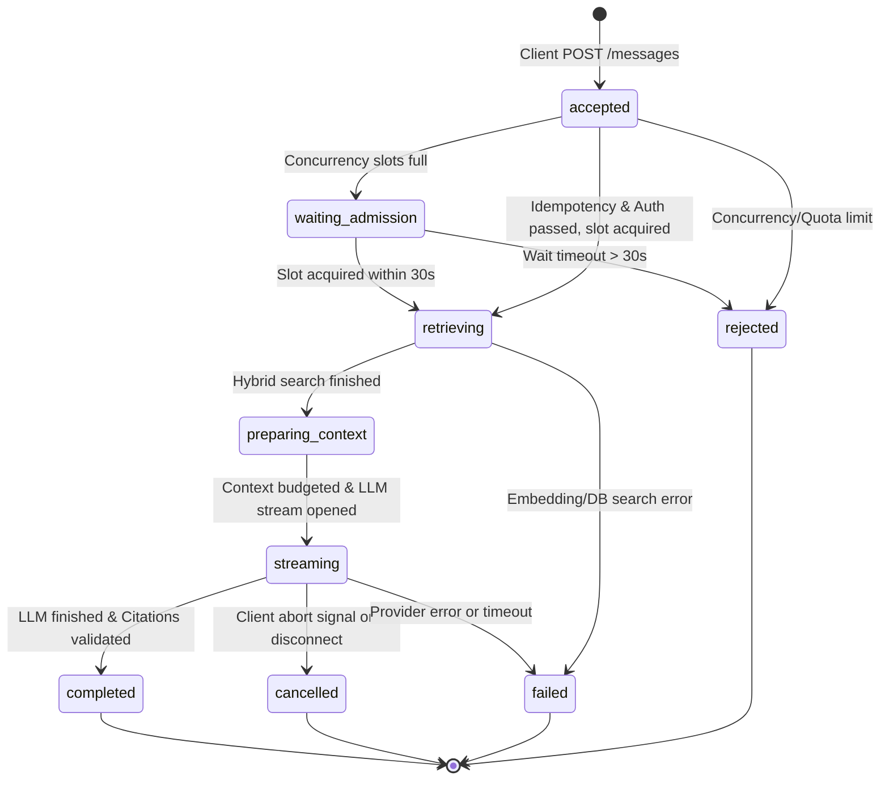
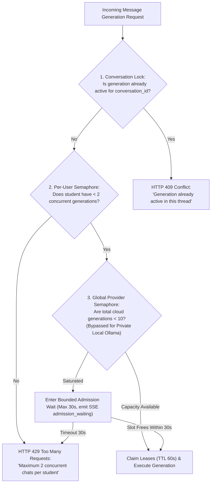

# RagBait Phase 4 — Generation Reliability and Load Plan

**Document Version:** 1.1.0  
**Phase:** Phase 4 — AI Study Assistant and Retrieval-Augmented Generation (RAG)  
**Date:** November 22, 2026  
**Status:** Approved Operational Specification (Remediated Baseline)  

---

## 1. Generation Request State Machine & Lifecycle

Every assistant generation request transitions through an explicit, auditable state machine. A generation is never permitted to hang indefinitely in an indeterminate state.



### 1.1 State Definitions
- `accepted`: Request payload validated, idempotency key checked, concurrency lease claimed.
- `waiting_admission`: Concurrency slots saturated; request is waiting in a bounded Redis polling loop (max 30s).
- `retrieving`: Hybrid semantic and keyword queries executing against PostgreSQL.
- `preparing_context`: Prompt context budget calculated, evidence selected, XML prompt assembled.
- `streaming`: Upstream provider connection established, emitting SSE `text_delta` events.
- `completed`: Upstream finish reason `stop` received, citations reconciled, message updated.
- `cancelled`: Client explicitly cancelled or browser disconnected; partial text preserved.
- `failed`: Upstream error, context overflow, or timeout encountered with normalized error logged.
- `rejected`: Inadmissible request (e.g. concurrent generation already active in thread, or wait timeout).

---

## 2. Concurrency Governance & Redis Distributed Semaphores

In a multi-user college environment, multiple students query the assistant simultaneously. RagBait enforces bounded concurrency using **Redis Distributed Semaphores with Unique Lease Tokens and Atomic Lua Scripts**:



### 2.1 Concurrency Limits
1. **Per-Conversation Mutex**: **1 active generation** per conversation. Enforces strict message sequence numbering and prevents interleaved assistant responses.
2. **Per-User Concurrency**: **2 simultaneous generations** per student account. Prevents a single student from consuming platform capacity across multiple browser tabs.
3. **Global Cloud Concurrency**: **10 simultaneous cloud API calls**. Prevents upstream rate limit cascades (`HTTP 429`) against shared free-tier credentials.
4. **Private Local Bypass**: Private Local Ollama requests **bypass the global cloud semaphore** (`sem:global:cloud`) entirely, because they execute against the student's own loopback hardware and consume zero cloud API quotas.

### 2.2 Atomic Lua Semaphore Scripts & Stale Release Protection

To prevent a slow or timed-out generation from inadvertently releasing a lock that has already been re-acquired by a subsequent generation, all locks and semaphore slots are associated with a unique UUID4 **Lease Permit Token**.

#### Acquisition Script
```lua
-- KEYS[1]: lock key (e.g. lock:chat:conversation:{id})
-- ARGV[1]: lease_token (UUID4)
-- ARGV[2]: ttl_seconds (e.g. 60)
local current = redis.call('get', KEYS[1])
if not current then
    redis.call('set', KEYS[1], ARGV[1], 'EX', ARGV[2])
    return 1
else
    return 0
end
```

#### Safe Token Release Script
```lua
-- KEYS[1]: lock key (e.g. lock:chat:conversation:{id})
-- ARGV[1]: lease_token (UUID4)
if redis.call('get', KEYS[1]) == ARGV[1] then
    return redis.call('del', KEYS[1])
else
    -- Token does not match: Lock expired and was re-claimed by another request!
    return 0
end
```

#### Lease Heartbeat & Expiration
- Every Redis lease has a strict 60-second TTL.
- Active streaming requests maintain a background heartbeat task that extends the TTL every 15 seconds as long as tokens are actively flowing.
- If a server worker crashes or power fails, the lock automatically self-clears after 60s, preventing permanent deadlocks.

---

## 3. Streaming & Cancellation Protocol

### 3.1 Server-Sent Events (SSE) Protocol
- Standard HTTP/1.1 or HTTP/2 chunked transfer encoding via FastAPI `EventSourceResponse`.
- Native browser disconnect detection via `await request.is_disconnected()`. If a student closes their laptop lid or navigates away, the server detects socket closure and halts generation immediately.

### 3.2 Explicit Client Cancellation
- **Routes**:
  - Primary: `POST /api/v1/chat/messages/{message_id}/cancel`
  - Conversation-scoped alias: `POST /api/v1/chat/conversations/{conversation_id}/messages/{message_id}/cancel`
- **Execution Flow**:
  1. The client aborts the active `fetch()` request via `AbortController`.
  2. The client fires either cancel endpoint.
  3. The backend publishes a Redis cancellation marker (`chat:cancel:{message_id}` + Pub/Sub `chat:cancel:ch:{message_id}`), waking the watcher and setting the stream `asyncio.Event` cancellation flag across worker processes.
  4. The upstream provider HTTP stream and admission wait abort cleanly, settling active quota reservations once (`cancelled_by_client`).
  5. Using conditional CAS (`WHERE status IN ('pending', 'streaming', 'cancelled')`), the assistant message in `chat_messages` transitions to `status = 'cancelled'` with any partial text preserved (`409` if already `completed` or `failed`).
  6. The 3-scope Redis ZSET semaphore leases are released immediately via the owner-verified Lua release script.

---

## 4. Idempotency & Retries

### 4.1 Client Idempotency Keys
- Every message submission requires an `idempotency_key` (e.g. `idem-msg-9b1deb4d-01`).
- If network jitter causes the client to resend the same prompt, the server detects the existing `idempotency_key` in `chat_messages`:
  - If generation is already completed: returns the existing message payload immediately.
  - If generation is still streaming: re-attaches to the active stream or returns HTTP 409.
  - **Zero duplicate assistant answers are ever created.**

### 4.2 Upstream Provider Retries
- **Transient Errors (500, 502, 503, 504)**: Automatic retry with exponential backoff and jitter ($1.0\text{s} \to 2.5\text{s}$, max 2 attempts).
- **Rate Limits (429)**: The router marks the credential or provider in cooldown and immediately attempts failover to the next eligible candidate in the pool.
- **Permanent Errors (400, 401, 403, 404, 422)**: Terminated immediately without retry, delivering an actionable error message to the student.

---

## 5. Multi-User Load Testing & Pilot Capacity Plan

### 5.1 Pilot User Cohort
- **Registered Students**: 30–100 students.
- **Expected Concurrency**: 5–10 concurrent generation streams during peak study periods.

### 5.2 Progressive Stress Profiles
| Profile | Concurrent Streams | Purpose | Latency Target (TTFT) | Target Total Duration |
| :--- | :--- | :--- | :--- | :--- |
| **Profile 1: Baseline** | 1 stream | Functional sanity & zero-contention baseline | $< 800\text{ms}$ | $< 4.5\text{s}$ |
| **Profile 2: Light** | 5 streams | Nominal study group concurrency | $< 1.2\text{s}$ | $< 6.0\text{s}$ |
| **Profile 3: Peak** | 10 streams | Maximum expected classroom pilot load | $< 2.0\text{s}$ | $< 8.5\text{s}$ |
| **Profile 4: Burst Stress** | 20 streams | Verification of bounded queue and 429 rejection | Bounded or 429 | Queue $\le 30\text{s}$ |

### 5.3 Failure Mode Matrix
| Failure Scenario | Immediate System Behavior | Student Experience |
| :--- | :--- | :--- |
| **Upstream Provider Down** | Router fails over to next candidate in pool before first visible token; if all fail, emits `event: generation_failed` (`PROVIDER_UNAVAILABLE`). | Neutral banner / prompt to retry or switch to Private Local. |
| **Redis Server Down** | Cloud generation **fails closed** with HTTP `503 SERVICE_UNAVAILABLE` BEFORE streaming; Private Local Ollama continues bypassing Redis cloud semaphores. | Clear outage message with Private Local Ollama fallback option. |
| **Database Pool Full** | Fast failover via connection timeout (5s). | Error message: "Database temporarily saturated; please retry." |
| **Worker Crash Mid-Stream** | Lease expires after 60s; message marked `failed` on subsequent load. | Student sees "Generation interrupted" with a safe Retry button. |
