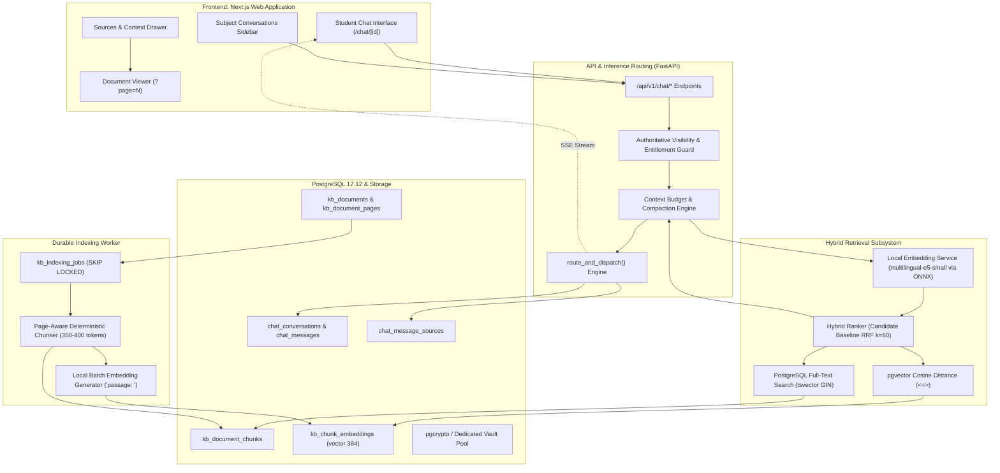
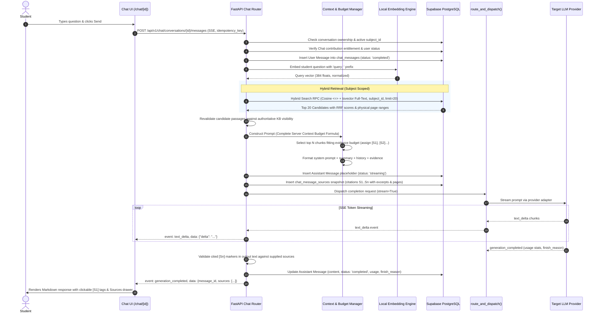

# RagBait Phase 4 — M4.0: Master Architecture & Evaluation Specification

**Document Version:** 1.1.0 (Remediated Baseline)  
**Phase:** Phase 4 — AI Study Assistant and Retrieval-Augmented Generation (RAG)  
**Milestone:** M4.0 — Architecture, Technical Research, Evaluation and Implementation Planning  
**Date:** November 22, 2026  
**Status:** Approved Technical Architecture  
**Target Execution Environment:** Next.js (TypeScript), FastAPI (Python 3.12+), PostgreSQL 17.12 (Supabase pgvector 0.8.2), Redis 7.2  

---

## 1. Executive Summary

RagBait Phase 3 established a collaborative academic knowledge-base platform allowing university students and faculty to browse subjects and topics, upload study materials (PDF/TXT), and view verified extracted text page-by-page.

**Phase 4 transforms RagBait into a persistent, grounded AI study assistant.** Students can create independent conversations strictly scoped to an academic subject, ask questions regarding their textbooks and lecture notes, and receive answers rigorously grounded in retrieved passages with verified physical page citations (`[S1]`, `[S2]`). A signature **Sources & Context** drawer allows students to inspect the exact excerpt used, see the physical page number, and jump directly to that page in the document viewer.

This master document defines the end-to-end technical architecture across text chunking, local vector embeddings, Supabase pgvector hybrid retrieval, persistent conversation history, context-window management, prompt-injection defense, and production concurrency control.

---

## 2. Baseline Architecture & Inherited Assets

### 2.1 Reused Components & Verified Interfaces

The Phase 4 architecture reuses the following verified Phase 0–Phase 3 infrastructure without duplication:

| Subsystem | Existing Component | Reused Capability | Phase 4 Integration Role |
| :--- | :--- | :--- | :--- |
| **Inference Routing** | `app/modules/routing/executor.py` | Multi-candidate discovery, free-tier policy scoring, credential retrieval, adapter dispatch | Phase 4 cloud answers are dispatched through `route_and_dispatch()`. |
| **Provider Adapters** | `app/modules/llm_gateway/providers/` | Groq, OpenRouter, Cerebras, Gemini adapters with usage parsing and retry | Executes final completion requests with provider fallbacks. |
| **Admission & Quota** | `app/modules/admission/service.py` | Reservation leases, idempotency, microcent cost accounting, concurrency gating | Governs generation leases, per-user limits, and request idempotency. |
| **Credential Vault** | `app/modules/credentials/vault.py` | Dedicated connection pool, pgcrypto decryption, owner-only protection | Decrypts API credentials for cloud models at runtime. |
| **Document Hierarchy** | `public.kb_subjects`, `public.kb_topics`, `public.kb_documents` | Academic taxonomy, document metadata, checksums, and soft-delete states | Provides conversation scoping, topic groupings, and document visibility fencing. |
| **Extracted Text** | `public.kb_document_pages` | Physical page numbers (`page_number`), character/word counts, verified text content | Provides authoritative input text and physical page provenance for chunking. |
| **Worker Framework** | `app/modules/knowledge_base/job_repository.py` | `FOR UPDATE OF d, j SKIP LOCKED`, lease heartbeat, retry backoff | Pattern reused for durable `kb_indexing_jobs` worker daemon. |
| **Local Private LLM** | `apps/web/src/lib/local-inference/` | Loopback permission detection, Ollama client, direct private inference | Private Local mode runs local Ollama models with retrieved context without server transmission. |

### 2.2 Phase 3 Dependencies & Carry-Over Technical Risks

1. **Parser Isolation Sandbox**:
   - *Status*: Phase 3 Conditional GO noted that the extraction worker runs pypdf in an isolated subprocess. While robust for development and staging, production deployment with untrusted student PDFs requires a gVisor / container sandbox boundary before accepting open campus uploads.
   - *Phase 4 Impact*: Phase 4 operates downstream of extraction on `kb_document_pages` and does not parse raw PDF bytes directly.
2. **Missing Chat Persistence**:
   - *Status*: The Phase 2 inference playground (`/local-inference`) used ephemeral React state. No database tables or REST endpoints existed for conversation history or message storage.
   - *Phase 4 Impact*: M4.1 implements first-class conversation tables and paginated message APIs.
3. **pgvector Extension Status**:
   - *Status*: Local Supabase PostgreSQL 17.12 has `vector 0.8.2` available in `pg_available_extensions`, but not yet enabled.
   - *Phase 4 Impact*: M4.3 migration will execute `CREATE EXTENSION IF NOT EXISTS vector WITH SCHEMA extensions;`. (Note: `pg_trgm` is not required; standard PostgreSQL full-text search uses native `tsvector` with GIN).

---

## 3. Core System Requirements & Operational Invariants

### 3.1 Hard Product Constraints
1. **Strict Subject Scoping**: Every conversation belongs to exactly one `subject_id`. Cross-subject queries are rejected in MVP. All semantic and keyword queries filter on `kb_documents.subject_id = conversation.subject_id`.
2. **Physical Page Provenance**: Every retrieved passage must carry `page_number_start` and `page_number_end` derived from `kb_document_pages`.
3. **Sources & Context Exclusivity**: The Sources & Context drawer displays **only** evidence actually supplied in the LLM's final prompt budget, never raw candidate search outputs.
4. **Historical Evidence Immutability**: Old conversation messages render evidence snapshots stored at generation time, never re-queried dynamic search results.
5. **Full Authoritative Visibility Fencing**: If a document, topic, or subject is archived, suspended, or soft-deleted after an answer was generated, expanding its source excerpt in history renders `[Source Unavailable — Document Archived or Removed by Administrator]`.
6. **Zero Community Compute / Zero Peer Sharing**: Embeddings run strictly server-side using a self-contained local model. Student devices are never used for peer compute or remote pooling.
7. **Free-Tier Cloud Sharing Preserved**: Automatic routing uses only verified, explicitly shared free-tier cloud credentials (`sharing_scope='community'`, `billing_tier='free_tier'`).

---

## 4. End-to-End RAG Sequence & Data Flow

---

## 5. Technology Selection & Specification Summary

| Domain | Technology / Selection | Justification & Baseline Specs |
| :--- | :--- | :--- |
| **Embedding Engine** | `intfloat/multilingual-e5-small` | 384 dimensions, 512 max input tokens, MIT license. Model artifact: ONNX INT8 quantized ($\approx 118\text{ MB}$) / FP32 ($\approx 470\text{ MB}$). Mean pooling, $L_2$ normalized. Runs locally on server CPU via FastEmbed / ONNX Runtime. |
| **Chunk Sizing** | 350–400 tokens (Hard max 420 tokens) | Enforces strict safety margin: $420 \text{ tokens} + 4 \text{ prefix tokens} = 424 \le 512$ max tokens. Indexed passages are **never truncated** by the model input ceiling. Overlap: 50–70 tokens. |
| **Vector Storage** | Supabase PostgreSQL `pgvector 0.8.2` | Native extension in Supabase PostgreSQL 17 (`extensions.vector(384)`). Normalized cosine distance `<=>`. Native integration with PostgreSQL transactions and ACID guarantees. |
| **Vector Indexing** | Exact Scan ($N < 20,000$) $\to$ HNSW ($N \ge 20,000$) | For typical university subjects with under 20k chunks, exact cosine distance with B-Tree filtering on `subject_id` achieves $< 8\text{ms}$ latency with 100% recall. HNSW (`m=16`, `ef_construction=64`) benchmarked during M4.3. |
| **Keyword Search** | PostgreSQL Full-Text Search (`tsvector`, `tsquery`) | Built-in text search using English dictionary with GIN indexing on `raw_text`. Captures exact technical algorithms, acronyms, and course codes. Does not require `pg_trgm`. |
| **Hybrid Ranking** | Reciprocal Rank Fusion (Candidate Baseline $k=60$) | $RRF(d) = \frac{0.6}{60 + rank_{vec}(d)} + \frac{0.4}{60 + rank_{fts}(d)}$. Scale-invariant rank fusion outperforming linear score combination. Baseline weights to be tuned via M4.4 grid search. |
| **Context Budgeting** | Deterministic Floor & Ceiling Formula | Full budgeting model: $B_{avail} = C_{model} - (T_{out} + T_{sys} + T_{guard} + T_{safe})$. Allocates user prompt first, caps evidence at 60% of remainder, and fits summary and sliding history into the rest. |
| **Long-Chat Memory** | Asynchronous Map-Reduce Summarization | Concurrency-safe sliding window: preserves last $K=6$ turns verbatim. Older messages summarized into `chat_conversation_summaries` under Redis mutex lock. Original messages permanently preserved. |
| **Streaming Protocol** | Server-Sent Events (SSE) | HTTP/1.1 and HTTP/2 compatible streaming over standard fetch API. Native disconnect detection and clean event framing (`generation_started`, `text_delta`, `generation_completed`). |
| **Concurrency Control** | Redis Distributed Semaphores & Lua Tokens | Atomic acquisition with unique UUID4 permit tokens. Safe release via Lua script ensures stale generations never release active permits. Max 1 generation per conversation, max 2 per user, max 10 global cloud. |
| **Private Local Mode** | Hybrid Local Execution | Server performs subject retrieval and context budgeting, browser streams directly from local Ollama instance via loopback. Zero cloud credits, zero cloud concurrency permits consumed. |

---

## 6. Document Map for Phase 4 Architecture

This master specification is supported by 11 specialized planning documents in `docs/phase4/`:

1. [M4_0_ARCHITECTURE_AND_EVALUATION.md](file:///d:/Projects/RagBait/docs/phase4/M4_0_ARCHITECTURE_AND_EVALUATION.md): Master architecture overview, sequence flow, and executive decisions.
2. [PHASE4_ROADMAP.md](file:///d:/Projects/RagBait/docs/phase4/PHASE4_ROADMAP.md): Detailed milestones M4.0 to M4.8 with deliverables, dependencies, and exit criteria.
3. [DATA_MODEL_AND_MIGRATION_DESIGN.md](file:///d:/Projects/RagBait/docs/phase4/DATA_MODEL_AND_MIGRATION_DESIGN.md): Detailed schema designs for chunks, embeddings, indexing jobs, conversations, messages, and evidence snapshots.
4. [API_AND_EVENT_CONTRACTS.md](file:///d:/Projects/RagBait/docs/phase4/API_AND_EVENT_CONTRACTS.md): Authoritative REST endpoint specifications, JSON schemas, SSE streaming protocols, and error envelopes.
5. [CHAT_CONTEXT_AND_GUARDRAILS.md](file:///d:/Projects/RagBait/docs/phase4/CHAT_CONTEXT_AND_GUARDRAILS.md): Complete prompt budgeting formula, model capabilities registry, summarization engine, and prompt-injection defense.
6. [SOURCES_AND_CITATIONS_DESIGN.md](file:///d:/Projects/RagBait/docs/phase4/SOURCES_AND_CITATIONS_DESIGN.md): Citation formatting, 4-stage evidence taxonomy, Sources & Context drawer UX, and physical page navigation.
7. [RETRIEVAL_AND_EMBEDDING_DESIGN.md](file:///d:/Projects/RagBait/docs/phase4/RETRIEVAL_AND_EMBEDDING_DESIGN.md): Bounded 350–400 token chunking, FastEmbed E5 ONNX runtime, candidate baseline RRF ranking, and pgvector schema.
8. [GENERATION_RELIABILITY_AND_LOAD_PLAN.md](file:///d:/Projects/RagBait/docs/phase4/GENERATION_RELIABILITY_AND_LOAD_PLAN.md): Concurrency control, Redis semaphores with Lua token safety, cancellation, retry backoff, and failure recovery.
9. [SECURITY_AND_PRIVACY_THREAT_MODEL.md](file:///d:/Projects/RagBait/docs/phase4/SECURITY_AND_PRIVACY_THREAT_MODEL.md): Full Knowledge Base visibility model, multi-tenant isolation, prompt injection threat analysis, and data leak prevention.
10. [RAG_EVALUATION_SPECIFICATION.md](file:///d:/Projects/RagBait/docs/phase4/RAG_EVALUATION_SPECIFICATION.md): 50-question golden dataset, precision/recall metrics, faithfulness benchmarks, and acceptance thresholds.
11. [ARCHITECTURE_DECISIONS.md](file:///d:/Projects/RagBait/docs/phase4/ARCHITECTURE_DECISIONS.md): Architectural Decision Records (ADRs 01 through 22) documenting options, selections, trade-offs, and conditions for revisiting.
12. [M4_0_FINAL_REVIEW_AND_OPEN_RISKS.md](file:///d:/Projects/RagBait/docs/phase4/M4_0_FINAL_REVIEW_AND_OPEN_RISKS.md): Remediation record, verified changes, open risks, and M4.1 entry criteria.
