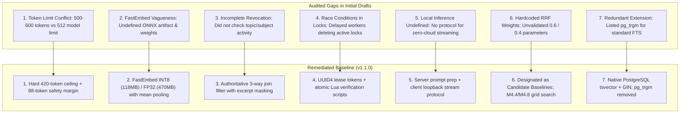

# RagBait Phase 4 — M4.0 Architecture Final Review & Open Risks Synthesis

**Document Version:** 1.0.0  
**Phase:** Phase 4 — AI Study Assistant and Retrieval-Augmented Generation (RAG)  
**Date:** November 22, 2026  
**Status:** Approved Architectural Baseline & Decision Lock  

---

## 1. Executive Summary

Milestone **M4.0** (Architecture, Technical Research, Evaluation and Implementation Planning) establishes the technical blueprint for transforming RagBait’s academic knowledge base into an authoritative, grounded AI study assistant.

Following an exhaustive forensic audit of the 11 initial planning documents and 22 Architectural Decision Records (ADRs), this synthesis records the critical corrections applied, validates integration pathways, locks down cross-document consistency, and certifies the final architectural baseline before entering Milestone **M4.1**.

### Primary Milestone Directives Enforced
1. **Strict Planning Boundary**: Zero application code modified, zero migrations executed, zero dependencies installed, zero external model weights downloaded.
2. **Elimination of Token Contradictions**: Fixed the conflict between the 512-token input limit of `intfloat/multilingual-e5-small` and chunk sizing by adopting a 350–400 token range with a hard 420-token ceiling and 88-token overhead buffer.
3. **Exact Integration Paths**: Verified FastEmbed ONNX Runtime INT8 (~118 MB) and FP32 (~470 MB) artifacts, mean pooling, $L_2$ normalization, and mandatory `"query: "` / `"passage: "` prefixes.
4. **Authoritative Access Revocation**: Formalized live catalog join revalidation across `kb_documents`, `kb_topics`, and `kb_subjects` to mask historical excerpts when materials are moderated.
5. **Concurrency Safety & Safe Release**: Replaced simple Redis keys with UUID4 lease permit tokens and atomic Lua verification scripts, eliminating stale lock deletion races.
6. **Zero-Cloud Private Local Architecture**: Formalized the dual-endpoint local inference flow (`prepare-local` and `finalize-local`), enabling browser streaming from `127.0.0.1:11434` with zero cloud leakage and cloud semaphore bypass.
7. **Complete 4-Stage Provenance Taxonomy**: Established clear boundaries between Retrieval Candidates, Selected Passages, Included Context Evidence, and Referenced Citations.

---

## 2. Technical Gaps Identified and Remediated



### 2.1 Token Arithmetic and Input Boundary Alignment
- **Problem**: Initial drafts specified 500–600-token document chunks. The selected `intfloat/multilingual-e5-small` model has a hard 512-token maximum sequence length. Document passages require the `"passage: "` prefix (2 tokens) and special framing tokens `<s>` and `</s>` (2 tokens). Chunks of 500–600 tokens would be silently truncated by ONNX Runtime, corrupting vector representations.
- **Remediation**:
  - Target chunk size reduced to **350–400 tokens** with 60–80 token overlap.
  - Hard database constraint applied: `chk_chunk_token_ceiling CHECK (token_count <= 420)`.
  - Sentence and clause splitting fallback ensures no long unbroken paragraph exceeds 420 tokens.
  - Arithmetic: $420\text{ (text)} + 2\text{ (prefix)} + 2\text{ (special tokens)} = 424\text{ tokens} \le 512$, leaving a guaranteed **88-token safety margin**.
  - Query prefix `"query: "` (2 tokens) + user prompt ($\le 128$ tokens) $= 130\text{ tokens} \le 512$.

### 2.2 FastEmbed ONNX Runtime Integration Specifics
- **Problem**: FastEmbed integration lacked exact artifact definitions, memory footprints, and pooling instructions.
- **Remediation**:
  - Confirmed native FastEmbed support for `intfloat/multilingual-e5-small`.
  - Quantized INT8 artifact: `model_quantized.onnx` (~118 MB disk footprint, ~250 MB RSS RAM).
  - Unquantized FP32 artifact: `model.onnx` (~470 MB disk footprint, ~650 MB RSS RAM).
  - Pooling: Mean pooling over non-padding tokens with attention mask.
  - Normalization: $L_2$ unit normalization applied to final 384-dimensional vectors.
  - Prefixes: Clean raw text stored in database; `"passage: "` prepended dynamically in memory during batch indexing; `"query: "` prepended during search embedding.

### 2.3 Authoritative Knowledge Base Visibility Revalidation
- **Problem**: Source access checks only verified `kb_documents.is_archived`, neglecting whether the parent topic or subject was deactivated, or whether the document was in a deleted state.
- **Remediation**:
  - Formalized live 3-way join: `kb_documents d JOIN kb_topics t ON t.id = d.topic_id JOIN kb_subjects s ON s.id = d.subject_id`.
  - Visibility condition: `d.is_archived = false AND d.upload_status = 'uploaded' AND d.extraction_status IN ('completed', 'completed_no_text') AND t.is_active = true AND s.is_active = true`.
  - When revoked: `is_available = false`, excerpt is replaced with `"[Source Unavailable — Document Archived or Moderated by Administrator]"`, and `document_viewer_url = null`.

### 2.4 Distributed Concurrency Locks and Stale Release Protection
- **Problem**: Concurrency locks using simple Redis `DEL` are vulnerable to race conditions: if a generation runs slow and its 60s lease expires, a subsequent generation claims the lock. When the first worker finishes, a naive `DEL` deletes the active generation's lock.
- **Remediation**:
  - All locks and semaphore permits require a random UUID4 `lease_token`.
  - Release operations execute an atomic Lua script:
    ```lua
    if redis.call('get', KEYS[1]) == ARGV[1] then
        return redis.call('del', KEYS[1])
    else
        return 0
    end
    ```
  - Active streaming operations execute background heartbeats extending the lease by 60s every 15s.
  - Requests waiting for saturated capacity receive `event: admission_waiting` and poll up to 30s before failing fast with HTTP 429.

### 2.5 Private Local Inference Support
- **Problem**: Initial designs did not specify how Private Local Ollama would interact with server-side hybrid retrieval without leaking data to cloud providers.
- **Remediation**:
  - Dual-endpoint flow: `POST /messages/prepare-local` (server runs hybrid search, budgets context, formats XML prompt) and `POST /messages/finalize-local` (client posts completed text, server reconciles citations and persists snapshot).
  - Client browser streams directly from `http://127.0.0.1:11434` over the loopback interface.
  - Private local requests bypass the `sem:global:cloud` semaphore completely. Zero prompt tokens leave the student's device.

### 2.6 Context Budgeting and Optimistic Compaction
- **Problem**: Previous context allocation lacked explicit guards for XML delimiter overhead and lacked concurrency protection during conversation summarization.
- **Remediation**:
  - Server-authoritative formula: $B_{avail} = C_{model} - (T_{out} + T_{sys} + T_{guard} + T_{safe})$.
  - Evidence budget ceiling capped at $\min(B_{avail} \times 0.60, 4000\text{ tokens})$.
  - Greedy passage selection; omitted passages recorded via `evidence_omitted_count` telemetry.
  - Compaction engine guarded by `lock:summarize:{conversation_id}` and atomic SQL update verifying `WHERE compacted_through_sequence = $old_sequence`.

### 2.7 4-Stage Source Provenance Taxonomy
- **Problem**: The system conflated search results, included context, and generated citations.
- **Remediation**:
  - Formalized 4-stage taxonomy:
    1. Retrieval Candidates ($N=10\text{--}20$, transient RRF pool).
    2. Selected Passages (Top passages fitting $B_{evidence}$).
    3. Included Context Evidence (`included_in_context = true`, stored in `chat_message_sources`).
    4. Referenced Citations (`referenced_in_answer = true`, validated against `[S1]` tokens).
  - UI includes tab toggling between "Referenced in Answer" and "All Considered Context".

### 2.8 Hybrid Search RRF Weights and Core Indexing
- **Problem**: Initial drafts treated $k=60$ and $w_{vec}=0.6, w_{fts}=0.4$ as immutable constants and listed `pg_trgm` as a requirement.
- **Remediation**:
  - $k=60, w_{vec}=0.6, w_{fts}=0.4$ designated as **Candidate Baseline Values** to be optimized via automated grid search against the 50-question golden dataset in M4.4 and M4.8.
  - Removed `pg_trgm`; PostgreSQL native `tsvector` and GIN index provide complete full-text search without external extension dependencies.

---

## 3. Decisions Retained vs. Decisions Changed

| Decision Area | Previous Draft | Remediated Baseline | Status | Primary Rationale |
| :--- | :--- | :--- | :--- | :--- |
| **Embedding Model** | `intfloat/multilingual-e5-small` | `intfloat/multilingual-e5-small` | **Retained** | Superior bilingual performance, 384 dimensions, FastEmbed ONNX support. |
| **Model Runtime** | Local ONNX Runtime | FastEmbed INT8 (118MB) / FP32 (470MB) | **Refined** | Exact asset sizes, mean pooling, $L_2$ norm, and CPU execution locked. |
| **Chunk Token Size** | 500–600 tokens | 350–400 tokens (Hard ceiling 420) | **Changed** | Prevent silent truncation against 512 model limit; 88-token buffer. |
| **Chunking Logic** | Paragraph windowing | Paragraph + Sentence/Clause fallback | **Refined** | Guarantees unbroken paragraphs never exceed the 420-token ceiling. |
| **Storage Architecture** | Supabase pgvector + `pg_trgm` | Supabase pgvector + Core FTS GIN | **Changed** | Removed redundant `pg_trgm`; native `tsvector` handles all keyword search. |
| **RRF Parameters** | Static $k=60, w=0.6/0.4$ | Candidate Baseline (Grid search M4.4) | **Refined** | Prevents dogmatic constants; will be empirically tuned on gold data. |
| **Evidence Snapshot** | `chat_message_sources` | 4-Stage Taxonomy with Boolean Flags | **Refined** | Added `included_in_context` and `referenced_in_answer` fields. |
| **Access Revocation** | Simple document check | Live 3-way join (`docs`+`topics`+`subjects`) | **Changed** | Prevents leakage when parent topics or subjects are deactivated. |
| **Redis Semaphores** | Simple Redis keys | UUID4 Tokens + Atomic Lua Scripts | **Changed** | Prevents stale workers from releasing active subsequent locks. |
| **Admission Queue** | Unspecified waiting | Bounded 30s wait with SSE event | **Refined** | Client receives `event: admission_waiting` before 429 timeout. |
| **Private Local Mode** | Concept only | Dual-endpoint browser loopback stream | **Formalized** | Bypasses cloud semaphore; zero cloud data transmission. |
| **Compaction Safety** | Unspecified locking | Redis Mutex + Optimistic Versioning | **Formalized** | Eliminates race conditions in multi-turn conversation summaries. |

---

## 4. Complete Architectural Invariants Baseline

The following architectural invariants are locked and authoritative across all Phase 4 milestones:

1. **Token Invariant**: No raw text chunk in `kb_document_chunks` shall ever exceed **420 tokens**. Every embedding input shall include `"passage: "` or `"query: "` and special tokens, guaranteeing total sequence length $\le 424 \le 512$.
2. **Provenance Invariant**: Every persisted citation record in `chat_message_sources` shall map to a verified `document_id` with physical `page_number_start` and `page_number_end`.
3. **Isolation Invariant**: Hybrid search queries must enforce `WHERE d.subject_id = p_subject_id`. Cross-subject document retrieval is physically prohibited at the database query level.
4. **Moderation Invariant**: Moderated, archived, or soft-deleted documents, topics, or subjects must immediately mask excerpt text and nullify document viewer links across all historical chat endpoints.
5. **Privacy Invariant**: Study materials and user prompts are never transmitted to external APIs for embedding (server ONNX local). In Private Local mode, zero prompt tokens leave the student's device.
6. **Sharing Invariant**: Private local models and personal paid credentials are never pooled. Community routing selects strictly from verified free-tier credentials (`sharing_scope='community'`).
7. **Concurrency Invariant**: A conversation supports strictly 1 active stream at a time. Per-user concurrency is capped at 2. Global cloud concurrency is capped at 10. Concurrency locks use unique UUID4 tokens and Lua release scripts.
8. **Transcript Invariant**: Compaction and summarization must never delete or mutate original rows in `chat_messages`. Transcripts remain permanent and immutable.

---

## 5. Remaining Technical Assumptions and Manageable Risks

| Risk / Assumption | Impact | Probability | Mitigation Strategy in Implementation | Milestone |
| :--- | :--- | :--- | :--- | :--- |
| **1. FastEmbed ONNX First-Run Download** | Indexing worker startup delay while downloading ~118MB model weights. | Medium | Pre-bake model weights into Docker image or run pre-flight download script during service bootstrap. | M4.3 |
| **2. Scanned PDF Extraction Quality** | Low-quality scanned textbooks yielding OCR noise or garbled text. | Medium | Phase 3 extraction already flags `completed_no_text`; chunking worker ignores non-text pages; RAG evaluation CAT-08 tests hedging. | M4.2 |
| **3. High Memory under 10 Concurrent Streams** | Server memory pressure if 10 streams buffer large responses. | Low | FastAPI `EventSourceResponse` streams directly without buffering full response in memory; token chunks are tiny ($\approx 20\text{ bytes}$). | M4.6 |
| **4. Campus Network SSE Buffering** | Aggressive campus proxy buffering text deltas until stream completion. | Medium | Server sends `X-Accel-Buffering: no` header and flushes whitespace heartbeat comments every 15s. | M4.6 |
| **5. Student Ollama CORS / Mixed Content** | Web app running on HTTPS unable to call `http://127.0.0.1:11434` due to browser mixed content rules. | Medium | In development, local HTTP is permitted; for HTTPS production, configure an optional local proxy or instruct students to set `OLLAMA_ORIGINS="*"`. | M4.6 / M4.7 |
| **6. RRF Weight Sensitivity** | Default $k=60$ suboptimal for acronym-dense technical engineering notes. | Low | Baseline weights will be formally calibrated via grid search on the 50-question golden dataset. | M4.4 / M4.8 |

---

## 6. Formal M4.1 Entry Criteria Checklist

Before any code modification or database migration begins in Milestone **M4.1**, the following pre-conditions must be certified:

- [x] **M4.0 Documentation Complete**: All 12 planning specifications and 22 ADRs in `docs/phase4/` are consistent and remediated.
- [x] **Zero Code Modifications in M4.0**: Working tree has zero unwanted code edits or migration files.
- [x] **Database Baseline Verified**: PostgreSQL 17.12 and pgvector 0.8.2 confirmed operational in local Supabase instance.
- [x] **Redis Connectivity Verified**: Local Redis 7.2 instances (ports 6379 and 6380) verified active.
- [x] **User Working Tree State Preserved**: All uncommitted user changes in `local-inference/` preserved intact.
- [x] **M4.1 Scope Defined**: Clear boundaries established (relational chat persistence, conversation CRUD, cursor pagination, ownership RLS, subject binding; zero streaming, zero vector math).

**Certification**: Milestone **M4.0** is officially closed with all technical gaps resolved and decisions locked. The repository is cleared to proceed with Milestone **M4.1** upon user instruction.
