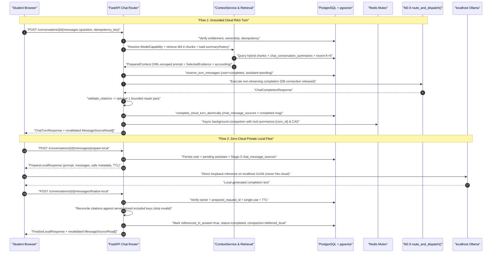

# RagBait Phase 4 — Milestone M4.5 Implementation Report

**Milestone:** M4.5 — Context Manager & Grounded RAG Orchestration  
**Branch:** `phase4`  
**Status:** COMPLETE & VERIFIED (November 25, 2026)  
**Primary Specifications:**
- [CHAT_CONTEXT_AND_GUARDRAILS.md](file:///D:/Projects/RagBait/docs/phase4/CHAT_CONTEXT_AND_GUARDRAILS.md)
- [SOURCES_AND_CITATIONS_DESIGN.md](file:///D:/Projects/RagBait/docs/phase4/SOURCES_AND_CITATIONS_DESIGN.md)
- [API_AND_EVENT_CONTRACTS.md](file:///D:/Projects/RagBait/docs/phase4/API_AND_EVENT_CONTRACTS.md)
- [SECURITY_AND_PRIVACY_THREAT_MODEL.md](file:///D:/Projects/RagBait/docs/phase4/SECURITY_AND_PRIVACY_THREAT_MODEL.md)
- [PHASE4_ROADMAP.md](file:///D:/Projects/RagBait/docs/phase4/PHASE4_ROADMAP.md)

---

## A. Executive Summary

Milestone M4.5 connects RagBait's completed persistent chat infrastructure (M4.1), local multilingual E5 embeddings (M4.3), and subject-scoped hybrid retrieval (M4.4) with the M2.9 inference routing gateway and Private Local Ollama dual-endpoint lifecycle.

Key delivered capabilities:
1. **Database Schema & Immutability Layer** ([20260305000000_m4_5_chat_evidence.sql](file:///D:/Projects/RagBait/supabase/migrations/20260305000000_m4_5_chat_evidence.sql)):
   - Unique partial idempotency index `uq_chat_messages_conv_role_idem` on `public.chat_messages (conversation_id, role, idempotency_key)`.
   - Immutable evidence snapshot table `public.chat_message_sources` enforcing 4-stage provenance flags (`included_in_context`, `referenced_in_answer`), update-immutability trigger `tr_chat_message_sources_immutable`, nullable `ON DELETE SET NULL` FKs paired with immutable `source_chunk_id`/`source_document_id` UUID lineage, and live catalog-gated SELECT RLS.
   - Summary persistence table `public.chat_conversation_summaries` supporting optimistic version control (`summary_version`, `compacted_through_sequence`), durable background status tracking (`idle`, `pending`, `running`, `completed`, `failed`, `deferred_local`), and owner-only RLS.
2. **Server-Authoritative Context Manager** (`apps/api/app/modules/chat/context/`):
   - Authoritative model capability resolution via `public.llm_models`, curated Ollama profiles, and documented conservative ceiling (`4096` tokens) for unlisted local tags.
   - Generation-specific `ModelTokenCounter` cleanly isolated from M4.3's `intfloat/multilingual-e5-small` embedding tokenizer.
   - Deterministic token budget allocator ($B_{avail}$ and $B_{evidence}$), greedy non-blocking evidence packing, turn-atomic recent history retention ($K=6$), XML-escaped prompt builder, and async map-reduce compaction engine with Redis distributed mutex locking and optimistic SQL CAS.
3. **Evidence Provenance, Citation Validation & Revalidation** (`apps/api/app/modules/chat/citations/`):
   - Precise regex parser distinguishing canonical `[S1]`/`[S10]` tags from malformed `[SOURCE1]`/`[s1]`/`[S0]` and non-citation brackets like `arr[S1]` or `[1]`.
   - Validator with bounded single repair pass (`CITATION_REPAIR_ATTEMPTS = 1`) for cloud generation and deterministic stripping for finalized local completions.
   - Live 3-way catalog revalidation endpoint masking archived, deleted, moderation-failed, or inactive topic/subject excerpts.
4. **Synchronous Cloud & Private Local Orchestration** (`apps/api/app/modules/chat/orchestration/` & [router.py](file:///D:/Projects/RagBait/apps/api/app/modules/chat/router.py)):
   - `POST /api/v1/chat/conversations/{conversation_id}/messages`
   - `POST /api/v1/chat/conversations/{conversation_id}/messages/prepare-local`
   - `POST /api/v1/chat/conversations/{conversation_id}/messages/finalize-local`
   - `GET /api/v1/chat/messages/{message_id}/sources`

---

## B. Architecture & Execution Flow

---

## C. Context Budgeting & Token Counting

### 1. Tokenizer Isolation
- Implemented in [token_counter.py](file:///D:/Projects/RagBait/apps/api/app/modules/chat/context/token_counter.py).
- Generation prompt budgeting uses `ModelTokenCounter` delegating to `app.modules.llm_gateway.token_estimation.estimate_text_tokens` (script-aware multilingual upper-bound estimator covering Latin, Bengali/Indic, CJK, math/code symbols, unbroken runs, `+15%` margin, plus structural framing of `+4` tokens/message and `+3` primer).
- Completely isolated from M4.3's `intfloat/multilingual-e5-small` ONNX tokenizer (`apps/api/app/modules/knowledge_base/chunking/tokenizer.py`).

### 2. Server-Authoritative Capability Registry
- Implemented in [model_capabilities.py](file:///D:/Projects/RagBait/apps/api/app/modules/chat/context/model_capabilities.py).
- Resolves `ModelCapability` from `public.llm_models` joined with `public.llm_providers` for cloud and catalog models (ignoring any client-supplied context windows).
- When `model_id` is omitted in `auto`/`cloud_only` mode, `resolve_cloud_model_capability()` probes `discover_cloud_candidates()`, `filter_candidates()`, and `rank_candidates()` upfront so prompt budgets fit the actual selected free/eligible model (for example `openrouter/meta-llama/llama-3.3-70b-instruct:free`).
- Supports curated Ollama profiles (`llama3.2:3b`, `llama3.1:8b`, `qwen2.5-coder:7b`, `qwen2.5:7b`, `mistral:7b`, `gemma2:9b`) and applies a documented conservative ceiling (`4096` context, `1024` output, `256` safety margin) for unlisted custom local tags.

### 3. Deterministic Budget Allocation & Packing
- Implemented in [budget.py](file:///D:/Projects/RagBait/apps/api/app/modules/chat/context/budget.py).
- Computes working headroom via:
  $$C_{model} = \min(\text{recommended\_budget}, \text{context\_window})$$
  $$B_{avail} = C_{model} - (T_{out} + T_{sys} + T_{guard} + T_{safe})$$
- Prioritizes the student's current question (`T_user`) without silent truncation; raises HTTP `422` (`PROMPT_BUDGET_EXCEEDED`) when $B_{avail} \le 0$ or $T_{user} > B_{avail}$.
- Computes evidence allowance over remaining working budget ($B_{rem1} = B_{avail} - T_{user}$):
  $$B_{evidence} = \min\left(\lfloor B_{rem1} \times 0.60 \rfloor, 4000\right)$$
- Packs Stage-1 candidate chunks greedily in retrieval rank order without chunk truncation, deduplicating by `(chunk_id, content_hash)` and continuing past oversized candidates so smaller ranked chunks still fit (non-blocking selection).
- Fits optional `<conversation_summary>` and recent completed turns atomically as `(user, assistant)` pairs (`_group_history_into_turns`), enforcing the hard invariant `total_input_token_count + reserved_output_tokens <= C_model`.

---

## D. Conversation Compaction & History Management

Implemented in [history.py](file:///D:/Projects/RagBait/apps/api/app/modules/chat/context/history.py) and [compaction.py](file:///D:/Projects/RagBait/apps/api/app/modules/chat/context/compaction.py):

1. **Verbatim Retention & Non-Destructive Storage**:
   - Retains the latest $K = 6$ completed messages verbatim (`SUMMARY_RETAIN_MESSAGES = 6`) and never deletes or mutates rows in `public.chat_messages`.
   - Compacts strictly completed messages at or before `(max_seq - K)` when uncompacted volume exceeds trigger thresholds (`SUMMARY_TRIGGER_MIN_MESSAGES = 10` or `SUMMARY_TRIGGER_TOKEN_THRESHOLD = 1500`).
2. **Distributed Redis Mutex with UUID4 Lease & Lua Scripts**:
   - Acquires `lock:summarize:{conversation_id}` using atomic `SET NX EX` (`SUMMARY_LOCK_TTL_SECONDS = 30`).
   - Releases and renews exclusively via atomic Lua compare-and-delete (`_RELEASE_LOCK_LUA`) and compare-and-expire (`_RENEW_LOCK_LUA`) matched against the caller's UUID4 `lease_token`, preventing stale workers from unlocking newer owners.
   - Degrades gracefully when Redis is unavailable by relying on PostgreSQL optimistic version guards.
3. **Optimistic SQL CAS & Durable Recovery**:
   - Writes summaries atomically with:
     `WHERE conversation_id = $6 AND summary_version = $7 AND compacted_through_sequence = $8 AND compacted_through_sequence < $2`.
   - Out-of-order stale runs detect version/sequence mismatch and discard cleanly (`conflict_discarded`).
   - Failed runs increment `retry_count` and store sanitized `last_error`; `recover_pending_compactions()` picks up pending/retry-eligible jobs (`retry_count < SUMMARY_MAX_RETRIES`).
4. **Private Local Privacy Boundary**:
   - Private Local conversations (`is_private_local=True`) never invoke cloud inference for summarization; when no local summarizer is supplied, state transitions to `compaction_status = 'deferred_local'`.

---

## E. Grounding, XML Escaping & Prompt-Injection Defense

Implemented in [formatter.py](file:///D:/Projects/RagBait/apps/api/app/modules/chat/context/formatter.py) and [prompt_builder.py](file:///D:/Projects/RagBait/apps/api/app/modules/chat/context/prompt_builder.py):

- **Control-Byte & XML Entity Sanitization**: `sanitize_xml_text()` strips disallowed control bytes (`\x00-\x08`, `\x0b`, `\x0c`, `\x0e-\x1f`, `\x7f`) and escapes `<`, `>`, `&`, `"`, and `'` so untrusted passage text or student prompts cannot close or spoof structural XML blocks (`</study_context_evidence>`, `<source>`, `<system_instructions>`).
- **Explicit Trust Envelopes**:
  - System role carries trusted `<system_instructions>` (core academic grounding rules + prompt-injection guardrails).
  - Unverified study passages sit inside `<study_context_evidence trust_level="untrusted_reference_data">` with server-assigned `<source id="S1">`, `<document_title>`, `<physical_pages>`, and `<content>`.
  - Historical memory sits inside `<conversation_summary trust_level="historical_memory_only" citable="false">`.
  - Current question sits inside `<user_query trust_level="untrusted_user_input">`.
- **Empty-Evidence Abstention**: When retrieval yields zero passages or none pass budget/provenance checks, `NO_EVIDENCE_ADDENDUM` instructs the model to abstain and emit zero `[S*]` citations.

---

## F. 4-Stage Source Provenance, Citation Validation & Live Revalidation

Implemented in [parser.py](file:///D:/Projects/RagBait/apps/api/app/modules/chat/citations/parser.py), [validator.py](file:///D:/Projects/RagBait/apps/api/app/modules/chat/citations/validator.py), and [source_repository.py](file:///D:/Projects/RagBait/apps/api/app/modules/chat/citations/source_repository.py):

1. **4-Stage Provenance Model**:
   - **Stage 1 (Candidate Pool)**: `RetrievalService.retrieve_subject_chunks()` returns ranked M4.4 candidates (`RETRIEVAL_CANDIDATE_POOL_LIMIT = 15`); count tracked in telemetry (`retrieval_candidate_count`).
   - **Stage 2 (Selected Budgeted Set)**: Context allocator fits verified chunks into `B_evidence`; omitted count tracked as `evidence_omitted_count`.
   - **Stage 3 (Included Context)**: Persisted immutably into `public.chat_message_sources` with `included_in_context = true` and `referenced_in_answer = false` (at completion for cloud, or upfront at `prepare-local` for Private Local).
   - **Stage 4 (Referenced in Answer)**: Verified citations flip `referenced_in_answer = true` strictly for keys present in server-persisted Stage-3 rows.
2. **Regex Citation Parsing & Bounded Repair**:
   - `parse_citations()` matches `(?<![A-Za-z0-9_])\[(S[1-9][0-9]*)\]` so `[S10]` never collides with `[S1]`, while identifier indexing like `arr[S1]` and prose numbers `[1]` are ignored cleanly.
   - Detects malformed tags (`[SOURCE1]`, `[s1]`, `[S0]`, `[S-1]`, `[S 1]`, comma-lists `[S1, S2]`).
   - For Cloud mode, invalid or hallucinated tags trigger at most one repair pass (`CITATION_REPAIR_ATTEMPTS = 1`); persistent invalid citations fail atomically with HTTP `422` (`CITATION_VALIDATION_FAILED`) and transition the assistant message to `status = 'failed'`.
   - For Private Local finalization (`finalize-local`), unknown/malformed citations are stripped deterministically via `strip_invalid_citations()` without making any cloud API call.
3. **Immutable Snapshots & Live Visibility Revalidation**:
   - Before-update trigger `tr_chat_message_sources_immutable` rejects any alteration to `citation_key`, `source_chunk_id`, `source_document_id`, `document_title_snapshot`, page spans, `excerpt`, `content_hash`, `chunk_version`, `retrieval_rank`, `relevance_score`, or `included_in_context`.
   - `chunk_id` and `document_id` use nullable `ON DELETE SET NULL` FKs alongside `NOT NULL source_chunk_id` and `source_document_id`, ensuring chunk deletion during re-indexing keeps historical snapshots accessible while document deletion cleanly masks the historical excerpt.
   - `get_message_sources_with_revalidation()` and RLS policy `p_chat_msg_sources_select` verify owner + approved profile + live `kb_documents`, `kb_topics`, and `kb_subjects` visibility. Unavailable items return `is_available = false`, `excerpt = "[Source Unavailable — Document Archived or Moderated by Administrator]"`, and `document_viewer_url = None`.

---

## G. Generation Gateway & Private Local Integration

Implemented in [generation.py](file:///D:/Projects/RagBait/apps/api/app/modules/chat/orchestration/generation.py), [persistence.py](file:///D:/Projects/RagBait/apps/api/app/modules/chat/orchestration/persistence.py), and [service.py](file:///D:/Projects/RagBait/apps/api/app/modules/chat/orchestration/service.py):

- **Single Cloud Dispatch Path**: `execute_grounded_cloud_generation()` delegates exclusively to `app.modules.routing.service.route_and_dispatch()` with `community_opt_in=False`, preserving all M2.9 credential vault, quota, billing-tier, and fallback policies without duplicating adapters.
- **Connection Pool Discipline**: `_borrow_conn()` acquires a pool connection for pre-LLM retrieval/reservation, releases it before upstream cloud HTTP inference, and re-acquires for post-LLM atomic completion/failure transitions.
- **Idempotency & Recovery**:
  - Replaying a completed `idempotency_key` with matching content returns the stored turn without re-invoking the LLM.
  - Reusing an `idempotency_key` with different content raises HTTP `409` (`IDEMPOTENCY_KEY_CONFLICT`).
  - Retrying a prior `failed` turn creates a fresh pending assistant row without duplicating the original `user` message.
- **Private Local Isolation**:
  - `prepare_local_chat_turn()` persists Stage-3 snapshots upfront and returns XML prompt + serialized `messages` + `prepared_request_id` + `expires_at` (`PREPARED_LOCAL_TTL_SECONDS = 600`), making zero cloud calls.
  - `finalize_local_chat_turn()` locks the pending message `FOR UPDATE`, verifies ownership, `mode = 'private_local'`, `prepared_request_id`, pending state (`ALREADY_FINALIZED` on replay), and TTL expiration (`PREPARED_REQUEST_EXPIRED`), and ignores any client-supplied source metadata.

---

## H. Configuration & Environment Variables

Defined in [config.py](file:///D:/Projects/RagBait/apps/api/app/modules/chat/context/config.py) via `ContextSettings` (`env_prefix = "RAGBAIT_"`):

| Environment Variable | Default | Allowed Range | Description |
|---|---:|---|---|
| `RAGBAIT_CONTEXT_SAFETY_MARGIN` | `512` | `0..8192` | Reserved safety cushion tokens ($T_{safe}$) per turn |
| `RAGBAIT_CONTEXT_OUTPUT_RESERVE` | `2048` | `128..32768` | Default reserved completion output tokens ($T_{out}$) |
| `RAGBAIT_CONTEXT_EVIDENCE_RATIO` | `0.60` | `(0.0, 0.90]` | Max fraction of $B_{rem1}$ allocated to retrieved evidence |
| `RAGBAIT_CONTEXT_MAX_EVIDENCE_TOKENS` | `4000` | `256..32000` | Hard upper token ceiling ($B_{evidence}$) for evidence blocks |
| `RAGBAIT_CONTEXT_RECENT_MESSAGES` | `6` | `2..20` | Verbatim recent message target window |
| `RAGBAIT_CONTEXT_HISTORY_FETCH_LIMIT` | `40` | `6..100` | Max uncompacted history rows scanned per turn |
| `RAGBAIT_RETRIEVAL_CANDIDATE_POOL_LIMIT` | `15` | `5..30` | Candidate chunks requested from M4.4 hybrid retrieval |
| `RAGBAIT_SUMMARY_RETAIN_MESSAGES` | `6` | `2..20` | Latest completed messages kept verbatim outside compaction |
| `RAGBAIT_SUMMARY_MAX_TOKENS` | `500` | `100..2000` | Max output token budget reserved for summary generation |
| `RAGBAIT_SUMMARY_TRIGGER_MIN_MESSAGES` | `10` | `6..100` | Min uncompacted completed messages before scheduling compaction |
| `RAGBAIT_SUMMARY_TRIGGER_TOKEN_THRESHOLD` | `1500` | `200..16000` | Uncompacted history token threshold triggering compaction |
| `RAGBAIT_SUMMARY_SEGMENT_MAX_TOKENS` | `1200` | `300..8000` | Chunk segment ceiling for map-reduce summary passes |
| `RAGBAIT_SUMMARY_LOCK_TTL_SECONDS` | `30` | `5..300` | Redis distributed compaction mutex TTL in seconds |
| `RAGBAIT_SUMMARY_MAX_RETRIES` | `3` | `1..10` | Max automatic recovery retries for failed compactions |
| `RAGBAIT_CITATION_REPAIR_ATTEMPTS` | `1` | `0..2` | Bounded cloud repair attempts when invalid citations occur |
| `RAGBAIT_PREPARED_LOCAL_TTL_SECONDS` | `600` | `60..3600` | Private Local prepared-context finalization lease TTL |

---

## I. Security Guarantees & Verification Results

### Static Analysis & Typing
- `uv run ruff format app/modules/chat/ tests/test_m4_5_*.py` — passed (`29 files left unchanged`).
- `uv run ruff check app/modules/chat/ tests/test_m4_5_*.py` — passed (`All checks passed!`).
- `uv run mypy app/modules/chat/` — passed (`Success: no issues found in 26 source files`, strict mode).

### Database Test Suite (`npx supabase test db`)
- Executed against local Supabase PostgreSQL (`127.0.0.1:54322`):
  - **Result**: `PASS` — **16/16 test files**, **341/341 subtests passed**.
  - Includes [m4_5_evidence_and_summaries_test.sql](file:///D:/Projects/RagBait/supabase/tests/m4_5_evidence_and_summaries_test.sql) (`31/31` subtests verifying schema, indexes, RLS isolation, update immutability, PostgREST archived-document masking, and optimistic compaction CAS).

### M4.5 Backend Test Suites (`uv run pytest ... -v`)
- Executed [test_m4_5_context_budget.py](file:///D:/Projects/RagBait/apps/api/tests/test_m4_5_context_budget.py), [test_m4_5_citations_and_compaction.py](file:///D:/Projects/RagBait/apps/api/tests/test_m4_5_citations_and_compaction.py), and [test_m4_5_orchestration_e2e.py](file:///D:/Projects/RagBait/apps/api/tests/test_m4_5_orchestration_e2e.py) against live PostgreSQL + Redis + FastEmbed ONNX (`route_and_dispatch` mocked for cloud turns):
  - **Result**: **22/22 passed in 3.76s**.
  - Covers capability registry & unknown rejection, tokenizer isolation, budget arithmetic & 4,000-token cap, overflow 422 errors, non-blocking greedy selection & determinism, XML breakout injection defense, Bengali/Hindi + empty abstention, turn-atomic history retention, citation regex precision/validation, summary sanitization/compaction/Redis lease CAS, E2E cloud RAG + idempotency + retry recovery, bounded citation repair/failure transitions, pre-LLM authorization/entitlement rejections, Private Local prepare/finalize lifecycle, and live historical source revalidation/masking.

### Regression & Full Suite (`uv run pytest`)
- Targeted regression suites (`test_chat_persistence.py`, `test_kb_chunking.py`, `test_kb_embeddings.py`, `test_kb_retrieval.py`, `test_m3_5_admin_moderation.py`):
  - **Result**: **55/55 passed in 11.56s**.
- Full backend suite (`uv run pytest tests/ -q --tb=line`):
  - **Result**: **397 passed, 4 skipped, 4 failed in 90.25s** (exit code `1`).
  - The **only 4 failures** are pre-existing user WIP tests in `apps/api/tests/test_community_inference.py` (`test_pairing_code_and_node_registration`, `test_node_management_and_isolation`, `test_dual_consent_and_job_submission`, `test_sse_stream_authentication_and_authorization`) asserting HTTP `410`. All 9 pre-existing user-owned files remained bit-identical (verified by SHA-256) and unstaged.

---

## J. Risks, Known Limitations & M4.6 Handoff

1. **Token Estimation Conservatism**: Without model-specific native BPE tokenizers loaded in-process, `ModelTokenCounter` relies on `estimate_text_tokens` (conservative `+15%` safety factor + framing overhead). Future milestones may plug exact model tokenizers cleanly into `ModelTokenCounter` while retaining the conservative fallback.
2. **Deferred Compaction for Private Local**: While Private Local finalization (`finalize-local`) correctly avoids calling cloud models by marking compaction `deferred_local`, automated background compaction inside the browser Ollama session is left for client/UI orchestration in M4.6/M4.7.
3. **Synchronous Cloud Execution**: `POST /api/v1/chat/conversations/{id}/messages` currently executes synchronously as JSON (`ChatTurnResponse`). M4.6 remains open to introduce SSE streaming (`text/event-stream`), cancellation endpoints, Redis concurrency semaphores (1/conversation, 2/user, 10/global), and bounded admission queues, while M4.7 remains open for the student chat UI and Sources & Context panel.
4. **Database Local Migration History**: As noted during preflight, local pre-M4.5 migrations (`20260303000000`, `20260304000000`) existed in schema without ledger rows; `20260305000000_m4_5_chat_evidence.sql` was applied transactionally and recorded cleanly in `supabase_migrations.schema_migrations`. Avoid destructive `supabase db reset` on the local volume without preserving M4.2–M4.5 ledger alignment.
