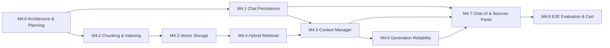

# RagBait Phase 4 — Implementation Roadmap (M4.0 – M4.8)

**Document Version:** 1.0.0  
**Phase:** Phase 4 — AI Study Assistant and Retrieval-Augmented Generation (RAG)  
**Date:** November 22, 2026  
**Status:** Approved Roadmap Plan  

---

## 1. Roadmap Overview & Phased Progression

Phase 4 transforms RagBait's academic knowledge base into an interactive, grounded AI study assistant. The implementation follows a strict 9-milestone progression, ensuring each component is verified before downstream integration.



---

## 2. Detailed Milestone Specifications

### Milestone M4.0 — Architecture, Technical Research & Evaluation Specification
- **Objective**: Complete systematic investigation, technical research, architecture design, and milestone planning without touching application code.
- **Scope**: Production of all 11 architecture specifications in `docs/phase4/`, ADRs 01–22, and evaluation framework.
- **Dependencies**: Verified Phase 3 release baseline (`7e24743` / `main`).
- **Database Changes**: NONE (Planning only).
- **Backend Changes**: NONE.
- **Frontend Changes**: NONE.
- **Security Considerations**: Reviewing multi-tenant isolation, RLS rules, and prompt-injection threat vectors.
- **Testing**: Pre-flight verification of existing test suites across `apps/api` and `apps/web`.
- **Acceptance Criteria**: All 11 planning artifacts written, mutually consistent, reviewed, and approved. Zero code or migration changes.
- **Exclusions**: Any implementation code or database alterations.

---

### Milestone M4.1 — Chat Persistence and Conversation Management
- **Objective**: Implement durable multi-conversation storage, message history, and ownership enforcement.
- **Scope**:
  - Database tables: `chat_conversations` and `chat_messages`.
  - Conversation CRUD: create, list, rename, archive, delete, search.
  - Message pagination with cursor-based ordering (`sequence_number`).
  - Strict subject binding: every conversation must belong to an active `kb_subjects.id`.
- **Dependencies**: M4.0 approved data model.
- **Database Changes**: Migration `20260301000000_m4_1_chat_persistence.sql` creating `chat_conversations` and `chat_messages` with foreign keys, indexes, and RLS policies.
- **Backend Changes**: New module `apps/api/app/modules/chat/` with repository, service, router (`/api/v1/chat/conversations`), and schemas.
- **Frontend Changes**: Conversation sidebar API hooks, initial chat route skeleton `/chat/[id]`.
- **Security Considerations**:
  - RLS policies ensuring users can only read and write their own conversations (`user_id = auth.uid()`).
  - Validation that `subject_id` references an active, non-archived subject.
- **Testing**:
  - Backend unit & integration tests (`test_chat_persistence.py`, `test_chat_ownership.py`).
  - Database pgTAP test (`supabase/tests/m4_1_chat_persistence_test.sql`).
- **Acceptance Criteria**:
  - User can create multiple conversations within a subject.
  - Conversations cannot switch subjects.
  - Messages maintain monotonic sequential ordering.
  - Users cannot access another student's conversations.
- **Exclusions**: LLM streaming, vector retrieval, or citation linking.

---

### Milestone M4.2 — Page-Aware Chunking and Durable Indexing Lifecycle
- **Objective**: Implement deterministic page-aware document chunking and the asynchronous indexing job daemon.
- **Scope**:
  - Deterministic chunking algorithm preserving physical PDF page ranges.
  - Chunk table: `public.kb_document_chunks` with `page_number_start`, `page_number_end`, `content_hash`.
  - Durable job table: `public.kb_indexing_jobs` with lease token and `SKIP LOCKED`.
  - Indexing worker daemon (`apps/api/app/modules/knowledge_base/indexing_worker.py`).
  - Automatic indexing trigger when document extraction completes (`completed`).
- **Dependencies**: M4.0 chunking specification, Phase 3 `kb_document_pages`.
- **Database Changes**: Migration `20260302000000_m4_2_chunking_and_indexing.sql` creating `kb_document_chunks` and `kb_indexing_jobs`.
- **Backend Changes**: Chunking utility, indexing repository, worker process, extraction hook.
- **Frontend Changes**: Admin Document moderation view showing chunk count and indexing job status badge.
- **Security Considerations**:
  - Fencing: If a document is archived or soft-deleted while indexing, the worker aborts without committing chunks.
  - Idempotency: Duplicate chunking runs on the same document version delete old chunks before inserting new ones.
- **Testing**:
  - Chunking unit tests (`test_page_aware_chunking.py`).
  - Worker lifecycle & lease tests (`test_indexing_worker.py`).
  - pgTAP test (`supabase/tests/m4_2_indexing_lifecycle_test.sql`).
- **Acceptance Criteria**:
  - 100% of chunks maintain physical page provenance.
  - Retrying an indexing job produces 0 duplicate chunks.
  - Worker crash recovers automatically upon lease expiration.
- **Exclusions**: Embedding generation or vector math.

---

### Milestone M4.3 — Embedding Infrastructure and Vector Storage
- **Objective**: Enable pgvector in PostgreSQL and integrate the local embedding model (`intfloat/multilingual-e5-small`).
- **Scope**:
  - PostgreSQL vector extension activation (`CREATE EXTENSION IF NOT EXISTS vector WITH SCHEMA extensions`).
  - Table: `public.kb_chunk_embeddings` with `embedding extensions.vector(384)`.
  - Local embedding runner using ONNX Runtime / `fastembed` running server-side on CPU.
  - Batch embedding generation within the indexing worker.
  - Query embedding function for search runtime.
- **Dependencies**: M4.2 chunks in database.
- **Database Changes**: Migration `20260303000000_m4_3_pgvector_storage.sql` enabling vector extension and creating `kb_chunk_embeddings`.
- **Backend Changes**: New module `app/modules/rag/embedding.py` with ONNX model loader, batch embedder, and vector repository.
- **Frontend Changes**: None.
- **Security Considerations**:
  - Zero external cloud transmission of raw study text during embedding.
  - Zero peer compute or student laptop pooling.
- **Testing**:
  - Embedding consistency tests (`test_embedding_service.py`).
  - Dimension and normalization verification (cosine similarity = inner product).
  - pgTAP test (`supabase/tests/m4_3_vector_storage_test.sql`).
- **Acceptance Criteria**:
  - Embedded vectors have exact 384 dimensions, normalized to unit length.
  - Embedding generation throughput exceeds 15 chunks/second on 4 CPU cores.
  - Vector similarity search returns top matching passage correctly.
- **Exclusions**: Hybrid search or prompt construction.

---

### Milestone M4.4 — Hybrid Retrieval and Subject Scoping
- **Objective**: Implement hybrid semantic and keyword retrieval using Reciprocal Rank Fusion (RRF).
- **Scope**:
  - PostgreSQL Full-Text Search indexing on `kb_document_chunks.raw_text`.
  - Database search function / RPC: `search_subject_chunks(subject_id, query_vec, query_text, limit)`.
  - RRF ranking combining vector cosine distance and `tsvector` keyword matching ($k=60$).
  - Active document visibility fencing: excludes archived topics, inactive subjects, or moderated documents.
- **Dependencies**: M4.3 embeddings and chunks.
- **Database Changes**: Migration `20260304000000_m4_4_hybrid_search.sql` adding GIN text index and `match_subject_chunks` SQL function.
- **Backend Changes**: RAG retrieval service (`app/modules/rag/retrieval.py`) executing hybrid query and formatting candidate passages.
- **Frontend Changes**: None.
- **Security Considerations**:
  - Mandatory `subject_id` filter prevents cross-subject data leakage.
  - Unapproved or deleted documents are excluded at the SQL query level.
- **Testing**:
  - Hybrid search precision tests (`test_hybrid_retrieval.py`).
  - Acronym, formula, and exact keyword recovery tests.
  - pgTAP test (`supabase/tests/m4_4_hybrid_retrieval_test.sql`).
- **Acceptance Criteria**:
  - Exact technical terms rank in the top 3 results even when semantic similarity is moderate.
  - Search latency remains under 35ms for a 10,000-chunk corpus.
  - Zero results returned from subjects outside the query's `subject_id`.
- **Exclusions**: LLM answer generation.

---

### Milestone M4.5 — Context Manager and Grounded RAG Orchestration
- **Objective**: Implement server-side prompt construction, model context budgeting, sliding-window compaction, and citation validation.
- **Scope**:
  - Model capability registry (context limits, output reserves, tokenizer factors).
  - Deterministic context budget formula allocating tokens across system instructions, summary, history, and retrieved evidence.
  - Asynchronous conversation summarization for turns older than $K=6$.
  - Prompt construction assigning citation identifiers `[S1]`, `[S2]` to selected evidence chunks.
  - Citation validator ensuring generated citations match supplied sources.
  - Evidence snapshot persistence in `public.chat_message_sources`.
- **Dependencies**: M4.1 chat persistence, M4.4 hybrid retrieval.
- **Database Changes**: Migration `20260305000000_m4_5_chat_evidence.sql` creating `chat_message_sources` and `chat_conversation_summaries`.
- **Backend Changes**: Context manager (`app/modules/chat/context.py`), summarization worker, and prompt builders.
- **Frontend Changes**: None.
- **Security Considerations**:
  - Strict prompt-injection delimiters separating untrusted document text from system instructions.
  - Rejection of hallucinated citation IDs that do not map to verified chunks.
- **Testing**:
  - Context budget overflow tests (`test_context_budgeting.py`).
  - Summarization accuracy and retention tests (`test_chat_compaction.py`).
  - Citation validator tests (`test_citation_validation.py`).
- **Acceptance Criteria**:
  - Generated prompts never exceed provider context limits.
  - Original user and assistant messages remain durable across summarization.
  - 100% of persisted citation records map to real database chunks and physical pages.
- **Exclusions**: Real-time client streaming.

---

### Milestone M4.6 — Generation Reliability and Load Control
- **Objective**: Implement SSE streaming, request cancellation, Redis-backed concurrency limits, and retry recovery.
- **Scope**:
  - Server-Sent Events (SSE) streaming endpoint: `POST /api/v1/chat/conversations/{id}/messages`.
  - Cancellation endpoint: `POST /api/v1/chat/conversations/{id}/messages/{msg_id}/cancel`.
  - Redis distributed concurrency semaphores (max 1 generation per conversation, max 2 per user, max 10 global).
  - Bounded request queue with 30s timeout and clear user feedback.
  - Safe error recovery and partial stream persistence on client disconnect.
- **Dependencies**: M4.5 orchestration, Phase 2 routing engine.
- **Database Changes**: Minor index additions for pending message state tracking.
- **Backend Changes**: Chat streaming router, cancellation handler, Redis semaphore wrapper.
- **Frontend Changes**: None.
- **Security Considerations**:
  - Concurrency locks prevent interleaved responses in the same conversation.
  - Abort signals release provider connections and Redis leases immediately.
- **Testing**:
  - Concurrency lease tests (`test_chat_concurrency.py`).
  - Cancellation race tests (`test_chat_cancellation.py`).
  - Client disconnect cleanup tests.
- **Acceptance Criteria**:
  - Concurrent requests within the same conversation are rejected with HTTP 409 Conflict.
  - Cancelling a stream stops token emission within 250ms and saves partial text.
  - Concurrency leases automatically expire after 60s to prevent deadlocks.
- **Exclusions**: Final frontend UI polishing.

---

### Milestone M4.7 — Student AI Chat Interface & Sources & Context Panel
- **Objective**: Build the full student-facing chat UI, conversation sidebar, citation tags, and Sources & Context drawer.
- **Scope**:
  - Responsive Chat UI at `/chat/[id]` and `/chat`.
  - Left sidebar: conversation list grouped by subject, new chat action, search, rename, delete.
  - Subject picker modal when creating a new chat.
  - Real-time SSE streaming reader with markdown, tables, and code blocks.
  - Clickable citation chips (`[S1]`, `[S2]`) highlighting referenced source cards.
  - **Sources & Context drawer** showing title, page number, exact excerpt, and "Open Document at Page X" action.
  - Direct document viewer jump: opens `/knowledge-base/document/[id]?page=X` in a new tab or split view.
  - Context limit warning badge when conversations approach capacity.
- **Dependencies**: M4.1–M4.6 backend endpoints.
- **Database Changes**: None.
- **Backend Changes**: None.
- **Frontend Changes**: New pages and components in `apps/web/src/app/(protected)/chat/` and `apps/web/src/components/chat/`.
- **Security Considerations**:
  - Sanitization of markdown and code blocks to prevent XSS.
  - Document viewing relies on existing authorized time-limited download URLs.
- **Testing**:
  - React Testing Library & Vitest component tests (`ChatInterface.test.tsx`, `SourcesPanel.test.tsx`, `CitationRenderer.test.tsx`).
  - Mobile responsiveness and drawer toggle tests.
- **Acceptance Criteria**:
  - Clicking a citation chip highlights the corresponding source in the drawer.
  - Clicking "Open Document at Page X" loads the document viewer on that physical page.
  - Student can create, switch, and delete conversations cleanly.
- **Exclusions**: End-to-end certification benchmarks.

---

### Milestone M4.8 — RAG Quality Evaluation, Security Audit & Release Certification
- **Objective**: Execute golden dataset evaluation, load testing, security review, and certify Phase 4 release.
- **Scope**:
  - 50-question golden dataset evaluation covering multiple subjects and edge cases.
  - Retrieval metrics calculation: Recall@5, Precision@5, MRR.
  - Generation metrics calculation: Groundedness/Faithfulness, Citation Precision, Abstention.
  - Multi-user load testing: 5, 10, and 20 simultaneous streaming generations.
  - Security audit: multi-tenant RLS verification, prompt-injection defense, revoked access fencing.
  - Production release certification document (`docs/M4_RELEASE_CERTIFICATION.md`).
- **Dependencies**: M4.1 through M4.7 fully implemented.
- **Database Changes**: None.
- **Backend Changes**: None.
- **Frontend Changes**: None.
- **Security Considerations**: Full pen-test for cross-user conversation leaks and storage URL tampering.
- **Testing**: Full regression test across backend pytest, frontend vitest, Supabase pgTAP, and evaluation scripts.
- **Acceptance Criteria**:
  - Recall@5 $\ge$ 80% on golden dataset.
  - Citation Validity = 100% (zero orphan citation links).
  - Abstention on unanswerable questions $\ge$ 90%.
  - Zero cross-user or cross-subject data leakage.
  - All automated tests pass with 0 errors.
- **Exclusions**: Future Phase 5 multimodal or quiz features.

---

## 3. Parallelization & Implementation Timeline

```text
Milestone Sequence:
M4.0 (Planning) ─────────────────────────► Complete
  │
  ├──► M4.1 (Chat Persistence DB & API) ────────┐
  │                                             │
  └──► M4.2 (Chunking & Indexing Daemon) ───┐   │
         │                                  │   │
         └──► M4.3 (pgvector & Embedding) ──┤   │
                │                           │   │
                └──► M4.4 (Hybrid Search) ──┴───┼──► M4.5 (Context Mgr & Guardrails)
                                                │      │
                                                │      └──► M4.6 (Load Control & SSE)
                                                │             │
                                                └─────────────┴──► M4.7 (Chat UI & Sources)
                                                                     │
                                                                     └──► M4.8 (Eval & Cert)
```
