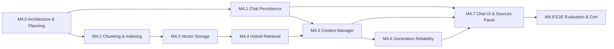

# RagBait Phase 4 — Implementation Roadmap (M4.0 – M4.8)

**Document Version:** 1.1.0  
**Phase:** Phase 4 — AI Study Assistant and Retrieval-Augmented Generation (RAG)  
**Date:** November 22, 2026  
**Status:** Approved Roadmap Plan (Remediated Baseline)  

---

## 1. Roadmap Overview & Phased Progression

Phase 4 transforms RagBait's academic knowledge base into an interactive, grounded AI study assistant. The implementation follows a strict 9-milestone progression, ensuring each component is verified before downstream integration.

---

## 2. Detailed Milestone Specifications

### Milestone M4.0 — Architecture, Technical Research & Evaluation Specification
- **Objective**: Complete systematic investigation, technical research, architecture design, and milestone planning without touching application code.
- **Scope**: Production of all 12 architecture specifications in `docs/phase4/`, ADRs 01–22, and evaluation framework.
- **Dependencies**: Verified Phase 3 release baseline (`7e24743` / `main`).
- **Database Changes**: NONE (Planning only).
- **Backend Changes**: NONE.
- **Frontend Changes**: NONE.
- **Security Considerations**: Reviewing multi-tenant isolation, RLS rules, and prompt-injection threat vectors.
- **Testing**: Pre-flight verification of existing test suites across `apps/api` and `apps/web`.
- **Acceptance Criteria**: All 12 planning artifacts written, mutually consistent, reviewed, and approved. Zero code or migration changes.
- **Exclusions**: Any implementation code or database alterations.

---

### Milestone M4.1 — Chat Persistence and Conversation Management (Completed)
- **Status**: COMPLETE & VERIFIED (November 23, 2026)
- **Objective**: Implement durable multi-conversation storage, message history, and ownership enforcement.
- **Scope**:
  - Database tables: `chat_conversations` and `chat_messages`.
  - Conversation CRUD: create, list, rename, archive, delete, search.
  - Message pagination with cursor-based ordering (`sequence_number`).
  - Strict subject binding: every conversation must belong to an active `kb_subjects.id`.
- **Dependencies**: M4.0 approved data model.
- **Database Changes**: Migration `20260301000000_m4_1_chat_persistence.sql` creating `chat_conversations` and `chat_messages` with foreign keys, indexes, and RLS policies.
- **Backend Changes**: New module `apps/api/app/modules/chat/` with repository, service, router (`/api/v1/chat/conversations`), and schemas.
- **Frontend Changes**: Conversation sidebar, management modals (new/rename/delete), message history viewer (`/chat` and `/chat/[id]`), and direct study chat integration in knowledge base.
- **Security Considerations**:
  - RLS policies ensuring users can only read and write their own conversations (`user_id = auth.uid()`).
  - Validation that `subject_id` references an active, non-archived subject.
- **Testing**:
  - Backend integration tests (`apps/api/tests/test_chat_persistence.py` - 11/11 passed).
  - Database pgTAP test (`supabase/tests/m4_1_chat_persistence_test.sql` - 28/28 passed).
  - Frontend Vitest suite (`apps/web/tests/chat/` - 19/19 passed).
- **Acceptance Criteria**:
  - User can create multiple conversations within a subject.
  - Conversations cannot switch subjects.
  - Messages maintain monotonic sequential ordering.
  - Users cannot access another student's conversations.
- **Exclusions**: LLM streaming, vector retrieval, or citation linking.

---

### Milestone M4.2 — Page-Aware Chunking and Durable Indexing Lifecycle (Completed)
- **Status**: COMPLETE & VERIFIED (November 23, 2026)
- **Objective**: Implement deterministic page-aware document chunking and the asynchronous indexing job daemon.
- **Scope**:
  - Deterministic chunking algorithm: target 350–400 tokens per chunk with 60–80 token overlap and hard ceiling of 420 tokens (`chk_chunk_token_ceiling CHECK (token_count <= 420)`).
  - Sentence and clause splitting fallback for exceptionally long paragraphs, ensuring no chunk ever exceeds 420 tokens.
  - Multilingual boundary support for English, Bengali (।), and Hindi (।, ॥).
  - Chunk table: `public.kb_document_chunks` with `page_number_start`, `page_number_end`, `page_spans`, and `content_hash`.
  - Durable job table: `public.kb_indexing_jobs` with lease token and `SKIP LOCKED`.
  - Indexing worker daemon (`apps/api/app/modules/knowledge_base/indexing_worker.py` and `apps/api/app/workers/indexing_worker.py`).
  - Automatic indexing trigger when document extraction completes (`completed`).
  - Idempotent backfill CLI command (`apps/api/app/cli/backfill_indexing.py`).
- **Dependencies**: M4.0 chunking specification, Phase 3 `kb_document_pages`.
- **Database Changes**: Migration `20260302000000_m4_2_document_indexing.sql` creating `kb_document_chunks` and `kb_indexing_jobs`, and adding `indexing_status` and `active_chunk_version` to `kb_documents`.
- **Backend Changes**: Chunking package (`tokenizer.py`, `chunker.py`), indexing repository, indexing service, standalone worker, backfill CLI, extraction hook, and moderation fencing.
- **Frontend Changes**: Unaffected (admin moderation and viewer integration prepared for M4.7).
- **Security Considerations**:
  - Fencing: If a document is archived or soft-deleted while indexing, the worker aborts without committing chunks, and active jobs are cancelled.
  - Idempotency: Duplicate chunking runs on the same document version delete old chunks before inserting new ones.
  - RLS: Direct mutations revoked from `anon` and `authenticated`; students can only read active chunks for accessible, non-archived materials.
- **Testing**:
  - Chunking unit tests with 420-token boundary length assertions (`test_kb_chunking.py` - 8/8 passed).
  - Worker lifecycle & lease tests (`test_kb_indexing_worker.py` - 4/4 passed).
  - pgTAP test (`supabase/tests/m4_2_indexing_test.sql` - 18/18 passed).
- **Acceptance Criteria**:
  - 100% of chunks maintain physical page provenance.
  - Zero chunks exceed 420 tokens.
  - Retrying an indexing job produces 0 duplicate chunks.
  - Worker crash recovers automatically upon lease expiration.
- **Exclusions**: Embedding generation or vector math (deferred to M4.3).

---

### Milestone M4.3 — Embedding Infrastructure and Vector Storage (Completed)
- **Status**: Completed (Certified in [M4_3_IMPLEMENTATION_REPORT.md](file:///d:/Projects/RagBait/docs/phase4/M4_3_IMPLEMENTATION_REPORT.md))
- **Objective**: Enable pgvector in PostgreSQL and integrate the local embedding model (`intfloat/multilingual-e5-small`).
- **Scope**:
  - PostgreSQL vector extension activation (`CREATE EXTENSION IF NOT EXISTS vector WITH SCHEMA extensions`).
  - Table: `public.kb_chunk_embeddings` with `embedding extensions.vector(384)`.
  - Native PostgreSQL full-text search (`tsvector` + GIN) without external `pg_trgm` dependencies.
  - Local embedding runner using FastEmbed ONNX Runtime (quantized INT8 ~118MB, FP32 ~470MB) running server-side on CPU.
  - Strict `"passage: "` prefixing during chunk embedding and `"query: "` during query embedding.
  - Mean pooling with attention mask and $L_2$ unit normalization.
  - Batch embedding generation within the indexing worker.
- **Dependencies**: M4.2 chunks in database.
- **Database Changes**: Migration `20260303000000_m4_3_pgvector_storage.sql` enabling vector extension and creating `kb_chunk_embeddings`.
- **Backend Changes**: New module `app/modules/rag/embedding.py` with FastEmbed ONNX loader, batch embedder, and vector repository.
- **Frontend Changes**: None.
- **Security Considerations**:
  - Zero external cloud transmission of raw study text during embedding.
  - Zero peer compute or student laptop pooling.
- **Testing**:
  - Embedding consistency tests (`test_embedding_service.py`).
  - Dimension and normalization verification (cosine similarity = inner product).
  - pgTAP test (`supabase/tests/m4_3_vector_storage_test.sql`).
- **Acceptance Criteria**:
  - Embedded vectors have exact 384 dimensions, normalized to unit length.
  - Embedding generation throughput exceeds 15 chunks/second on 4 CPU cores.
  - Vector similarity search returns top matching passage correctly.
- **Exclusions**: Hybrid search or prompt construction.

---

### Milestone M4.4 — Hybrid Retrieval and Subject Scoping (Completed)
- **Status**: COMPLETE & VERIFIED (November 24, 2026 — [M4_4_IMPLEMENTATION_REPORT.md](file:///d:/Projects/RagBait/docs/phase4/M4_4_IMPLEMENTATION_REPORT.md))
- **Objective**: Implement hybrid semantic and keyword retrieval using Reciprocal Rank Fusion (RRF) with strict subject isolation and physical page provenance.
- **Scope**:
  - PostgreSQL Full-Text Search indexing (`idx_kb_chunks_fts_simple` on unstemmed Unicode lexemes for English, Bengali, Hindi, acronyms, and formulas).
  - Database search function / RPC: `public.match_subject_chunks` with `SECURITY DEFINER`, fixed search path, permissions revoked from client roles and granted to `service_role`.
  - Reciprocal Rank Fusion (RRF) combining vector cosine distance and lexical matching ($k=60, w_{vec}=0.60, w_{fts}=0.40$).
  - Authoritative document visibility fencing: excludes archived topics, inactive subjects, unapproved documents, deleted files, stale chunk versions, and content-hash mismatches.
  - Python retrieval subsystem (`apps/api/app/modules/knowledge_base/retrieval/`) with authorization gates, query validation (<= 128 tokens), local FastEmbed ONNX query embeddings, and typed result schemas.
- **Dependencies**: M4.1 chat persistence, M4.2 chunks, M4.3 embeddings.
- **Database Changes**: Migration `20260304000000_m4_4_hybrid_retrieval.sql` adding GIN text index and `public.match_subject_chunks` SQL function.
- **Backend Changes**: New module `apps/api/app/modules/knowledge_base/retrieval/` (`config.py`, `schemas.py`, `ranking.py`, `authorization.py`, `query_service.py`, `retrieval_repository.py`, `retrieval_service.py`).
- **Frontend Changes**: None (internal retrieval service consumed by M4.5).
- **Security Considerations**:
  - Mandatory `subject_id` filter prevents cross-subject data leakage (0% leakage certified).
  - Student authorization gate checks user approval status, conversation ownership, and active status.
  - Unapproved, archived, or deleted documents and incomplete embeddings are excluded at the SQL level.
  - Raw vectors and vector distances never exposed to client-facing endpoints.
- **Testing**:
  - Retrieval unit, authorization, plan inspection, and benchmark tests (`apps/api/tests/test_kb_retrieval.py` - 8/8 passed).
  - Multilingual evaluation benchmark: Recall@5 = 100%, MRR = 1.000, Precision@5 = 0.200 across English, Bengali, Hindi, acronyms, and formulas.
  - Database pgTAP test (`supabase/tests/m4_4_retrieval_test.sql` - 19/19 passed, full pgTAP suite 310/310 passed).
- **Acceptance Criteria**:
  - Exact technical terms, acronyms, formulas, Bengali, and Hindi passages retrieved with top rank.
  - Zero results returned from subjects outside the query's bound subject (100% isolation).
  - Physical page spans and provenance preserved for every retrieved chunk.
- **Exclusions**: Prompt construction, context budgeting, XML framing, or streaming generation (deferred to M4.5–M4.7).

---

### Milestone M4.5 — Context Manager and Grounded RAG Orchestration (Completed)
- **Status**: COMPLETE & VERIFIED (November 25, 2026)
- **Objective**: Implement server-side prompt construction, model context budgeting, sliding-window compaction, and citation validation.
- **Scope**:
  - Model capability registry (context limits, output reserves, tokenizer factors).
  - Deterministic context budget formula: $B_{avail} = C_{model} - (T_{out} + T_{sys} + T_{guard} + T_{safe})$.
  - Greedy evidence allocation within $B_{evidence} = \min(B_{rem1} \times 0.60, 4000)$ with `evidence_omitted_count` telemetry.
  - 4-stage evidence taxonomy: candidate pool $\to$ selected passages $\to$ included evidence (`included_in_context = true`) $\to$ referenced citations (`referenced_in_answer = true`).
  - Concurrency-safe conversation compaction using Redis mutex lock (`lock:summarize:{conversation_id}` with UUID4 lease + Lua scripts) and optimistic sequence number CAS checks.
  - Prompt construction assigning citation identifiers `[S1]`, `[S2]` to selected evidence chunks inside XML trust delimiters.
  - Citation validator ensuring generated citations match supplied sources with bounded single cloud repair and deterministic local stripping.
  - Evidence snapshot persistence in `public.chat_message_sources` with live 3-way KB catalog visibility revalidation.
- **Dependencies**: M4.1 chat persistence, M4.4 hybrid retrieval.
- **Database Changes**: Migration `20260305000000_m4_5_chat_evidence.sql` creating `public.chat_message_sources`, `public.chat_conversation_summaries`, immutability trigger, idempotency unique index `uq_chat_messages_conv_role_idem`, and strict RLS policies.
- **Backend Changes**: Modularized context, citation, and orchestration packages under `apps/api/app/modules/chat/` (`context/`, `citations/`, `orchestration/`, updated `router.py`, `repository.py`, `schemas.py`) exposing synchronous cloud generation, Private Local `prepare-local`/`finalize-local` endpoints, and `GET /api/v1/chat/messages/{message_id}/sources`.
- **Frontend Changes**: None (deferred to M4.7).
- **Security Considerations**:
  - Strict XML entity escaping (`sanitize_xml_text`) and prompt-injection trust boundaries separating untrusted document text and user queries from system instructions.
  - Rejection of hallucinated citation IDs that do not map to server-verified Stage-3 snapshots.
  - Live catalog masking for archived, moderation-failed, deleted, or inactive subject/topic sources in both API and PostgREST RLS.
  - Zero-cloud isolation for Private Local (`prepare-local`/`finalize-local` and `deferred_local` compaction).
- **Testing**:
  - pgTAP schema, immutability, RLS, and compaction CAS tests (`supabase/tests/m4_5_evidence_and_summaries_test.sql` — 31/31 subtests passed).
  - Context budgeting, model registry, XML defense, and tokenizer isolation tests (`apps/api/tests/test_m4_5_context_budget.py` — 10/10 passed).
  - Citation parsing/validation and Redis/CAS compaction tests (`apps/api/tests/test_m4_5_citations_and_compaction.py` — 7/7 passed).
  - Grounded cloud RAG, idempotency, bounded repair, entitlement, Private Local lifecycle, and historical source masking E2E tests (`apps/api/tests/test_m4_5_orchestration_e2e.py` — 5/5 passed).
- **Acceptance Criteria**:
  - Generated prompts never exceed provider context limits ($T_{input} + T_{out} \le C_{model}$).
  - Original user and assistant messages remain durable across summarization.
  - 100% of persisted citation records map to server-verified chunks and physical pages.
- **Exclusions**: SSE streaming, generation semaphores, request cancellation, and admission queues (deferred to M4.6); UI drawer and citation chips (deferred to M4.7).

---

### Milestone M4.6 — Generation Reliability and Load Control (Completed)
- **Status**: COMPLETE & VERIFIED (November 25, 2026 — [M4_6_IMPLEMENTATION_REPORT.md](file:///d:/Projects/RagBait/docs/phase4/M4_6_IMPLEMENTATION_REPORT.md))
- **Objective**: Implement SSE streaming, distributed request cancellation, Redis-backed concurrency limits, lease heartbeats, and bounded admission wait/retry recovery.
- **Scope**:
  - Server-Sent Events (SSE) streaming endpoint: `POST /api/v1/chat/conversations/{id}/messages` (streaming default `stream=true`, plus synchronous `stream=false` JSON parity).
  - Provider SSE adapters (`GeminiAdapter`, `GroqAdapter`, `OpenRouterAdapter`, `CerebrasAdapter`) with mid-stream error frame sanitization and M2.9 pre-first-token failover + post-first-token isolation in `stream_route_and_dispatch()`.
  - Cancellation endpoints: `POST /api/v1/chat/messages/{message_id}/cancel` and `/conversations/{conversation_id}/messages/{message_id}/cancel` with Redis marker/PubSub + DB CAS guards.
  - Private Local Ollama endpoints (`prepare-local` and `finalize-local`) bypassing `sem:global:cloud` semaphores even under 10/10 saturation or Redis outage.
  - Atomic 3-scope Redis ZSET Lua semaphores (`sem:conv:{id}` = 1, `sem:user:{id}` = 2, `sem:global:cloud` = 10) with UUID4 lease tokens, 60s TTL, 15s background heartbeat renewal, and fail-closed `503` on Redis outage.
  - Bounded request wait with `event: admission_waiting`, 30s timeout -> `event: generation_failed` (`RATE_LIMITED`), keepalive pings, client disconnect detection, and partial response preservation on cancel.
- **Dependencies**: M4.5 orchestration + hardening (`36f4a46`), M2.9 routing engine.
- **Database Changes**: Migration `20260307000000_m4_6_generation_reliability.sql` adding partial lookup indexes `idx_chat_messages_gen_req_id` and `idx_chat_messages_active_conv`.
- **Backend Changes**: `streaming_service.py`, `semaphores.py`, `cancellation.py`, `config.py`, extended gateway `interfaces.py`/`streaming.py`/providers, routing `executor.py`/`service.py`, and updated `chat/router.py` & `orchestration/service.py`.
- **Frontend Changes**: Thin transport & cancellation types (`src/types/chat.ts`), `cancelGeneration` (`src/lib/chat-client.ts`), and incremental SSE client (`src/lib/chat/streaming-client.ts`). (Full UI components remain deferred to M4.7.)
- **Security Considerations**:
  - Atomic ZSET Lua scripts + UUID4 lease tokens prevent stale workers from releasing active permits or reviving expired leases.
  - Non-owner cancellation returns `404 MESSAGE_NOT_FOUND`; completed/failed messages return `409`; `expected_generation_request_id` CAS prevents terminal overwrite races.
- **Testing**:
  - Gateway SSE, UTF-8 multibyte, provider adapter error mapping, failover & quota settlement tests (`tests/test_m4_6_adapters_and_sse.py`).
  - Real Redis semaphore, heartbeat, lease expiry, fail-closed 503, and multi-process contention tests (`tests/test_m4_6_semaphores_and_heartbeat.py`).
  - E2E streaming lifecycle, repair, cancel, disconnect, wait queue, and Private Local isolation tests (`tests/test_m4_6_streaming_lifecycle.py`).
  - Controlled load saturation tests for 5, 10, and 20 concurrent streams (`tests/test_m4_6_load.py`).
  - Frontend SSE chunked UTF-8 & abort/cancel tests (`apps/web/tests/chat/streaming-client.test.ts` and `chat-client.test.ts`).
- **Acceptance Criteria**:
  - Concurrent requests within the same conversation are rejected with HTTP 409 (`CONVERSATION_CONCURRENCY_LIMIT`), and >2 per user with HTTP 429 (`USER_CONCURRENCY_LIMIT`).
  - Active Redis global saturation never exceeds `sem:global:cloud` = 10 and cleans up with 0 leaked permits across contention and disconnects.
  - Cancelling a stream aborts upstream generation promptly, settles quota once, and preserves partial text.
- **Exclusions**: Final student chat UI page, sidebar, Sources drawer, citation chips, and M4.8 50-question evaluation certification.

---

### Milestone M4.7 — Student AI Chat Interface & Sources & Context Panel
- **Objective**: Build the full student-facing chat UI, conversation sidebar, citation tags, and Sources & Context drawer.
- **Scope**:
  - Responsive Chat UI at `/chat/[id]` and `/chat`.
  - Left sidebar: conversation list grouped by subject, new chat action, search, rename, delete.
  - Subject picker modal when creating a new chat.
  - Real-time SSE streaming reader with markdown, tables, and code blocks.
  - Clickable citation chips (`[S1]`, `[S2]`) highlighting referenced source cards.
  - **Sources & Context drawer** showing title, page number, exact excerpt, and "Open Document at Page X" action.
  - Tab toggle in Sources drawer: "Referenced in Answer" vs "All Considered Context".
  - Direct document viewer jump: opens `/knowledge-base/document/[id]?page=X` in a new tab or split view.
  - Authoritative excerpt masking for archived or moderated documents.
  - Context limit warning badge when conversations approach capacity.
- **Dependencies**: M4.1–M4.6 backend endpoints.
- **Database Changes**: None.
- **Backend Changes**: None.
- **Frontend Changes**: New pages and components in `apps/web/src/app/(protected)/chat/` and `apps/web/src/components/chat/`.
- **Security Considerations**:
  - Sanitization of markdown and code blocks to prevent XSS.
  - Document viewing relies on existing authorized time-limited download URLs.
- **Testing**:
  - React Testing Library & Vitest component tests (`ChatInterface.test.tsx`, `SourcesPanel.test.tsx`, `CitationRenderer.test.tsx`).
  - Mobile responsiveness and drawer toggle tests.
- **Acceptance Criteria**:
  - Clicking a citation chip highlights the corresponding source in the drawer.
  - Clicking "Open Document at Page X" loads the document viewer on that physical page.
  - Student can create, switch, and delete conversations cleanly.
- **Exclusions**: End-to-end certification benchmarks.

---

### Milestone M4.8 — RAG Quality Evaluation, Security Audit & Release Certification
- **Objective**: Execute golden dataset evaluation, load testing, security review, and certify Phase 4 release.
- **Scope**:
  - 50-question golden dataset evaluation covering multiple subjects, bilingual items, and edge cases.
  - RRF parameter grid search ($k \in \{20, 40, 60, 80\}$, $w_{vec} \in [0.4, 0.8]$).
  - Retrieval metrics calculation: Recall@5, MRR, Physical Page Accuracy.
  - Generation metrics calculation: Groundedness/Faithfulness, Citation Precision, Abstention.
  - Multi-user load testing: 5, 10, and 20 simultaneous streaming generations.
  - Security audit: multi-tenant RLS verification, prompt-injection defense, revoked access fencing.
  - Production release certification document (`docs/M4_RELEASE_CERTIFICATION.md`).
- **Dependencies**: M4.1 through M4.7 fully implemented.
- **Database Changes**: None.
- **Backend Changes**: None.
- **Frontend Changes**: None.
- **Security Considerations**: Full pen-test for cross-user conversation leaks and storage URL tampering.
- **Testing**: Full regression test across backend pytest, frontend vitest, Supabase pgTAP, and evaluation scripts.
- **Acceptance Criteria**:
  - Recall@5 $\ge$ 80% on golden dataset.
  - MRR $\ge$ 0.70.
  - Citation Precision = 100%.
  - Physical Page Accuracy = 100%.
  - Groundedness $\ge$ 80%.
  - Abstention Correctness $\ge$ 90%.
  - Zero cross-subject retrieval leaks.
  - Zero cross-user conversation access.
