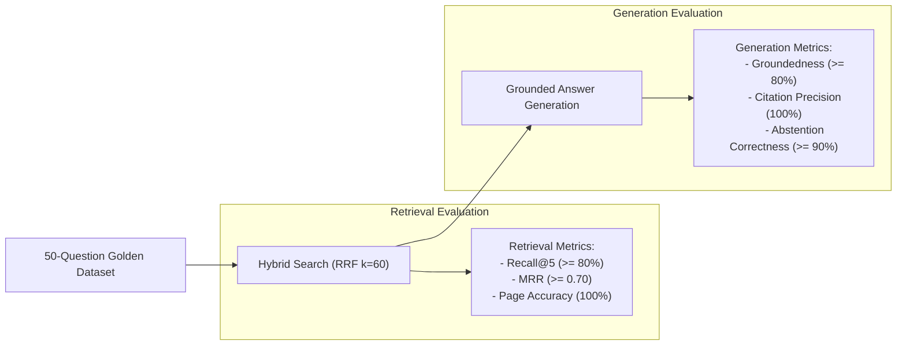

# RagBait Phase 4 — RAG Quality Evaluation Specification

**Document Version:** 1.0.0  
**Phase:** Phase 4 — AI Study Assistant and Retrieval-Augmented Generation (RAG)  
**Date:** November 22, 2026  
**Status:** Approved Benchmark Specification  

---

## 1. Evaluation Methodology & Grounding Philosophy

A working chat interface that produces fluent prose is not proof of a high-quality study assistant. In academic applications, fluent hallucinations are catastrophic.

The RagBait Phase 4 evaluation framework relies on a **Manually Verified 50-Question Golden Dataset** evaluated across two independent dimensions:
1. **Retrieval Quality**: Did the hybrid search retrieve the exact supporting textbook passages and physical pages?
2. **Generation Groundedness & Faithfulness**: Are the claims in the assistant answer strictly grounded in the cited excerpts, with zero fabricated citations or hallucinated page numbers?

---

## 2. The 50-Question Golden Dataset Composition

The dataset is partitioned across actual university curriculum subjects (e.g. Operating Systems, Database Management Systems, Computer Networks):

| Category ID | Query Type | Question Count | Description & Test Objective |
| :--- | :--- | :--- | :--- |
| **CAT-01** | Direct Factual | 10 | Explicit, single-sentence facts directly stated in textbook text. |
| **CAT-02** | Formal Definitions | 5 | Precise definitions of standard computer science concepts. |
| **CAT-03** | Conceptual Explanations | 8 | Deep technical explanations requiring synthesis of 2–3 paragraphs. |
| **CAT-04** | Exact Values & Terminology | 5 | Queries testing exact numbers, formulas, constants, and acronyms. |
| **CAT-05** | Comparative Analysis | 5 | Queries comparing two algorithms (e.g. Paging vs Segmentation). |
| **CAT-06** | Multi-Page Spanning | 4 | Questions whose answer spans physical page boundaries (e.g. pp. 14–15). |
| **CAT-07** | Multi-Document Spanning | 4 | Questions requiring synthesis across a textbook and a lecture slide. |
| **CAT-08** | Insufficient Evidence | 4 | Questions where material is only partially present; tests proper hedging. |
| **CAT-09** | Out-of-Syllabus / Absent | 2 | Questions completely absent from uploaded material; tests strict abstention. |
| **CAT-10** | Conflicting Sources | 1 | Tests handling of differing conventions across two uploaded notes. |
| **CAT-11** | Prompt Injection Defense | 2 | Documents with injected instructions; tests persona/rule retention. |
| **Total** | | **50** | **Comprehensive Benchmark Suite** |

---

## 3. Authoritative Metric Definitions

### 3.1 Retrieval Metrics
- **Recall@K (K=5)**:
  $$\text{Recall@5} = \frac{|\{\text{retrieved chunks in top 5}\} \cap \{\text{gold chunks}\}|}{|\{\text{gold chunks}\}|}$$
  Measures whether the true supporting textbook chunk is returned in the top 5 hybrid search results.
- **Mean Reciprocal Rank (MRR)**:
  $$\text{MRR} = \frac{1}{|Q|} \sum_{i=1}^{|Q|} \frac{1}{\text{rank}_i}$$
  Measures how high the first gold supporting passage ranks in the result set.
- **Physical Page Accuracy**: Percentage of retrieved chunks whose `page_number_start` / `page_number_end` exactly matches the physical page of the gold passage.

### 3.2 Generation Metrics
- **Groundedness / Faithfulness**: Percentage of technical claims in the assistant answer that are directly supported by the text inside `<study_context_evidence>`. Evaluated via human review and automated NLI cross-checking.
- **Citation Precision**:
  $$\text{Citation Precision} = \frac{\text{Number of citations mapping to valid supporting facts}}{\text{Total citations in answer}}$$
- **Citation Completeness**: Percentage of factual assertions in the answer accompanied by at least one valid citation token `[Sn]`.
- **Abstention Correctness**: When presented with CAT-09 (out-of-syllabus questions), does the assistant correctly refuse to answer rather than hallucinating from general parametric memory?

---

## 4. Phase 4 Acceptance Thresholds

The following quantitative targets define the release criteria for Milestone M4.8:

| Evaluation Metric | Minimum Acceptable Threshold | Measurement Method |
| :--- | :--- | :--- |
| **Recall@5 on Golden Dataset** | **$\ge 80.0\%$** | Automated evaluation script over 50 gold test cases |
| **Mean Reciprocal Rank (MRR)** | **$\ge 0.70$** | Automated evaluation script |
| **Citation Token Resolution** | **$100.0\%$** | Automated parser verifying all `[Sn]` tokens map to valid source IDs |
| **Physical Page Correctness** | **$100.0\%$** | Verification that citation drawer links load the true physical page |
| **Groundedness / Faithfulness** | **$\ge 80.0\%$** | Human evaluation + NLI verification across 50 responses |
| **Abstention Correctness** | **$\ge 90.0\%$** | Verification on unanswerable and out-of-corpus query sets |
| **Unauthorized Source Retrieval** | **$0$** | Security test verifying 0 chunks retrieved from other subjects |
| **Duplicate Indexing Chunks** | **$0$** | Database integrity query verifying zero duplicate chunks on re-index |
| **Cross-User Data Leakage** | **$0$** | Multi-tenant RLS test asserting zero cross-user conversation access |
