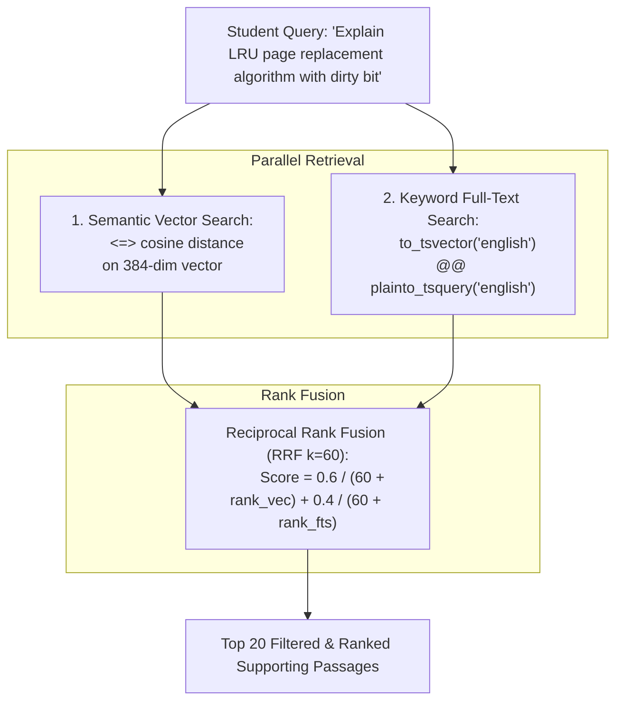

# RagBait Phase 4 — Retrieval and Embedding Design

**Document Version:** 1.0.0  
**Phase:** Phase 4 — AI Study Assistant and Retrieval-Augmented Generation (RAG)  
**Date:** November 22, 2026  
**Status:** Approved Technical Design  

---

## 1. Page-Aware Deterministic Text Chunking

Text extraction in Phase 3 produced structured records in `public.kb_document_pages`, each containing `page_number`, `raw_text`, `character_count`, and `has_text`. Phase 4 transforms these pages into dense semantic chunks with physical page provenance.

### 1.1 Chunking Specifications
- **Target Chunk Size**: 500–600 tokens ($\approx 2,000 - 2,400$ characters).
- **Target Overlap**: 80–100 tokens ($\approx 350 - 400$ characters).
- **Boundary Preservation**: Paragraph and sentence boundaries are strictly prioritized. A chunk is never broken mid-sentence unless a single paragraph exceeds the maximum token ceiling.
- **Physical Page Boundary Tracking**:
  - Chunks track `page_number_start` and `page_number_end`.
  - If a paragraph flows across physical pages (e.g., end of page 12 into top of page 13), the chunk records `page_number_start = 12` and `page_number_end = 13`.
- **Document Boundary Fencing**: A chunk **never** spans across different documents.
- **Empty / Short Page Handling**: Pages with `has_text = false` or whitespace are skipped. Very short pages (e.g. title pages $< 150$ characters) are prepended to the subsequent chunk.
- **Content Hashing**: Every chunk computes `content_hash = sha256(raw_text)` to support idempotent re-indexing.

---

## 2. Embedding Model Research & Selection

### 2.1 Model Evaluation Matrix

| Metric | Candidate 1: `bge-small-en-v1.5` | Candidate 2: `multilingual-e5-small` | Candidate 3: `bge-m3` | Candidate 4: OpenAI `text-embedding-3-small` |
| :--- | :--- | :--- | :--- | :--- |
| **Model Size** | 133 MB | 470 MB (ONNX quantized: 118 MB) | 2.2 GB | Remote API (0 MB) |
| **Embedding Dims** | 384 | 384 | 1,024 | 1,536 (or 512 reduced) |
| **Max Input Tokens** | 512 | 512 | 8,192 | 8,191 |
| **License** | MIT | MIT | MIT | Proprietary |
| **Languages** | English only | 100+ (English, Bengali, Hindi) | 100+ | Multilingual |
| **Inference Hardware**| CPU (Fast) | CPU (Fast with ONNX Runtime) | GPU recommended (High RAM) | External Cloud API |
| **Cost / Limits** | Free / Local | Free / Local | Free / High Server Memory | Paid (\$0.02 / 1M tokens) |
| **Privacy Boundary** | 100% On-Premise | 100% On-Premise | 100% On-Premise | Transmits text to OpenAI |

### 2.2 Recommended Selection: `intfloat/multilingual-e5-small`
**Decision:** Adopt **`intfloat/multilingual-e5-small`** as RagBait's primary embedding model.
- **Justification**:
  1. **Academic Demographics**: University study materials in the local context include English textbooks interspersed with bilingual explanations, terminology, and slides in regional languages. `multilingual-e5-small` exhibits state-of-the-art multilingual retrieval performance.
  2. **Compact Dimensions (384)**: 384 dimensions consume $< 50\%$ of the vector memory of 768/1536-dim models. At 20,000 chunks, the entire vector dataset fits in $\approx 30\text{MB}$ of RAM, allowing blazingly fast pgvector queries.
  3. **Zero External API Cost / Zero Rate Limits**: Runs locally on the backend server CPU via ONNX Runtime / `fastembed`, generating embeddings at $> 25\text{ chunks/sec}$ on standard multi-core hardware.
  4. **Strict Model Prefixing**:
     - Document Chunks: `passage: <chunk_text>`
     - Search Queries: `query: <student_question>`

---

## 3. Vector Storage Architecture & Indexing Strategy

### 3.1 Supabase pgvector 0.8.2 Configuration
- Vector extension is activated in `extensions` schema:
  `CREATE EXTENSION IF NOT EXISTS vector WITH SCHEMA extensions;`
- Column definition: `embedding extensions.vector(384) NOT NULL`.
- All vectors are $L_2$-normalized to unit length ($\|v\|_2 = 1.0$) upon generation. Under unit normalization, **cosine distance (`<=>`) is monotonically equivalent to inner product (`<#>`)**, enabling maximal vector math optimization.

### 3.2 Indexing Strategy: Scale-Aware Progression
```
Corpus Size <= 20,000 chunks (Typical College Subjects):
  └── Exact Cosine Scan with B-Tree Subject Fencing
      - Filters by subject_id first (reducing scan to ~2,000 chunks)
      - Latency: < 8ms
      - Recall: Exactly 100.0% (Zero approximation loss)

Corpus Size > 20,000 chunks:
  └── HNSW Index on embeddings
      - Parameters: m = 16, ef_construction = 64
      - Distance metric: vector_cosine_ops
      - Latency: < 15ms
      - Recall: > 98.5%
```

---

## 4. Hybrid Search & Reciprocal Rank Fusion (RRF)

Semantic vector search excels at conceptual matching, but frequently fails on exact acronyms (e.g., `TLB`, `FIFO`, `RAID 5`), algorithm names (e.g., `Dijkstra`), or course-specific formula names. RagBait pairs vector search with **PostgreSQL Full-Text Search** using **Reciprocal Rank Fusion (RRF)**.



### 4.1 The Reciprocal Rank Fusion (RRF) Formula
$$RRF(d) = \frac{w_{vec}}{k + \text{rank}_{vec}(d)} + \frac{w_{fts}}{k + \text{rank}_{fts}(d)}$$

Where:
- $k = 60$ (smoothing constant preventing high ranks from dominating)
- $w_{vec} = 0.60$ (weight for semantic retrieval)
- $w_{fts} = 0.40$ (weight for exact keyword retrieval)

### 4.2 Database Search Function (`match_subject_chunks`)
```sql
CREATE OR REPLACE FUNCTION public.match_subject_chunks(
    p_subject_id uuid,
    p_query_vector extensions.vector(384),
    p_query_text text,
    p_limit integer DEFAULT 20
)
RETURNS TABLE (
    chunk_id uuid,
    document_id uuid,
    document_title text,
    page_number_start integer,
    page_number_end integer,
    raw_text text,
    rrf_score double precision
)
LANGUAGE sql
STABLE
AS $$
WITH vector_matches AS (
    SELECT 
        c.id AS chunk_id,
        ROW_NUMBER() OVER (ORDER BY e.embedding <=> p_query_vector ASC) AS rank
    FROM public.kb_document_chunks c
    JOIN public.kb_chunk_embeddings e ON e.chunk_id = c.id
    JOIN public.kb_documents d ON d.id = c.document_id
    WHERE d.subject_id = p_subject_id
      AND d.is_archived = false
      AND d.upload_status != 'deleted'
    LIMIT p_limit * 2
),
fts_matches AS (
    SELECT 
        c.id AS chunk_id,
        ROW_NUMBER() OVER (ORDER BY ts_rank(to_tsvector('english', c.raw_text), plainto_tsquery('english', p_query_text)) DESC) AS rank
    FROM public.kb_document_chunks c
    JOIN public.kb_documents d ON d.id = c.document_id
    WHERE d.subject_id = p_subject_id
      AND d.is_archived = false
      AND d.upload_status != 'deleted'
      AND to_tsvector('english', c.raw_text) @@ plainto_tsquery('english', p_query_text)
    LIMIT p_limit * 2
)
SELECT 
    c.id AS chunk_id,
    c.document_id,
    d.title AS document_title,
    c.page_number_start,
    c.page_number_end,
    c.raw_text,
    COALESCE(0.6 / (60 + vm.rank), 0.0) + COALESCE(0.4 / (60 + fm.rank), 0.0) AS rrf_score
FROM public.kb_document_chunks c
JOIN public.kb_documents d ON d.id = c.document_id
LEFT JOIN vector_matches vm ON vm.chunk_id = c.id
LEFT JOIN fts_matches fm ON fm.chunk_id = c.id
WHERE vm.chunk_id IS NOT NULL OR fm.chunk_id IS NOT NULL
ORDER BY rrf_score DESC
LIMIT p_limit;
$$;
```
