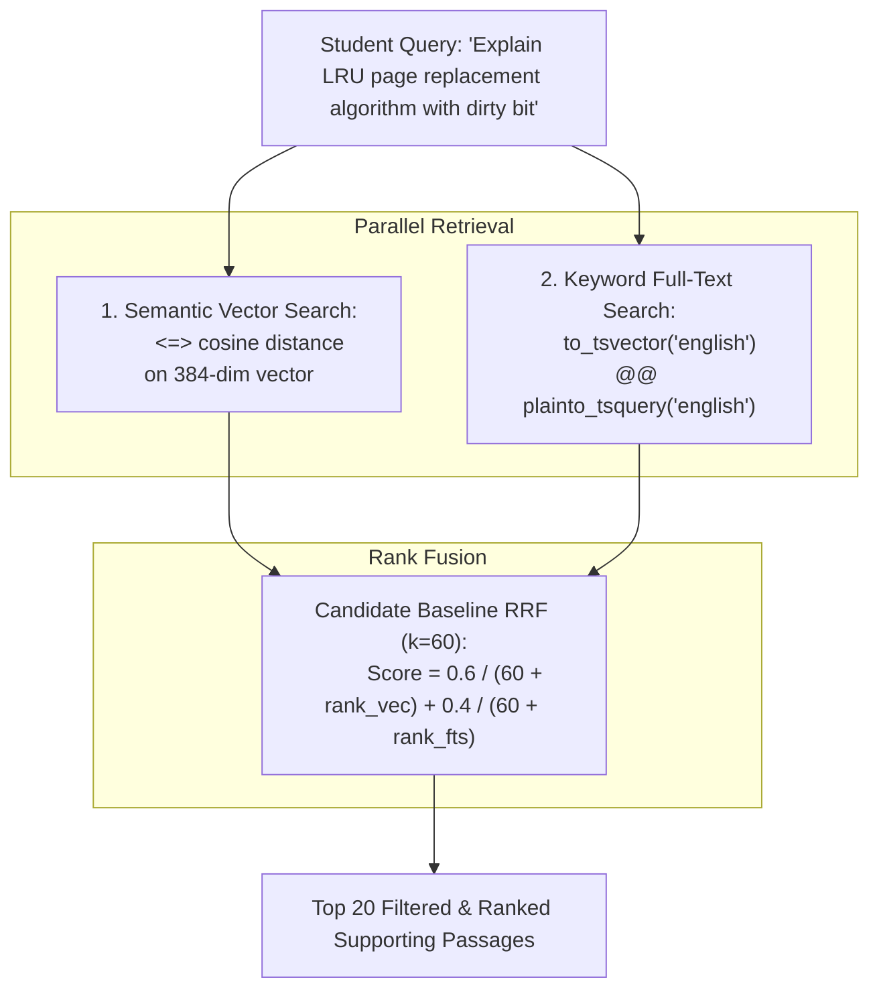

# RagBait Phase 4 — Retrieval and Embedding Design

**Document Version:** 1.1.0 (Remediated Baseline)  
**Phase:** Phase 4 — AI Study Assistant and Retrieval-Augmented Generation (RAG)  
**Date:** November 22, 2026  
**Status:** Approved Technical Design  

---

## 1. Page-Aware Deterministic Text Chunking

Text extraction in Phase 3 produced structured records in `public.kb_document_pages`, each containing `page_number`, `raw_text`, `character_count`, and `has_text`. Phase 4 transforms these pages into dense semantic chunks with physical page provenance.

### 1.1 Chunk Sizing & Tokenizer Overhead Accounting

The selected embedding model, `intfloat/multilingual-e5-small`, enforces a **hard maximum input ceiling of 512 tokens** using an XLM-RoBERTa SentencePiece tokenizer. In this tokenizer:
- The required document passage prefix `"passage: "` consumes **2 tokens** (`"passage"` + `": "`).
- Special tokens `<s>` (beginning of sequence, ID 0) and `</s>` (end of sequence, ID 2) consume **2 tokens**.
- Total prefix and framing overhead = **4 tokens**.

```
+----------------------------------------------------------------------------------------------------+
| 512-TOKEN INPUT BUDGET ALLOCATION                                                                  |
| [<s>] [passage: ] [----------------- Clean Chunk Body (Max 420 tokens) -----------------] [</s>]    |
|   1       2                                 350 - 400 Target                                 1     |
| <---------------- Total Tokens: 404 - 424 <= 512 (Guaranteed Safety Margin: 88 tokens) ----------> |
+----------------------------------------------------------------------------------------------------+
```

### 1.2 Authoritative Chunking Rules
1. **Target Chunk Size**: **350–400 tokens** ($\approx 1,400 - 1,600$ characters).
2. **Hard Chunk Token Ceiling**: **420 tokens**.
   $$\text{Max Total Tokens} = 420 \text{ (chunk body)} + 4 \text{ (prefix/framing)} = 424 \le 512$$
   This guarantees a safety margin of $512 - 424 = 88$ tokens, mathematically ensuring that **no indexed chunk is ever silently truncated** by the embedding model's 512-token limit.
3. **Target Overlap**: **50–70 tokens** ($\approx 200 - 300$ characters).
4. **Boundary Preservation**: Paragraph and sentence boundaries are strictly prioritized. A chunk is never broken mid-sentence unless an individual sentence exceeds the 420-token ceiling.
5. **Handling Exceptionally Long Paragraphs**:
   - If a single paragraph exceeds 420 tokens, the chunker splits at sentence terminators (`. `, `? `, `! `, `\n`).
   - If an individual sentence exceeds 420 tokens (e.g. unformatted raw code, large mathematical tables, or long semicolon lists), it splits at clause delimiters (`;`, `,`) with token verification.
6. **Query Token Budget**:
   - Query prefix `"query: "` consumes 2 tokens.
   - Student questions are bounded to a maximum of **128 tokens**. Total query tokens: $2 + 128 = 130 \le 512$. Questions exceeding 128 tokens receive clear client-side validation feedback.
7. **Clean Storage Invariant**:
   - `public.kb_document_chunks.raw_text` stores the clean text excerpt **without** the `"passage: "` prefix.
   - When generating embeddings, the indexing worker passes `"passage: " + raw_text` to the embedding engine.
   - `token_count` on `kb_document_chunks` records the clean text token count, while embedding metadata records the total input tokens.
8. **Physical Page Boundary Tracking**:
   - Chunks track `page_number_start` and `page_number_end`.
   - If a paragraph flows across physical pages (e.g., end of page 12 into top of page 13), the chunk records `page_number_start = 12` and `page_number_end = 13`.
9. **Document Boundary Fencing**: A chunk **never** spans across different documents.
10. **Empty / Short Page Handling**: Pages with `has_text = false` or whitespace are skipped. Very short pages (e.g. title pages $< 150$ characters) are prepended to the subsequent chunk.
11. **Content Hashing**: Every chunk computes `content_hash = sha256(raw_text)` to support idempotent re-indexing.

---

## 2. Embedding Model Research & FastEmbed / ONNX Integration

### 2.1 Model Evaluation Matrix

| Metric | Candidate 1: `bge-small-en-v1.5` | Candidate 2: `multilingual-e5-small` | Candidate 3: `bge-m3` | Candidate 4: OpenAI `text-embedding-3-small` |
| :--- | :--- | :--- | :--- | :--- |
| **Model Size** | 133 MB | ONNX INT8: 118 MB / FP32: 470 MB | 2.2 GB | Remote API (0 MB) |
| **Embedding Dims** | 384 | 384 | 1,024 | 1,536 (or 512 reduced) |
| **Max Input Tokens** | 512 | 512 | 8,192 | 8,191 |
| **License** | MIT | MIT | MIT | Proprietary |
| **Languages** | English only | 100+ (English, Bengali, Hindi) | 100+ | Multilingual |
| **Inference Hardware**| CPU (Fast) | CPU (Fast with ONNX Runtime) | GPU recommended (High RAM) | External Cloud API |
| **Cost / Limits** | Free / Local | Free / Local | Free / High Server Memory | Paid (\$0.02 / 1M tokens) |
| **Privacy Boundary** | 100% On-Premise | 100% On-Premise | 100% On-Premise | Transmits text to OpenAI |

### 2.2 FastEmbed & ONNX Runtime Integration Path
- **Library**: `fastembed` (Qdrant) running with `onnxruntime` on CPU.
- **Model Identifier**: Supported natively in FastEmbed as `intfloat/multilingual-e5-small` (or `qdrant/multilingual-e5-small-onnx`).
- **Artifact Specifications**:
  - **Default Production Artifact**: ONNX INT8 quantized (`model_quantized.onnx`), size $\approx \mathbf{118\text{ MB}}$. Achieves $\approx 12\text{ms}$ CPU inference latency per batch of 8 chunks.
  - **Unquantized Fallback**: ONNX FP32 (`model.onnx`), size $\approx \mathbf{470\text{ MB}}$.
  - **Pooling Method**: **Mean Pooling** over token representations with attention mask filtering.
  - **Normalization**: $L_2$ unit normalization ($\|v\|_2 = 1.0$).
  - **Model Cache Directory**: Cached locally in `~/.cache/ragbait/models/` (configured via `settings.RAG_MODEL_CACHE_DIR`).

### 2.3 Reproducible Offline Benchmark Plan (M4.3)
During M4.3, before enabling production indexing, a local benchmark script will execute against a sample corpus of 100 academic chunks to verify:
1. Exact output dimension = 384.
2. Unit vector norm: $|\|v\|_2 - 1.0| < 10^{-5}$.
3. Monotonic equivalence: $\text{CosineDistance}(u, v) = 1.0 - \text{InnerProduct}(u, v)$.
4. Throughput $\ge 25\text{ chunks/sec}$ on 4 CPU cores.

---

## 3. Vector Storage Architecture & Indexing Strategy

### 3.1 Supabase pgvector 0.8.2 Configuration
- Vector extension is activated in `extensions` schema:
  `CREATE EXTENSION IF NOT EXISTS vector WITH SCHEMA extensions;`
- Column definition: `embedding extensions.vector(384) NOT NULL`.
- All vectors are $L_2$-normalized to unit length ($\|v\|_2 = 1.0$) upon generation. Under unit normalization, **cosine distance (`<=>`) is monotonically equivalent to inner product (`<#>`)**, enabling maximal vector math optimization.
- **Extension Clarification**: `pg_trgm` is **NOT required** for Phase 4 MVP. PostgreSQL full-text search uses the native `tsvector` data type and `GIN` indexing, which are built into PostgreSQL core without extra extension dependencies.

### 3.2 Indexing Strategy: Scale-Aware Progression
```
Corpus Size <= 20,000 chunks (Typical College Subjects):
  └── Exact Cosine Scan with B-Tree Subject Fencing
      - Filters by subject_id first (reducing scan to ~2,000 chunks)
      - Latency: < 8ms
      - Recall: Exactly 100.0% (Zero approximation loss)

Corpus Size > 20,000 chunks:
  └── HNSW Index on embeddings
      - Parameters: m = 16, ef_construction = 64
      - Distance metric: vector_cosine_ops
      - Latency: < 15ms
      - Recall: > 98.5%
```

---

## 4. Hybrid Search & Reciprocal Rank Fusion (RRF)

Semantic vector search excels at conceptual matching, but frequently fails on exact acronyms (e.g., `TLB`, `FIFO`, `RAID 5`), algorithm names (e.g., `Dijkstra`), or course-specific formula names. RagBait pairs vector search with **PostgreSQL Full-Text Search** using **Reciprocal Rank Fusion (RRF)**.



### 4.1 The Reciprocal Rank Fusion (RRF) Formula
$$RRF(d) = \frac{w_{vec}}{k + \text{rank}_{vec}(d)} + \frac{w_{fts}}{k + \text{rank}_{fts}(d)}$$

Where:
- $k = 60$ (**Candidate Baseline Value**; to be tuned in M4.4 / M4.8 via grid search over $k \in [20, 60, 100]$)
- $w_{vec} = 0.60$ (Candidate baseline weight for semantic retrieval)
- $w_{fts} = 0.40$ (Candidate baseline weight for exact keyword retrieval)

### 4.2 Database Search Function (`match_subject_chunks`)
```sql
CREATE OR REPLACE FUNCTION public.match_subject_chunks(
    p_subject_id uuid,
    p_query_vector extensions.vector(384),
    p_query_text text,
    p_limit integer DEFAULT 20
)
RETURNS TABLE (
    chunk_id uuid,
    document_id uuid,
    document_title text,
    page_number_start integer,
    page_number_end integer,
    raw_text text,
    rrf_score double precision
)
LANGUAGE sql
STABLE
AS $$
WITH vector_matches AS (
    SELECT 
        c.id AS chunk_id,
        ROW_NUMBER() OVER (ORDER BY e.embedding <=> p_query_vector ASC) AS rank
    FROM public.kb_document_chunks c
    JOIN public.kb_chunk_embeddings e ON e.chunk_id = c.id
    JOIN public.kb_documents d ON d.id = c.document_id
    JOIN public.kb_topics t ON t.id = d.topic_id
    JOIN public.kb_subjects s ON s.id = d.subject_id
    WHERE d.subject_id = p_subject_id
      AND d.is_archived = false
      AND d.upload_status = 'uploaded'
      AND d.extraction_status IN ('completed', 'completed_no_text')
      AND t.is_active = true
      AND s.is_active = true
    LIMIT p_limit * 2
),
fts_matches AS (
    SELECT 
        c.id AS chunk_id,
        ROW_NUMBER() OVER (ORDER BY ts_rank(to_tsvector('english', c.raw_text), plainto_tsquery('english', p_query_text)) DESC) AS rank
    FROM public.kb_document_chunks c
    JOIN public.kb_documents d ON d.id = c.document_id
    JOIN public.kb_topics t ON t.id = d.topic_id
    JOIN public.kb_subjects s ON s.id = d.subject_id
    WHERE d.subject_id = p_subject_id
      AND d.is_archived = false
      AND d.upload_status = 'uploaded'
      AND d.extraction_status IN ('completed', 'completed_no_text')
      AND t.is_active = true
      AND s.is_active = true
      AND to_tsvector('english', c.raw_text) @@ plainto_tsquery('english', p_query_text)
    LIMIT p_limit * 2
)
SELECT 
    c.id AS chunk_id,
    c.document_id,
    d.title AS document_title,
    c.page_number_start,
    c.page_number_end,
    c.raw_text,
    COALESCE(0.6 / (60 + vm.rank), 0.0) + COALESCE(0.4 / (60 + fm.rank), 0.0) AS rrf_score
FROM public.kb_document_chunks c
JOIN public.kb_documents d ON d.id = c.document_id
LEFT JOIN vector_matches vm ON vm.chunk_id = c.id
LEFT JOIN fts_matches fm ON fm.chunk_id = c.id
WHERE vm.chunk_id IS NOT NULL OR fm.chunk_id IS NOT NULL
ORDER BY rrf_score DESC
LIMIT p_limit;
$$;
```
