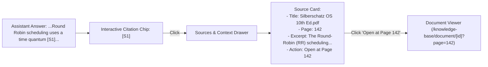
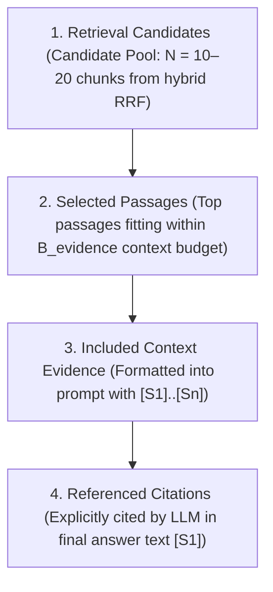

# RagBait Phase 4 — Sources & Citations Design

**Document Version:** 1.1.0  
**Phase:** Phase 4 — AI Study Assistant and Retrieval-Augmented Generation (RAG)  
**Date:** November 22, 2026  
**Status:** Approved Feature Specification (Remediated Baseline)  

---

## 1. Feature Mission: Signature Evidence Provenance

In an academic study environment, students must be able to verify every claim made by the AI against their actual course textbooks and lecture materials. The **Sources & Context** experience is a signature RagBait capability designed to eliminate unverified hallucinations and empower students to inspect original study text.



---

## 2. The 4-Stage Evidence Provenance Taxonomy

To provide complete transparency and prevent conflation between raw search hits and cited evidence, RagBait formalizes a strict **4-Stage Evidence Lifecycle**:



| Stage | Name | Definition | Persistence & State |
| :--- | :--- | :--- | :--- |
| **Stage 1** | **Retrieval Candidates** | Initial candidate chunks returned by the hybrid semantic and full-text search ($N=10\text{--}20$, RRF ranked). | Transient memory in retrieval service. Not persisted. |
| **Stage 2** | **Selected Passages** | Top-ranked chunks that fit greedily within the computed $B_{evidence}$ token ceiling. | Filtered subset prepared for prompt assembly. |
| **Stage 3** | **Included Context Evidence** | Passages injected into the prompt inside `<study_context_evidence>` with assigned keys `[S1]`, `[S2]`. | Persisted in `public.chat_message_sources` with `included_in_context = true`. |
| **Stage 4** | **Referenced Citations** | Passages explicitly cited by the LLM in the generated completion text (e.g. `[S1]`). | Validated by regex scanner; marked with `referenced_in_answer = true`. |

---

## 3. Citation Token Format & Validation Rules

### 3.1 The Standard Citation Token
- Inline citations in generated assistant text strictly use bracketed numeric identifiers prefixed by `S`:
  `[S1]`, `[S2]`, `[S3]`.
- Multiple sources for a single technical claim are formatted as comma-separated bracketed tokens:
  `[S1], [S2]`.
- The tokens are generated by the LLM following strict instructions in `<system_instructions>`.

### 3.2 Server-Side Citation Validation Pipeline
To ensure that students never see broken, hallucinated, or ungrounded citation links:
1. **Extraction**: Post-generation regex `\[S(\d+)\]` extracts all cited keys from the assistant text.
2. **Intersection**: Compares cited keys against the authoritative `chat_message_sources` map built during Stage 3 context construction.
3. **Reconciliation**:
   - **Valid Citations**: Citation record in `chat_message_sources` is updated with `referenced_in_answer = true`.
   - **Unreferenced Evidence**: If `[S3]` was included in context but the model didn't cite it, it remains stored with `included_in_context = true, referenced_in_answer = false`. The UI presents it under an "All Considered Context" tab.
   - **Hallucinated Citations**: If the model invents `[S8]` when only `[S1]` and `[S2]` were supplied, the server strips the hallucinated token from the text before database persistence and client emission.

---

## 4. Evidence Snapshots & Immutable Historical Records

A student must be able to reopen a 3-week-old study conversation and see the exact sources and physical page numbers originally used to answer their question.

### 4.1 Immutable Snapshot Architecture
- Rather than re-running retrieval or dynamically looking up current chunks (which could change due to document updates or re-indexing), the backend stores an **immutable evidence snapshot** in `public.chat_message_sources` at the moment of generation.
- Snapshot contents:
  - `citation_key`: `'S1'`, `'S2'`, etc.
  - `document_id`: Stable UUID foreign key to `public.kb_documents`.
  - `document_title_snapshot`: Text copy of title at the time of generation.
  - `page_number_start` & `page_number_end`: Physical PDF page numbers.
  - `excerpt`: The exact text string supplied in `<study_context_evidence>`.
  - `relevance_score`: The RRF similarity score.
  - `content_hash`: SHA-256 hash of the excerpt string for verification.
  - `included_in_context`: Boolean (always `true` for persisted snapshot rows).
  - `referenced_in_answer`: Boolean indicating whether model cited it.

---

## 5. Authoritative Access Revocation & Moderation Fencing

A critical security and copyright risk in RAG systems is using cached historical chat logs to view restricted or deleted materials. RagBait implements strict **Server-Authoritative Access Revocation Fencing**.

### 5.1 Authoritative Visibility Join
When a student requests `/api/v1/chat/messages/{message_id}/sources` for an older message, the backend revalidates document visibility against the live catalog using the authoritative join predicate:

```sql
SELECT 
    s.id,
    s.citation_key,
    s.document_id,
    s.document_title_snapshot,
    s.page_number_start,
    s.page_number_end,
    s.relevance_score,
    s.included_in_context,
    s.referenced_in_answer,
    CASE 
        WHEN d.id IS NOT NULL 
         AND d.is_archived = false 
         AND d.upload_status = 'uploaded' 
         AND d.extraction_status IN ('completed', 'completed_no_text')
         AND t.is_active = true 
         AND subj.is_active = true 
        THEN s.excerpt
        ELSE '[Source Unavailable — Document Archived or Moderated by Administrator]'
    END AS excerpt,
    CASE 
        WHEN d.id IS NOT NULL 
         AND d.is_archived = false 
         AND d.upload_status = 'uploaded' 
         AND d.extraction_status IN ('completed', 'completed_no_text')
         AND t.is_active = true 
         AND subj.is_active = true 
        THEN true 
        ELSE false 
    END AS is_available,
    CASE 
        WHEN d.id IS NOT NULL 
         AND d.is_archived = false 
         AND d.upload_status = 'uploaded' 
         AND d.extraction_status IN ('completed', 'completed_no_text')
         AND t.is_active = true 
         AND subj.is_active = true 
        THEN '/knowledge-base/document/' || s.document_id || '?page=' || s.page_number_start
        ELSE NULL 
    END AS document_viewer_url
FROM public.chat_message_sources s
LEFT JOIN public.kb_documents d ON d.id = s.document_id
LEFT JOIN public.kb_topics t ON t.id = d.topic_id
LEFT JOIN public.kb_subjects subj ON subj.id = d.subject_id
WHERE s.message_id = $1
ORDER BY s.citation_key ASC;
```

### 5.2 Masking Guarantees
If the cited document or its parent topic or subject has been archived, moderated, or soft-deleted:
1. `is_available` returns `false`.
2. `excerpt` is masked with `"[Source Unavailable — Document Archived or Moderated by Administrator]"`.
3. `document_viewer_url` returns `null`.
4. The student's message transcript remains readable, but the moderated content cannot be exfiltrated through historical chat drawers.

---

## 6. Sources & Context UI Specification

### 6.1 Desktop Experience (Persistent Drawer)
- **Position**: Slide-over panel docked on the right side of the chat interface (`380px` wide).
- **Header**: "Sources & Evidence" with tab filter toggle:
  - **Tab 1: Referenced in Answer** (default, shows sources where `referenced_in_answer = true`).
  - **Tab 2: All Considered Context** (shows all sources where `included_in_context = true`).
- **Source Cards**:
  - **Badge**: `[S1]` in bold blue with physical page indicator: `Page 142`.
  - **Title**: Document filename with PDF/TXT icon.
  - **Excerpt Box**: Formatted blockquote containing the exact passage with matching query terms highlighted in subtle yellow.
  - **Action Button**: `"Open Document at Page 142"` with an external link icon.

### 6.2 Mobile Experience (Bottom Sheet)
- On screens $< 768\text{px}$, the Sources panel transitions to an expandable bottom sheet drawer.
- Tapping a citation chip `[S1]` in the message bubble slides up the bottom sheet directly focused on the corresponding source card.

### 6.3 One-Click Physical Page Navigation
When a student clicks `"Open Document at Page 142"`:
1. The client opens `/knowledge-base/document/{document_id}?page=142` in a new tab (or side-by-side pane on large displays).
2. The existing Phase 3 document viewer loads the document, validates authorization, fetches a signed download URL, and renders page 142.
3. Zero permanent signed Storage URLs are ever stored in chat tables. URLs are generated on-demand with a 300-second TTL.
