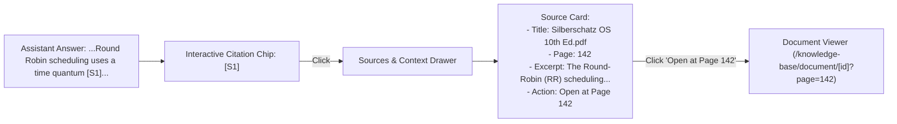

# RagBait Phase 4 — Sources & Citations Design

**Document Version:** 1.0.0  
**Phase:** Phase 4 — AI Study Assistant and Retrieval-Augmented Generation (RAG)  
**Date:** November 22, 2026  
**Status:** Approved Feature Specification  

---

## 1. Feature Mission: Signature Evidence Provenance

In an academic study environment, students must be able to verify every claim made by the AI against their actual course textbooks and lecture materials. The **Sources & Context** experience is a signature RagBait capability designed to eliminate unverified hallucinations and empower students to inspect original study text.

---

## 2. Citation Token Format & Validation Rules

### 2.1 The Standard Citation Token
- Inline citations in generated assistant text strictly use bracketed numeric identifiers prefixed by `S`:
  `[S1]`, `[S2]`, `[S3]`.
- Multiple sources for a single technical claim are formatted as comma-separated bracketed tokens:
  `[S1], [S2]`.
- The tokens are generated by the LLM following strict instructions in the system prompt.

### 2.2 Server-Side Citation Validation Pipeline
To ensure that students never see broken, hallucinated, or ungrounded citation links:
1. **Extraction**: Post-generation regex `\[S(\d+)\]` extracts all cited keys from the assistant text.
2. **Intersection**: Compares cited keys against the authoritative `chat_message_sources` map built during retrieval context construction.
3. **Reconciliation**:
   - **Valid Citations**: Citation record in `chat_message_sources` is updated with `referenced_in_answer = true`.
   - **Unreferenced Evidence**: If `[S3]` was included in context but the model didn't cite it, it remains in the Sources drawer under an "Additional Context Considered" tab with `referenced_in_answer = false`.
   - **Hallucinated Citations**: If the model invents `[S8]` when only `[S1]` and `[S2]` were supplied, the server strips the hallucinated token from the text before database persistence and client emission.

---

## 3. Evidence Snapshots & Immutable Historical Records

A student must be able to reopen a 3-week-old study conversation and see the exact sources and physical page numbers originally used to answer their question.

### 3.1 Immutable Snapshot Architecture
- Rather than re-running retrieval or dynamically looking up current chunks (which could change due to re-indexing), the backend stores an **immutable evidence snapshot** in `public.chat_message_sources` at the moment of generation.
- Snapshot contents:
  - `citation_key`: `'S1'`, `'S2'`, etc.
  - `document_id`: Stable UUID foreign key to `public.kb_documents`.
  - `document_title_snapshot`: Text copy of title at the time of generation.
  - `page_number_start` & `page_number_end`: Physical PDF page numbers.
  - `excerpt`: The exact text string supplied in `<study_context_evidence>`.
  - `relevance_score`: The RRF similarity score.
  - `content_hash`: SHA-256 hash of the excerpt string for verification.

---

## 4. Access Revocation & Moderation Fencing

A critical security and copyright risk in RAG systems is using cached historical chat logs to view restricted or deleted materials. RagBait implements strict **Access Revocation Fencing**.

### 4.1 Revalidation Rule
When a student requests `/api/v1/chat/messages/{message_id}/sources` for an older message:
1. The backend inspects `kb_documents` for each cited source:
   - Is `kb_documents.is_archived = true`?
   - Is `kb_documents.upload_status = 'deleted'`?
   - Has the parent topic or subject been archived?
2. If the document has been moderated, archived, or deleted:
   - `is_available` returns `false`.
   - `excerpt` is masked to: `"[Source Unavailable — Document Archived or Removed by Administrator]"`.
   - `document_viewer_url` returns `null`.
   - The student's assistant message text remains intact, but the restricted material cannot be leaked through the evidence drawer.

---

## 5. Sources & Context UI Specification

### 5.1 Desktop Experience (Persistent Drawer)
- **Position**: Slide-over panel docked on the right side of the chat interface (`380px` wide).
- **Header**: "Sources & Evidence (3)" with close button and filter toggle (`Referenced in Answer` vs `All Considered Context`).
- **Source Cards**:
  - **Badge**: `[S1]` in bold blue with physical page indicator: `Page 142`.
  - **Title**: Document filename with PDF/TXT icon.
  - **Excerpt Box**: Formatted blockquote containing the exact 200–400 character passage with matching query terms highlighted in subtle yellow.
  - **Action Button**: `"Open Document at Page 142"` with an external link icon.

### 5.2 Mobile Experience (Bottom Sheet)
- On screens $< 768\text{px}$, the Sources panel transitions to an expandable bottom sheet drawer.
- Tapping a citation chip `[S1]` in the message bubble slides up the bottom sheet directly focused on the corresponding source card.

### 5.3 One-Click Physical Page Navigation
When a student clicks `"Open Document at Page 142"`:
1. The client opens `/knowledge-base/document/{document_id}?page=142` in a new tab (or side-by-side pane on large displays).
2. The existing Phase 3 document viewer loads the document, validates authorization, fetches a signed download URL, and renders page 142.
3. Zero permanent signed Storage URLs are ever stored in chat tables. URLs are generated on-demand with a 300-second TTL.
