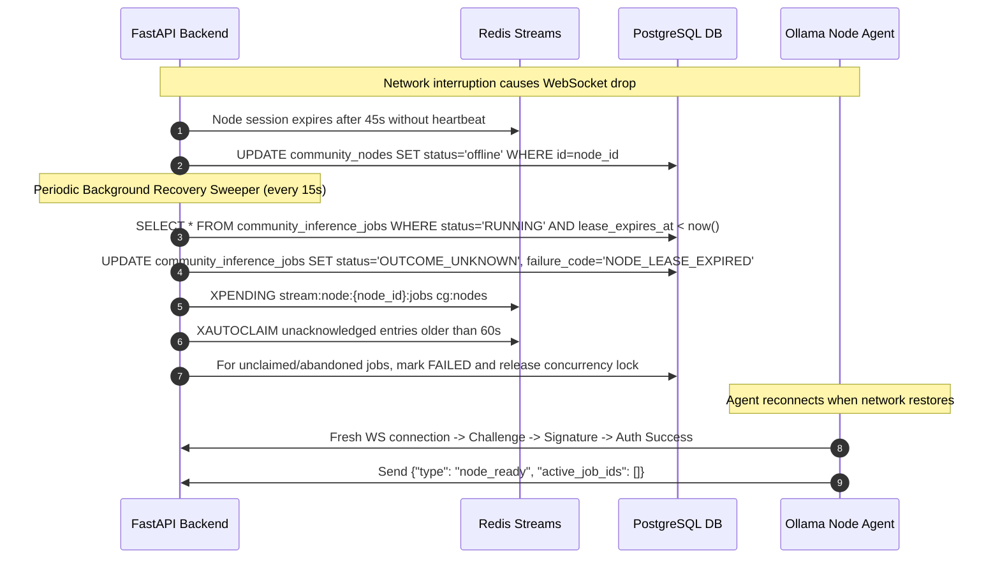

# RagBait — M2.8 Implementation Plan: Shared Community Local Inference & Ollama Node Agent

**Milestone**: M2.8  
**Status**: DRAFT FOR APPROVAL  
**Branch**: `phase2`  
**Dependencies**: M2.1–M2.5, M2.7 (completed and active)  
**Deferred / Out of Scope**: M2.6 (paid providers), M2.9 (intelligent automatic routing)  

---

## 1. Executive Summary & Existing Architecture Findings

### 1.1 Existing Architecture Summary
Through exhaustive inspection of the RagBait codebase, the current architecture was confirmed:
- **`apps/api`**: FastAPI 0.115, Python 3.12, managed with `uv`. Features asyncpg for PostgreSQL with RLS session wrappers (`get_user_db_session`), Redis 8.1.0 connection pooling (`apps/api/app/core/redis.py`), PyJWT + `cryptography` for JWT/asymmetric cryptography, and `uvicorn` with `websockets` 15.0.1.
- **`apps/web`**: Next.js 15.1.7 App Router, TypeScript 5.7, Tailwind CSS, Vitest 3.0. Features authenticated layouts (`(protected)`), credentials management, usage ledger views, and the M2.7 Private Local Inference playground (`apps/web/src/app/(protected)/local-inference/page.tsx`).
- **Database (`supabase`)**: PostgreSQL 15+ with pgvector, RLS on public tables, dedicated vault schema with service isolation, and migrations through M2.5 (`20260208000000_m2_5_provenance_safe_defaults.sql`). The `llm_providers` table already registers `'ollama'` with `runtime_type = 'local_runtime'`, and `'qwen2.5:7b'` is seeded.
- **Admission & Gateway (`apps/api/app/modules/`)**: Centralized admission control (`apps/api/app/modules/admission`) managing atomic Redis rate limiting, concurrency leases, and financial microcent ledger. Unified gateway (`apps/api/app/modules/llm_gateway`) with native adapters for Gemini, Groq, OpenRouter, and Cerebras.
- **M2.7 Private Local Inference**: Completely browser-side loopback connection to `http://127.0.0.1:11434` with `targetAddressSpace: "loopback"`, `credentials: "omit"`, thinking token omission, and local memory guardrails.

### 1.2 Core Mission of M2.8
M2.8 extends this foundation by enabling approved students to voluntarily contribute their local computer's idle compute as a **community inference node**. Other approved students can explicitly choose community inference for their prompts.

### 1.3 Strict Boundaries & Non-Negotiables
1. **Outbound-Only Connectivity**: Contributor machines **never** open inbound ports, never bind Ollama to `0.0.0.0`, and never use reverse tunnels (Ngrok, Cloudflare Tunnel). RagBait cloud never connects directly to a student's IP or loopback. The Node Agent initiates an outbound WSS connection over TLS to RagBait.
2. **Cryptographic Identity & Zero Secret Sharing**: The agent generates an Ed25519 keypair locally. The private key never leaves the contributor's device. RagBait authenticates nodes via fresh challenge-response signatures. The agent contains zero Supabase service keys, database passwords, or vault keys.
3. **Signed Job Authorizations**: The agent never executes an inference request based on a raw message. Every job carries a server-signed authorization token binding `job_id`, `node_id`, `model_name`, `payload_digest`, limits, and expiry. The agent verifies the server's signature and payload hash before contacting Ollama.
4. **Dual Explicit Consent**: 
   - Contributor: Sharing disabled by default; explicit model-by-model allowlist; configurable concurrency and resource limits.
   - Requester: Explicit opt-in with a prominent privacy disclosure explaining that prompts and retrieved context are processed on a fellow student's computer.
5. **No Automatic Routing (No M2.9)**: Requester must explicitly select community inference. Zero silent fallback to community nodes or cloud providers.
6. **Honest Ledger Provenance**: Zero fake dollars/cents or cloud billing for local compute. Usage events record `usage_provenance = 'device_reported'`.

---

## 2. Target Architecture & Trust Boundaries

```
                              RAGBAIT CLOUD
       ┌─────────────────────────────────────────────────────────┐
       │                       Next.js UI                        │
       │  • Contributor Node Management & Pairing Screen         │
       │  • Requester Community Inference Selection & Consent    │
       │  • Real-time SSE Stream Consumer with Replay Cursor     │
       └────────────────────────────┬────────────────────────────┘
                                    │ HTTPS (Bearer Supabase JWT)
                                    ▼
       ┌─────────────────────────────────────────────────────────┐
       │                     FastAPI Backend                     │
       │  • /api/v1/community/nodes (Pairing, Config, Lifecycle) │
       │  • /api/v1/community/jobs  (Submit, Cancel, SSE Stream) │
       │  • /api/v1/community/ws    (Authenticated WSS Handler)  │
       │  • Ed25519 Job Signer & Challenge-Response Validator    │
       │  • Redis Stream Dispatcher & Pending Job Recovery Loop  │
       └──────────────┬───────────────────────────┬──────────────┘
                      │                           │
                      ▼                           ▼
       ┌───────────────────────────┐  ┌───────────────────────────┐
       │   PostgreSQL (Supabase)   │  │       Redis Streams       │
       │  • community_nodes        │  │  • stream:node:{id}:jobs  │
       │  • community_node_models  │  │    (Durable Job Dispatch) │
       │  • community_node_pairs   │  │  • stream:job:{id}:chunks │
       │  • community_infer_jobs   │  │    (Sequenced SSE chunks) │
       │  • community_node_audits  │  │  • pubsub:job:{id}        │
       │    (Authoritative State)  │  │    (SSE Consumer Wakeup)  │
       └───────────────────────────┘  └─────────────┬─────────────┘
                                                    │
                                             Outbound WSS (TLS)
                                                    │
                                                    ▼
       ┌──────────────────────────────────────────────────────────┐
       │              Contributor's Personal Computer             │
       │                                                          │
       │   ┌──────────────────────────────────────────────────┐   │
       │   │               Ollama Node Agent                  │   │
       │   │  • Local Ed25519 Private Key (~/.ragbait-node)   │   │
       │   │  • Challenge Signer & Job Signature Verifier     │   │
       │   │  • SQLite Deduplication Store (Metadata-only)    │   │
       │   │  • Heartbeat & Cancellation Controller           │   │
       │   └────────────────────────┬─────────────────────────┘   │
       │                            │ Loopback HTTP               │
       │                            │ (credentials: omit)         │
       │                            ▼                             │
       │   ┌──────────────────────────────────────────────────┐   │
       │   │             Local Ollama Daemon                  │   │
       │   │            http://127.0.0.1:11434                │   │
       │   │  • Pure Local Weight Execution (CPU / GPU)       │   │
       │   └──────────────────────────────────────────────────┘   │
       └──────────────────────────────────────────────────────────┘
```

### Trust Boundary Analysis
| Component | What It Knows | What It CANNOT Access |
| :--- | :--- | :--- |
| **Node Agent** | Own Ed25519 private key, Server public key, assigned `node_id`, authorized job prompt/options during active execution, local Ollama models. | Supabase secrets, Database credentials, Requester identity/email/JWT, Other nodes' jobs, Other users' files. |
| **Contributor** | Can observe local terminal logs and memory of processes running on their own computer. | Cannot forge server signatures, cannot intercept jobs meant for other nodes, cannot impersonate other users on RagBait. |
| **Requester** | Prompt, generated response, selected community model name, job status. | Contributor's identity (email/name/IP/device paths are completely redacted). |
| **RagBait Backend** | Authoritative database state, server Ed25519 signing key, node public keys, Redis streams. | Contributor's private key (never transmitted), Local contributor files. |

---

## 3. Protocol, Authentication & Cryptography Specification

### 3.1 Cryptographic Algorithms & Formats
- **Asymmetric Signature Scheme**: Ed25519 (`cryptography.hazmat.primitives.asymmetric.ed25519`).
- **Keys**: 32-byte raw public key, encoded as 64-character lowercase hex string.
- **Canonical Serialization**: To eliminate signature malleability caused by JSON key reordering or whitespace variance, all signed payloads are constructed using strict, deterministic canonical strings:
  - **Challenge Signing Format**:
    ```
    RAGBAIT-NODE-AUTH:v1:<node_id>:<nonce_hex>:<session_id>:<timestamp_int>
    ```
  - **Job Authorization Signing Format**:
    ```
    RAGBAIT-JOB-AUTH:v1:<job_id>:<node_id>:<model_name>:<payload_digest_hex>:<max_tokens>:<deadline_timestamp>:<auth_nonce>
    ```
  - **Payload Digest**: SHA-256 hash of the canonical JSON representation of `{"model": ..., "messages": [...], "params": {...}}` (with keys sorted, separators `(',', ':')`, UTF-8 encoded).

### 3.2 Server Signing Key Management (`SERVER_COMMUNITY_SIGNING_KEY`)
- The server holds an Ed25519 signing keypair for issuing job authorizations.
- Key identifier: `kid = "k1"` (versioned string).
- In development/testing, if not explicitly provided via environment, a reproducible test key is derived or generated once at startup with a prominent warning.
- In production (`ENVIRONMENT == 'production'`), the server requires `COMMUNITY_SERVER_SIGNING_KEY_HEX` in environment settings; if missing or invalid, startup fails closed immediately (`RuntimeError`).
- The corresponding public key (`COMMUNITY_SERVER_VERIFYING_KEY_HEX`) is distributed to the agent during authenticated pairing and stored in the local config file.

---

## 4. Sequence Diagrams

### 4.1 Sequence 1: Node Pairing & Registration
```mermaid
sequenceDiagram
    autonumber
    actor Contributor as Contributor (Web UI)
    participant Web as Next.js Web App
    participant API as FastAPI Backend
    participant DB as PostgreSQL DB
    participant Agent as Ollama Node Agent (CLI)

    Contributor->>Web: Navigate to /community-nodes, click "Pair New Node"
    Web->>API: POST /api/v1/community/nodes/pair-code (Bearer JWT)
    API->>DB: INSERT community_node_pairing_codes (owner_id, code_hash, expires_in=5m)
    API-->>Web: Return { pairing_code: "RB-849201", expires_at: "..." }
    Web-->>Contributor: Display pairing code & terminal instructions

    Contributor->>Agent: Run `ragbait-node pair --code RB-849201`
    Agent->>Agent: Generate local Ed25519 Keypair (retained in ~/.ragbait-node/node_key.pem)
    Agent->>Agent: Query local Ollama (http://127.0.0.1:11434/api/tags)
    Agent->>API: POST /api/v1/community/nodes/pair (pairing_code, public_key_hex, metadata)
    API->>DB: Verify code, owner_id, not expired, not used; Atomic UPDATE used=true
    API->>DB: INSERT community_nodes (owner_id, public_key, metadata, status='active', sharing_enabled=false)
    API->>DB: INSERT community_node_audit_events ('node_paired')
    API-->>Agent: Return { node_id, server_public_key_hex, server_key_id: "k1" }
    Agent->>Agent: Save config to ~/.ragbait-node/config.json
    Agent-->>Contributor: "Node successfully paired! ID: <node_id>"
    Contributor->>Web: Refresh: node appears in list; enable sharing & select models
```

### 4.2 Sequence 2: Authenticated Outbound WebSocket Connection
```mermaid
sequenceDiagram
    autonumber
    participant Agent as Ollama Node Agent
    participant API as FastAPI Backend (WSS)
    participant Redis as Redis
    participant DB as PostgreSQL DB

    Agent->>API: Outbound TLS WS to /api/v1/community/ws (headers: X-Node-ID, X-Protocol-Version: 1)
    API->>DB: Fetch node by node_id; verify status != 'revoked'
    API->>Redis: Generate cryptographically random 32-byte nonce; SETEX nonce:{nonce} 60s
    API-->>Agent: Send {"type": "challenge", "nonce": nonce_hex, "session_id": uuid, "timestamp": now}
    
    Agent->>Agent: Canonical string: "RAGBAIT-NODE-AUTH:v1:<node_id>:<nonce>:<session_id>:<timestamp>"
    Agent->>Agent: Sign canonical string with private Ed25519 key
    Agent->>API: Send {"type": "auth", "node_id": node_id, "signature": sig_hex, "timestamp": timestamp}
    
    API->>Redis: Atomically GET and DEL nonce:{nonce} (prevents replay)
    API->>API: Verify Ed25519 signature against stored node.public_key
    API->>DB: UPDATE community_nodes SET status = 'active', last_seen_at = now()
    API->>Redis: SETEX node:session:{node_id} 90s {session_id, connected_at}
    API-->>Agent: Send {"type": "auth_success", "session_id": session_id, "heartbeat_interval_sec": 15}

    loop Every 15 seconds
        Agent->>Agent: Check local Ollama status & installed models
        Agent->>API: Send {"type": "heartbeat", "installed_models": [...], "active_jobs": 0}
        API->>Redis: EXPIRE node:session:{node_id} 45s
        API->>DB: UPDATE community_nodes SET last_seen_at = now()
        API->>DB: Sync community_node_models (last_seen_at)
        API-->>Agent: Send {"type": "heartbeat_ack", "timestamp": now}
    end
```

### 4.3 Sequence 3: Job Submission, Consent, Dispatch, Inference & Streaming
```mermaid
sequenceDiagram
    autonumber
    actor Requester as Approved Student (Requester)
    participant Web as Next.js Web App
    participant API as FastAPI Backend
    participant DB as PostgreSQL DB
    participant Redis as Redis Streams
    participant Agent as Contributor Node Agent
    participant Ollama as Local Ollama (127.0.0.1:11434)

    Requester->>Web: Select "Community Inference", pick model "llama3.2:3b"
    Web-->>Requester: Present Privacy Disclosure & Consent Dialog
    Requester->>Web: Check "I agree to send this prompt to a community device", submit
    Web->>API: POST /api/v1/community/jobs/submit (model, messages, params, consent_accepted=true)
    API->>DB: Verify requester approved; verify consent_policy_version
    API->>DB: Find eligible active node (sharing_enabled=true, model enabled, concurrency lease available)
    API->>DB: INSERT community_inference_jobs (status='QUEUED', payload_digest=sha256)
    API->>API: Sign canonical job authorization with SERVER_COMMUNITY_SIGNING_KEY
    API->>Redis: XADD stream:node:{node_id}:jobs {job_id, authorization, payload_json}
    API-->>Web: Return { job_id, status: "QUEUED" }

    Web->>API: Connect GET /api/v1/community/jobs/{job_id}/stream (SSE)
    
    API->>Redis: Dispatcher reads job from stream:node:{node_id}:jobs (XREADGROUP)
    API->>Agent: Send over WS {"type": "job_dispatch", "job_id": job_id, "authorization": auth, "payload": payload}

    Agent->>Agent: Verify server Ed25519 signature on auth token
    Agent->>Agent: Verify node_id matches self, sha256(payload) == auth.payload_digest, expiry > now
    Agent->>Agent: Verify model is in local shared allowlist
    Agent->>Agent: Deduplicate job_id in local SQLite
    Agent->>API: Send over WS {"type": "job_accepted", "job_id": job_id}
    
    API->>DB: UPDATE community_inference_jobs SET status='RUNNING', accepted_at=now(), lease_expires_at=now()+30s
    API->>Redis: XACK stream:node:{node_id}:jobs cg:nodes {stream_id}
    
    Agent->>Ollama: POST http://127.0.0.1:11434/api/chat (stream=true, credentials: omit)
    
    loop For each streamed token chunk from Ollama
        Agent->>API: Send over WS {"type": "job_chunk", "job_id": job_id, "seq_id": N, "delta": "...", "done": false}
        API->>Redis: XADD stream:job:{job_id}:chunks {seq_id: N, delta: "...", done: 0}
        API->>Redis: PUBLISH pubsub:job:{job_id} {seq_id: N}
        API-->>Web: SSE data: {"seq_id": N, "delta": "..."}\n\n
        Web-->>Requester: Render token live in chat bubble
    end

    Ollama-->>Agent: Final chunk with eval_count, total_duration
    Agent->>API: Send over WS {"type": "job_completed", "job_id": job_id, "reported_input_tokens": 15, "reported_output_tokens": 42, "duration_ms": 1100, "tokens_per_second": 38.1}
    API->>DB: UPDATE community_inference_jobs SET status='COMPLETED', reported_tokens, duration, usage_provenance='device_reported'
    API->>Redis: XADD stream:job:{job_id}:chunks {seq_id: N+1, done: 1, stats: ...}
    API-->>Web: SSE data: {"seq_id": N+1, "done": true, "stats": ...}\n\n
    Web-->>Requester: Display completed response and device telemetry
```

### 4.4 Sequence 4: Cancellation & Node Disconnection
```mermaid
sequenceDiagram
    autonumber
    actor Requester as Requester
    participant Web as Next.js Web App
    participant API as FastAPI Backend
    participant DB as PostgreSQL DB
    participant Agent as Ollama Node Agent
    participant Ollama as Local Ollama

    Requester->>Web: Click "Stop / Cancel"
    Web->>API: POST /api/v1/community/jobs/{job_id}/cancel (Bearer JWT)
    API->>DB: Verify requester owns job; UPDATE community_inference_jobs SET status='CANCELLED', cancelled_at=now()
    API->>Agent: Send over WS {"type": "job_cancel", "job_id": job_id}
    Agent->>Ollama: Abort active HTTP request (AbortSignal / connection close)
    Agent->>API: Send over WS {"type": "job_cancelled_ack", "job_id": job_id}
    API-->>Web: HTTP 200 OK
    API-->>Web: SSE data: {"error": "CANCELLED", "message": "Inference cancelled by requester"}\n\n
```

### 4.5 Sequence 5: Reconnection & Pending-Job Recovery


---

## 5. Detailed Database Schema & Migrations

A new additive migration file will be created:  
`supabase/migrations/20260209000000_m2_8_community_local_inference.sql`

### 5.1 Tables

#### 1. `public.community_nodes`
Tracks contributor device registration, cryptographic identity, and status:
```sql
CREATE TABLE public.community_nodes (
  id uuid PRIMARY KEY DEFAULT gen_random_uuid(),
  owner_id uuid NOT NULL REFERENCES public.profiles(id) ON DELETE CASCADE,
  display_name text NOT NULL CHECK (char_length(display_name) BETWEEN 2 AND 64),
  public_key text NOT NULL UNIQUE CHECK (public_key ~ '^[0-9a-f]{64}$'),
  key_version text NOT NULL DEFAULT 'ed25519-v1',
  agent_version text NOT NULL DEFAULT '0.1.0',
  os text,
  architecture text,
  ollama_version text,
  status text NOT NULL DEFAULT 'pending'
    CHECK (status IN ('pending', 'active', 'paused', 'offline', 'revoked')),
  sharing_enabled boolean NOT NULL DEFAULT false,
  max_concurrent_jobs integer NOT NULL DEFAULT 1 CHECK (max_concurrent_jobs BETWEEN 1 AND 4),
  max_execution_duration integer NOT NULL DEFAULT 300 CHECK (max_execution_duration BETWEEN 30 AND 600),
  last_seen_at timestamptz,
  created_at timestamptz NOT NULL DEFAULT now(),
  updated_at timestamptz NOT NULL DEFAULT now(),
  revoked_at timestamptz
);
```

#### 2. `public.community_node_models`
Explicit contributor model allowlist (zero implicit sharing):
```sql
CREATE TABLE public.community_node_models (
  id uuid PRIMARY KEY DEFAULT gen_random_uuid(),
  node_id uuid NOT NULL REFERENCES public.community_nodes(id) ON DELETE CASCADE,
  model_name text NOT NULL CHECK (char_length(model_name) BETWEEN 2 AND 128),
  enabled boolean NOT NULL DEFAULT false,
  parameter_size text,
  quantization_level text,
  size_bytes bigint,
  last_seen_at timestamptz NOT NULL DEFAULT now(),
  created_at timestamptz NOT NULL DEFAULT now(),
  updated_at timestamptz NOT NULL DEFAULT now(),
  CONSTRAINT uq_node_model UNIQUE (node_id, model_name)
);
```

#### 3. `public.community_node_pairing_codes`
Ephemeral single-use pairing codes:
```sql
CREATE TABLE public.community_node_pairing_codes (
  id uuid PRIMARY KEY DEFAULT gen_random_uuid(),
  owner_id uuid NOT NULL REFERENCES public.profiles(id) ON DELETE CASCADE,
  code_hash text NOT NULL UNIQUE,
  expires_at timestamptz NOT NULL,
  used boolean NOT NULL DEFAULT false,
  used_at timestamptz,
  created_at timestamptz NOT NULL DEFAULT now()
);
```

#### 4. `public.community_inference_jobs`
Authoritative job metadata and lifecycle state:
```sql
CREATE TABLE public.community_inference_jobs (
  id uuid PRIMARY KEY DEFAULT gen_random_uuid(),
  requester_id uuid NOT NULL REFERENCES public.profiles(id) ON DELETE CASCADE,
  node_id uuid NOT NULL REFERENCES public.community_nodes(id) ON DELETE RESTRICT,
  model_name text NOT NULL,
  status text NOT NULL DEFAULT 'QUEUED'
    CHECK (status IN ('QUEUED', 'CLAIMED', 'SENT', 'AGENT_ACCEPTED', 'RUNNING', 'COMPLETED', 'FAILED', 'CANCELLED', 'EXPIRED', 'OUTCOME_UNKNOWN')),
  payload_digest text NOT NULL CHECK (payload_digest ~ '^[0-9a-f]{64}$'),
  authorization_key_id text NOT NULL,
  consent_policy_version text NOT NULL,
  accepted_at timestamptz,
  started_at timestamptz,
  completed_at timestamptz,
  cancelled_at timestamptz,
  lease_expires_at timestamptz,
  hard_deadline_at timestamptz NOT NULL,
  failure_code text,
  failure_details text,
  reported_input_tokens integer CHECK (reported_input_tokens IS NULL OR reported_input_tokens >= 0),
  reported_output_tokens integer CHECK (reported_output_tokens IS NULL OR reported_output_tokens >= 0),
  duration_ms integer CHECK (duration_ms IS NULL OR duration_ms >= 0),
  tokens_per_second numeric(7, 2),
  usage_provenance text NOT NULL DEFAULT 'device_reported'
    CHECK (usage_provenance IN ('device_reported', 'estimated', 'unknown')),
  created_at timestamptz NOT NULL DEFAULT now(),
  updated_at timestamptz NOT NULL DEFAULT now()
);
```
*(CRITICAL PRIVACY GUARANTEE: Prompts and generated text are NEVER stored in PostgreSQL or audit logs).*

#### 5. `public.community_node_audit_events`
Append-only tamper-resistant operational audit events:
```sql
CREATE TABLE public.community_node_audit_events (
  id uuid PRIMARY KEY DEFAULT gen_random_uuid(),
  node_id uuid REFERENCES public.community_nodes(id) ON DELETE SET NULL,
  actor_id uuid NOT NULL REFERENCES public.profiles(id) ON DELETE CASCADE,
  event_type text NOT NULL
    CHECK (event_type IN ('node_paired', 'node_paused', 'node_resumed', 'node_revoked', 'sharing_toggled', 'models_updated', 'auth_failed', 'policy_violation', 'job_cancelled')),
  details jsonb NOT NULL DEFAULT '{}'::jsonb,
  created_at timestamptz NOT NULL DEFAULT now()
);
```

### 5.2 Row Level Security (RLS) Policies
- `community_nodes`:
  - `SELECT`: `owner_id = auth.uid()` OR `public.is_admin()`.
  - `UPDATE`: `owner_id = auth.uid()` (limited to `display_name`, `sharing_enabled`, `max_concurrent_jobs`, `max_execution_duration`). Privileged fields (`status`, `public_key`, `revoked_at`) can only be modified via server-side transactions (`SECURITY INVOKER` functions or dedicated backend service role).
  - `DELETE`: Prohibited. Nodes must be transitioned to `revoked`.
- `community_node_models`:
  - `SELECT`: Node owner OR approved users querying available community models.
  - `UPDATE`: Node owner only (`node_id IN (SELECT id FROM community_nodes WHERE owner_id = auth.uid())`).
- `community_inference_jobs`:
  - `SELECT`: `requester_id = auth.uid()` OR `node_id IN (SELECT id FROM community_nodes WHERE owner_id = auth.uid())` OR `public.is_admin()`. (Contributor can see status/telemetry of jobs run on their node, but job table has no prompt/response columns).
  - `INSERT / UPDATE`: Server-side service only. Requesters cannot update jobs directly; cancellations occur through dedicated backend endpoint.
- `community_node_pairing_codes`:
  - `SELECT / INSERT`: `owner_id = auth.uid()`.
- `community_node_audit_events`:
  - `SELECT`: `actor_id = auth.uid()` OR `public.is_admin()`.
  - Immutable: Protected with `prevent_ledger_tampering()` trigger.

---

## 6. Redis Streams Architecture & Reliability Design

### 6.1 Redis Key Layout
| Key | Type | Purpose & Lifecycle |
| :--- | :--- | :--- |
| `stream:node:{node_id}:jobs` | Stream | Durable job dispatch queue for the node. Consumer group: `cg:nodes`. |
| `stream:job:{job_id}:chunks` | Stream | Monotonically sequenced token stream (`seq_id`, `delta`, `done`). TTL: 1 hour (`EXPIRE`). |
| `pubsub:job:{job_id}` | Pub/Sub | Real-time wake-up channel notifying SSE handlers when a new chunk is appended. |
| `node:session:{node_id}` | Hash | Active node connection tracking (`session_id`, `connected_at`). TTL: 45s (refreshed by heartbeat). |
| `node:concurrency:{node_id}` | Integer | Active concurrency counter (`INCR` / `DECR`). |
| `node:nonce:{nonce}` | String | Single-use challenge nonce. TTL: 60s (`SET ... EX 60 NX`). |

### 6.2 Bounded Retention & Cleanup
- Chunks stream is trimmed with `XADD ... MAXLEN ~ 2000` to prevent memory exhaustion on giant generations.
- Job chunks stream key has an explicit 1-hour expiration set on creation (`EXPIRE stream:job:{job_id}:chunks 3600`).
- Completed, cancelled, and expired entries in `stream:node:{node_id}:jobs` are acknowledged (`XACK`) and cleaned up with `XDEL` or periodic `XTRIM`.

### 6.3 Pending-Entry Inspection & Recovery
- A dedicated background task in FastAPI (`_run_community_sweeper_task`) runs every 15 seconds:
  1. Inspects active jobs in PostgreSQL where `status = 'RUNNING'` and `lease_expires_at < now()`.
  2. If the node lease is expired and the node is offline, marks the job as `OUTCOME_UNKNOWN` or `FAILED`.
  3. Uses `XPENDING stream:node:{node_id}:jobs cg:nodes` and `XAUTOCLAIM` to detect jobs that were sent to an agent that crashed before sending `job_accepted`.
  4. Releases concurrency locks in Redis and PostgreSQL.

---

## 7. Node Agent Design (`apps/node-agent`)

### 7.1 Packaging & Language Choice
- **Language**: Python 3.12 (managed via `uv` consistent with the monorepo).
- **Directory**: `apps/node-agent/` with its own `pyproject.toml` and CLI entrypoint `ragbait-node`.
- **Dependencies**:
  - `httpx>=0.28.0` (for local Ollama HTTP calls and initial pairing POST)
  - `websockets>=13.0` (for outbound WSS connection)
  - `cryptography>=43.0.0` (for Ed25519 key generation, signing, and signature verification)
  - `pydantic>=2.10.0` (for protocol schema validation)
- Zero framework bloat (no FastAPI, no Flask, no web server). Runs natively on Windows, macOS, and Linux.

### 7.2 Directory Layout
```
apps/node-agent/
├── pyproject.toml               # Standalone package definition for ragbait-node
├── README.md                    # CLI usage & setup instructions
├── src/
│   └── ragbait_node/
│       ├── __init__.py
│       ├── cli.py               # CLI entrypoint (pair, run, status, pause, resume, unpair)
│       ├── config.py            # Local config management (~/.ragbait-node/config.json)
│       ├── crypto.py            # Ed25519 keypair generation, storage, challenge signing, auth verification
│       ├── storage.py           # SQLite metadata-only deduplication store (~/.ragbait-node/state.db)
│       ├── protocol.py          # Typed Pydantic models for WS frames
│       ├── client.py            # Outbound WebSocket client, heartbeat loop, reconnect backoff
│       └── ollama.py            # Isolated local Ollama HTTP client (http://127.0.0.1:11434)
└── tests/
    ├── test_crypto.py           # Key generation, challenge signing, signature verification tests
    ├── test_protocol.py         # Protocol serialization & canonical string tests
    ├── test_ollama.py           # Mocked Ollama interaction & error tests
    └── test_client.py           # WebSocket state machine & dispatch acceptance tests
```

### 7.3 Local Key Storage & Permissions
- Private key is saved at `~/.ragbait-node/node_key.pem`.
- On Linux/macOS: created with strict `0600` POSIX permissions (`chmod 600`).
- On Windows: file ACLs restricted to the current user via PowerShell / Windows API where practical.
- Never logged, never printed, never exported.

### 7.4 Dedicated CLI Commands
- `ragbait-node pair --code <code> [--server <url>] [--name <name>]`:
  Generates key, calls `/api/v1/community/nodes/pair`, stores config.
- `ragbait-node run`:
  Starts the agent in the foreground, connects outbound WSS, handles jobs, prints clean activity logs (no prompt text).
- `ragbait-node status`:
  Shows local node ID, public key fingerprint, Ollama status, shared models.
- `ragbait-node pause`:
  Notifies server to pause new job assignments.
- `ragbait-node resume`:
  Resumes accepting jobs.
- `ragbait-node unpair`:
  Revokes the node registration and securely removes local credentials.

---

## 8. Backend API Routes & WebSocket Endpoints

### 8.1 Node Management Routes (`apps/api/app/modules/community/router.py`)
- `POST /api/v1/community/nodes/pair-code` (Requires approved user): Generates single-use pairing code.
- `POST /api/v1/community/nodes/pair` (Public/Agent with pairing code): Consumes code, registers node, returns server public key.
- `GET /api/v1/community/nodes`: Lists authenticated user's registered nodes.
- `GET /api/v1/community/nodes/{node_id}`: Returns details, status, and shared models for owned node.
- `PATCH /api/v1/community/nodes/{node_id}`: Updates display name, `sharing_enabled`, concurrency, duration limits.
- `PUT /api/v1/community/nodes/{node_id}/models`: Updates the enabled/disabled status of models for sharing.
- `POST /api/v1/community/nodes/{node_id}/pause`: Pauses the node (`status = 'paused'`).
- `POST /api/v1/community/nodes/{node_id}/resume`: Resumes the node (`status = 'active'`).
- `DELETE /api/v1/community/nodes/{node_id}`: Revokes node (`status = 'revoked'`), closes active session, prevents reconnection.

### 8.2 Community Inference Routes
- `GET /api/v1/community/models`: Lists currently available models across all online, sharing-enabled community nodes.
- `POST /api/v1/community/jobs/submit` (Requires approved user):
  - Validates `consent_accepted == True` and matching `consent_policy_version`.
  - Finds an active, online node with matching model.
  - Generates signed authorization, creates job in DB, pushes to Redis Stream.
  - Returns `{ "job_id": "...", "status": "QUEUED" }`.
- `GET /api/v1/community/jobs/{job_id}`: Returns job status and metadata.
- `GET /api/v1/community/jobs/{job_id}/stream`: SSE endpoint streaming token chunks from Redis Stream. Supports `Last-Event-ID` for reconnection replay.
- `POST /api/v1/community/jobs/{job_id}/cancel`: Cancels an active job.

### 8.3 WebSocket Endpoint
- `WebSocket /api/v1/community/ws`:
  - Enforces protocol version check.
  - Issues challenge nonce.
  - Verifies Ed25519 signature against registered node public key.
  - Manages heartbeat intervals and dispatches jobs from Redis Stream to the agent.
  - Ingests `job_accepted`, `job_chunk`, and `job_completed` frames and commits them to Redis Streams and PostgreSQL.

---

## 9. Frontend Integration (`apps/web`)

### 9.1 Contributor Community Node Management (`/community-nodes`)
- New protected page: `apps/web/src/app/(protected)/community-nodes/page.tsx`
- Features:
  - **Pair New Device Modal**: Displays 5-minute single-use code and exact CLI command to run.
  - **Node Cards**: Shows online/offline status, agent version, OS, last seen timestamp, active jobs counter.
  - **Model Sharing Toggles**: Checkboxes for each model discovered on the device. Models are disabled by default until the contributor explicitly clicks to share.
  - **Resource Limits Configuration**: Concurrency (1–4), Max Duration slider.
  - **Controls**: Pause/Resume toggle, Revoke button with confirmation dialog.
  - **Contributor Privacy & Stats**: Shows total jobs completed, total device-reported tokens contributed. **Never** exposes requester names, emails, prompts, or completions.

### 9.2 Requester Community Inference Experience
- Integrated into the existing inference view or dedicated community inference tab:
  - Dropdown displays models available on the community network (e.g. `llama3.2:3b (Community Node)`).
  - Prominent **Privacy & Compute Disclosure Modal**:
    - Clearly explains:
      1. Prompt and study material will be sent to a fellow student's computer.
      2. The student contributor's machine executes the inference locally.
      3. Compute and electricity are provided voluntarily by the student.
    - Requires explicit checkbox: *"I understand and consent to community local inference."*
  - Live SSE streaming with token-by-token rendering, cancellation button, and graceful reconnection handling using `Last-Event-ID`.
  - Telemetry card showing device-reported tokens, throughput (`tok/s`), and node status.

---

## 10. Security, Privacy & Failure Handling Matrix

| Threat / Failure Scenario | Prevention & Mitigation Control |
| :--- | :--- |
| **Malicious backend attempts arbitrary shell/code execution** | Node Agent has zero code-eval or shell execution capability. Only understands fixed `ollama.chat` operation with fixed loopback destination `http://127.0.0.1:11434`. |
| **Inbound network attacks on contributor** | Agent initiates outbound WSS over TLS only. Zero listening ports on host or network. |
| **Agent private key theft from backend** | Private key is generated locally on the agent device and never transmitted over the wire or stored in DB. |
| **Replay attacks on authentication** | Server issues fresh 32-byte nonce stored with 60s TTL in Redis. Atomically consumed (`GETDEL`) during verification. Timestamps verified within 60s clock skew window. |
| **Tampered or spoofed jobs** | Every job carries server Ed25519 signature binding `job_id`, `node_id`, `model_name`, `payload_digest`, and limits. Agent recalculates SHA-256 of payload and verifies signature. |
| **Prompt data leakage in logs or database** | Prompts and completions are NEVER written to PostgreSQL, audit tables, Redis logs, or application logs. Only SHA-256 `payload_digest` is stored in DB. |
| **Requester privacy violation by contributor** | Agent suppresses prompt logging. Requester user ID, email, and JWT are completely stripped before dispatching to node. |
| **Network disconnect during streaming** | Result chunks are appended to Redis Stream with sequence IDs. Reconnecting SSE clients pass `Last-Event-ID` and replay missed tokens seamlessly. |
| **Node crashes during inference** | Job lease expires in 30s. Background recovery sweeper transitions dangling job to `OUTCOME_UNKNOWN` / `FAILED` and releases locks. |
| **Late chunk arrival after cancellation** | Server checks authoritative DB status (`CANCELLED`) before appending chunks. Discards late chunks from cancelled jobs. |

---

## 11. Test Strategy & Exact Verification Plan

### 11.1 Agent Test Suite (`apps/node-agent/tests/`)
- `test_crypto.py`: Ed25519 key generation, storage permissions, canonical string generation, challenge signing, invalid signature rejection.
- `test_protocol.py`: Pydantic frame validation, rejection of unknown operations or oversized payloads.
- `test_ollama.py`: Loopback request construction, redirect rejection, streaming chunk parsing, model availability check, timeout handling.
- `test_client.py`: Challenge-response handshake, heartbeat loop, job signature verification, payload digest verification, cancellation signal handling.

### 11.2 Backend Unit & Integration Tests (`apps/api/tests/`)
- `test_community_pairing.py`: Pairing code generation, expiration, single-use atomic consumption, brute force rate-limiting.
- `test_community_auth.py`: WebSocket challenge-response verification, nonce replay prevention, revoked node rejection.
- `test_community_jobs.py`: Dual-consent enforcement, server-signed authorization generation, payload digest verification, model allowlist enforcement.
- `test_community_streams.py`: Redis Streams job dispatch, consumer group `XREADGROUP`, acknowledgment after `job_accepted`, chunk sequencing, SSE `Last-Event-ID` replay.
- `test_community_recovery.py`: Node lease expiration, worker restart recovery, cancellation propagation.
- `test_community_security.py`: Cross-user node access rejection, cross-user job isolation, prompt redaction in logs/audit records.

### 11.3 Database Tests (`supabase/tests/`)
- `m2_8_community_inference_test.sql`: pgTAP tests verifying table schemas, foreign key constraints, RLS policies (owner-only access, cross-user isolation), and append-only audit triggers.

### 11.4 Frontend Tests (`apps/web/tests/`)
- `CommunityNodesPage.test.tsx`: Pairing modal, node list rendering, model toggle controls, pause/resume/revoke actions.
- `CommunityInferenceConsent.test.tsx`: Dual-consent disclosure dialog, requirement for explicit checkbox before submission, no default community selection.

### 11.5 Regression Suites to Run
- Backend: `uv run ruff check .`, `uv run ruff format --check .`, `uv run mypy app`, `uv run pytest -q`
- Frontend: `pnpm --filter ragbait-web lint`, `pnpm --filter ragbait-web typecheck`, `pnpm --filter ragbait-web test`, `pnpm --filter ragbait-web build`
- Database: `npx supabase test db`

---

## 12. Implementation Sequence & File Manifest

### Phase 1: Database Migration & Models
1. `supabase/migrations/20260209000000_m2_8_community_local_inference.sql`
2. `supabase/tests/m2_8_community_inference_test.sql`

### Phase 2: Backend Core & Cryptography
3. `apps/api/app/core/config.py` (Add `COMMUNITY_SERVER_SIGNING_KEY_HEX`, `COMMUNITY_SERVER_VERIFYING_KEY_HEX`, sweeper timeouts)
4. `apps/api/app/modules/community/crypto.py` (Server Ed25519 signer & verifier, canonical string builders)
5. `apps/api/app/modules/community/schemas.py` (Pydantic models for pairing, node management, jobs, and WS frames)
6. `apps/api/app/modules/community/repository.py` (Database queries for nodes, models, pairing codes, and jobs)
7. `apps/api/app/modules/community/streams.py` (Redis Streams dispatch, consumer groups, chunk streaming, recovery)
8. `apps/api/app/modules/community/service.py` (Orchestration for pairing, consent, job lifecycle, and sweeper recovery)
9. `apps/api/app/modules/community/ws.py` (WebSocket challenge-response, heartbeat, and dispatch loop)
10. `apps/api/app/modules/community/router.py` (FastAPI REST endpoints + WebSocket mount)
11. `apps/api/app/api/v1/router.py` (Mount community router under `/api/v1/community`)
12. `apps/api/app/main.py` (Register community sweeper task in lifespan)

### Phase 3: Standalone Ollama Node Agent
13. `apps/node-agent/pyproject.toml`
14. `apps/node-agent/README.md`
15. `apps/node-agent/src/ragbait_node/config.py`
16. `apps/node-agent/src/ragbait_node/crypto.py`
17. `apps/node-agent/src/ragbait_node/storage.py`
18. `apps/node-agent/src/ragbait_node/protocol.py`
19. `apps/node-agent/src/ragbait_node/ollama.py`
20. `apps/node-agent/src/ragbait_node/client.py`
21. `apps/node-agent/src/ragbait_node/cli.py`
22. `apps/node-agent/tests/` (Agent test suite)

### Phase 4: Frontend UI & SSE Consumer
23. `apps/web/src/types/community.ts`
24. `apps/web/src/lib/community-client.ts`
25. `apps/web/src/app/(protected)/community-nodes/page.tsx`
26. `apps/web/src/components/CommunityConsentModal.tsx`
27. Update `apps/web/src/components/Navbar.tsx` to include "Community Nodes" link
28. Update local inference view to support community model selection with explicit consent

### Phase 5: Documentation & Manual Smoke Test Guide
29. `docs/M2_8_COMMUNITY_INFERENCE.md` (Architecture, setup, troubleshooting, dual consent)
30. `docs/M2_8_MANUAL_VERIFICATION.md` (End-to-end multi-user test script)
