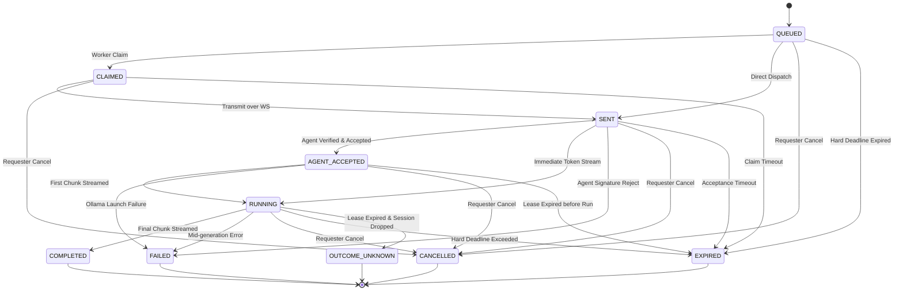
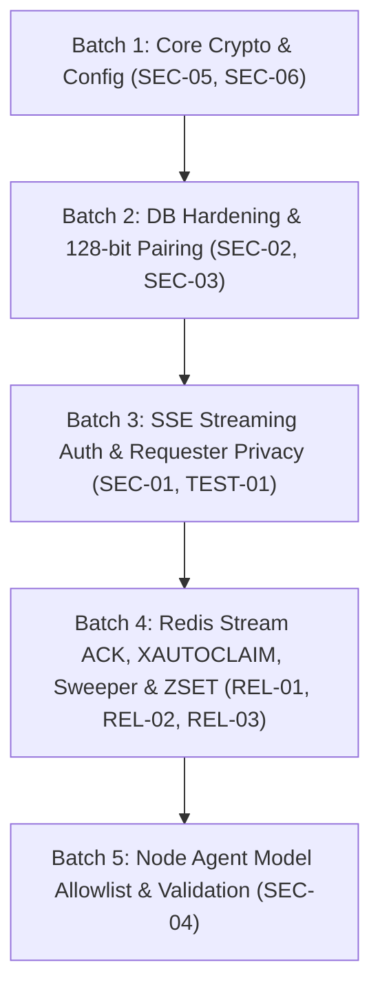

# RagBait M2.8.2 — Security & Reliability Remediation Plan (Revised)

> **Status:** Final Review Draft  
> **Target Commit:** `1b415088222c80cacae7353d71d16bb4c7bfabd6`  
> **Target Branch:** `phase2`  
> **Workflow Stage:** Inspect → Revalidate → Plan → Review → **STOP**

---

## 1. Executive Summary & Audit Revalidation

Following the completion of M2.8 (Shared Community Local Inference & Ollama Node Agent), an independent security and reliability audit (M2.8.1) issued a verdict of **FAIL** based on 10 reported findings.

This revised remediation plan incorporates the architectural review amendments, revalidates every finding against the authoritative repository state, resolves false positives, establishes strict cryptographic and state-machine specifications, and defines an atomic, phased implementation path.

### Summary of Revalidated Findings & Action Matrix

| Finding ID | Audit Severity | Revalidated Severity | Classification | Target Area | Authoritative Scope & Impact |
| :--- | :---: | :---: | :---: | :--- | :--- |
| **SEC-01** | Critical | **Critical** | Confirmed Defect | API Router | `GET /jobs/{job_id}/stream` omits `get_current_user` and requester check. Frontend already sends `Authorization: Bearer <token>` in [`community-client.ts:114`](file:///d:/Projects/RagBait/apps/web/src/lib/community-client.ts#L114). Endpoint must enforce authentication, requester ownership (disallowing even node owner), and return HTTP 404/403 prior to sending SSE headers. |
| **SEC-02** | High | **High** | Confirmed Defect | API / Crypto | Pairing codes currently have only 24 bits of entropy (`RB-XXXXXX`), are stored in plaintext, and `/nodes/pair` has no rate limiter. Will upgrade to 128-bit pairing token (`RB-XXXXXXXX-XXXXXXXX-XXXXXXXX-XXXXXXXX`), store only SHA-256 hash, make redemption atomic, and enforce multi-scoped rate limiting. |
| **SEC-03** | High | **High** | Confirmed Defect | Supabase RLS | Table-wide `UPDATE` on `community_nodes` and `INSERT, UPDATE` on `community_node_pairing_codes` granted to `authenticated` allows PostgREST tampering. Migration `20260209000001` will revoke broad writes and enforce trigger-based defense against altering server-managed fields. |
| **REL-01** | High | **High** | Confirmed Defect | Redis Streams | Dispatched jobs are never acknowledged via `XACK` upon acceptance, and disconnects abandon jobs in the PEL without session-fenced `XAUTOCLAIM` recovery. |
| **REL-02** | High | **High** | Confirmed Defect | Sweeper / Concurrency | Sweeper ignores non-terminal `QUEUED` and `SENT` jobs, never releases Redis concurrency slots on timeout, and uses non-idempotent raw counters. |
| **REL-03** | Medium | **Medium** | Confirmed Defect | Repository / State | `update_job_status` lacks a terminal state guard, allowing late completion frames to overwrite `CANCELLED` status. |
| **SEC-04** | Medium | **Medium** | Confirmed Defect | Node Agent | Agent does not assert `auth["model_name"] == payload["model"]` and does not check against a local model allowlist. |
| **SEC-05** | Low | **Low** | Confirmed Defect | Streams / Nonce | `consume_challenge_nonce` has a test fallback `if r is None: return len(nonce) == 64` that fails open. Will remove fallback and fail closed with 503. |
| **SEC-06** | Low | **Low** | Confirmed Defect | Config Validation | Settings do not verify that `COMMUNITY_SERVER_VERIFYING_KEY_HEX` is the cryptographic public key of `COMMUNITY_SERVER_SIGNING_KEY_HEX`. |
| **TEST-01** | Low | **Low** | **Partial False Positive** | Web Tests | Audit claimed 0 community tests existed. Revalidation confirmed `CommunityConsentModal.test.tsx` (4 tests) and `CommunityNodesPage.test.tsx` (4 tests) **already exist and pass** in `apps/web/tests/`. Genuinely missing test is `community-client.ts` streaming client. |

---

## 2. Cryptographic Pairing Security & 128-Bit Entropy Calculation

### 1. Entropy Calculation
- **Previous Implementation:** `f"RB-{secrets.token_hex(3).upper()}"` = 3 bytes = 6 hex characters = 24 bits of entropy ($2^{24} = 16,777,216$ combinations).
- **Hardened Specification:** 16 cryptographically random bytes = 128 bits of entropy ($2^{128} \approx 3.4028 \times 10^{38}$ combinations).
- **Canonical Format:**
  ```text
  RB-XXXXXXXX-XXXXXXXX-XXXXXXXX-XXXXXXXX
  ```
  Composed of four 8-character uppercase hexadecimal blocks (32 hex characters total), prefixed with `RB-`.
- **Search Space & Brute-Force Resistance:**
  At an aggressive brute-force rate of 1,000,000 guesses per second across distributed attacker nodes, guessing a valid 128-bit pairing token would require on average $5.39 \times 10^{24}$ years.

### 2. Digest Storage & Single-Use Consumption
- **PostgreSQL Column:** `community_node_pairing_codes.code_hash` (stores `sha256(canonical_pairing_code.encode("utf-8")).hexdigest()`).
- **Plaintext Policy:** Raw pairing tokens are **never** stored in PostgreSQL, never written to audit tables, and never printed in server logs. Only the requester receives the plaintext code in the HTTP response of `POST /api/v1/community/nodes/pair-code`.
- **Atomic Redemption:**
  ```sql
  UPDATE public.community_node_pairing_codes
  SET used = true
  WHERE code_hash = $1
    AND used = false
    AND expires_at > now()
  RETURNING id, owner_id;
  ```
  If zero rows are updated, the redemption attempt fails immediately with `400 Bad Request`.

### 3. Distributed Rate Limiting & Abuse Prevention
Rate limiting reuses RagBait's existing Redis distributed sliding-window counter (`check_rate_limit`) with multi-scoped protection:

1. **IP Scope (Unauthenticated Endpoint):**
   - Rate limit: 5 pairing redemption attempts per 5 minutes per client IP.
   - **Trusted Proxy Resolution:** To prevent `X-Forwarded-For` spoofing, the client IP is extracted from `request.client.host`. Only if the direct connection originates from a proxy in `settings.TRUSTED_PROXY_IPS` will the rightmost untrusted IP in `X-Forwarded-For` be used.
2. **Account / Owner Scope (Code Creation):**
   - Rate limit: 10 pairing code generation requests per hour per authenticated owner (`user.user_id`).
3. **Failed Attempt Penalty (Brute-Force Damping):**
   - Failed attempts against an IP or target code hash increment a temporary Redis penalty counter, introducing progressive backoff delays.
4. **Fail-Closed Guarantee:**
   - In production (`settings.ENVIRONMENT == "production"`), if Redis is unreachable, `check_rate_limit` fails closed with HTTP 503 (`SERVICE_UNAVAILABLE`).

---

## 3. Authoritative Job-State Transition Model

Inspection of [`supabase/migrations/20260209000000_m2_8_community_local_inference.sql:85-115`](file:///d:/Projects/RagBait/supabase/migrations/20260209000000_m2_8_community_local_inference.sql#L85-L115) reveals the actual PostgreSQL check constraint:
```sql
CHECK (status IN ('QUEUED', 'CLAIMED', 'SENT', 'AGENT_ACCEPTED', 'RUNNING', 'COMPLETED', 'FAILED', 'CANCELLED', 'EXPIRED', 'OUTCOME_UNKNOWN'))
```
> [!IMPORTANT]
> The audit report referred to `TIMEOUT`. In the authoritative database schema, the status is **`EXPIRED`** (not `TIMEOUT`). Using `TIMEOUT` would violate check constraints.

### State Classification

| State | Lifecycle Role | Description |
| :--- | :--- | :--- |
| **`QUEUED`** | Non-Terminal | Job created in PostgreSQL and enqueued in Redis stream; awaiting dispatch. |
| **`CLAIMED`** | Non-Terminal | Reserved by a consumer session prior to transmission. |
| **`SENT`** | Non-Terminal | Transmitted over WebSocket to the Node Agent; awaiting agent local verification. |
| **`AGENT_ACCEPTED`** | Non-Terminal | Agent cryptographically verified authorization and accepted job locally. |
| **`RUNNING`** | Non-Terminal | Agent actively streaming inference tokens from local Ollama loopback. |
| **`COMPLETED`** | **Terminal** | Normal inference finished; final tokens and self-reported metrics recorded. |
| **`FAILED`** | **Terminal** | Node Agent reported local Ollama failure, model error, or syntax fault. |
| **`CANCELLED`** | **Terminal** | Requester explicitly aborted the job. |
| **`EXPIRED`** | **Terminal** | Sweeper expired job due to hard execution deadline or unaccepted dispatch timeout. |
| **`OUTCOME_UNKNOWN`** | **Terminal** | Node disconnected mid-execution during `RUNNING` and lease expired without recovery. |

### State Transition Matrix



### Transition Invariants & Compare-and-Set Enforcement
1. **Terminal Absorbing State:** Once a job reaches `COMPLETED`, `FAILED`, `CANCELLED`, `EXPIRED`, or `OUTCOME_UNKNOWN`, it can **never** transition to any other status via worker frames or normal API requests.
2. **Atomic CAS Query:**
   ```sql
   UPDATE public.community_inference_jobs
   SET status = $2,
       updated_at = now(),
       ...
   WHERE id = $1
     AND status NOT IN ('COMPLETED', 'FAILED', 'CANCELLED', 'EXPIRED', 'OUTCOME_UNKNOWN')
   RETURNING *;
   ```
3. **Cancellation Overwrite Immunity:** If a user cancels a running job (`CANCELLED`), a late `job_completed` frame returns zero updated rows from the CAS query, preventing resurrected status.
4. **Reconciliation Policy:** Jobs marked `OUTCOME_UNKNOWN` represent ambiguous executions. They cannot be silently re-executed or marked successful. Requesters are notified via SSE and must explicitly resubmit if desired.

---

## 4. Hardened Redis Consumer Recovery & Session Fencing

### 1. Session Fencing Architecture
To prevent stale WebSocket connections or split-brain consumers from advancing job state:
- Each node maintains an authoritative `active_session_id` (UUID) and `session_epoch` (integer) recorded in PostgreSQL `community_nodes` and Redis `ragbait:comm:node:{node_id}:session`.
- When a Node Agent authenticates, a new `session_id` is generated and `session_epoch` is incremented.
- Any prior active WebSocket connection for that `node_id` is sent a close frame (`code=4001, reason="Session superseded"`) and abruptly terminated.
- Every incoming protocol frame (`job_accepted`, `job_chunk`, `job_completed`) carries `session_id`. If the frame's `session_id` does not match the current authoritative `active_session_id`, the frame is dropped immediately.

### 2. Stream Lifecycle, XACK Timing, and Crash Recovery
- **Redis Stream Key:** `ragbait:comm:node:{node_id}:jobs`
- **Consumer Group:** `cg:nodes`
- **Consumer Name:** `cons-{session_id}`
- **Configurable Idle Threshold:** `COMMUNITY_PENDING_CLAIM_IDLE_SECONDS` (default: 30 seconds). This threshold comfortably exceeds the 15-second heartbeat interval and 10-second acceptance grace period.

#### Exact Recovery Scenarios

| Failure Scenario | State in PostgreSQL | State in Redis | Recovery Procedure |
| :--- | :--- | :--- | :--- |
| **Dispatched but not accepted** | `SENT` | In PEL under dead consumer `cons-{old_session}` | New session runs `XAUTOCLAIM` with 30s idle threshold. Inspects DB: status is `SENT`. If `hard_deadline_at > now()`, re-dispatches over new WebSocket. If deadline passed, marks `EXPIRED`, acknowledges via `XACK`, and deletes entry. |
| **Accepted but not started** | `AGENT_ACCEPTED` | Acknowledged via `XACK` on acceptance | Node already verified authorization. If agent crashes before generation starts, lease expires in 30s. Sweeper transitions job to `OUTCOME_UNKNOWN` and releases concurrency. Job is NOT automatically redelivered to prevent duplicate execution loops. |
| **Started but disconnected** | `RUNNING` | Acknowledged via `XACK` on acceptance | Chunks were partially streamed. If WebSocket drops, agent continues local Ollama generation or cancels. Because lease is not renewed, sweeper marks `OUTCOME_UNKNOWN` after 30s. SSE stream emits error event to requester. |
| **Completed but final event not persisted** | `RUNNING` | Acknowledged via `XACK` | Network drops right as agent finishes. Agent retries or closes. Lease expires; sweeper marks `OUTCOME_UNKNOWN`. Requester is notified. |

> [!CAUTION]
> **Delivery Semantics:** Community local inference operates under **at-least-once dispatch, at-most-once execution** after acceptance. Once a node accepts a job, the platform guarantees it will not silently duplicate the execution on another node. If an accepted node fails mid-run, the outcome is marked `OUTCOME_UNKNOWN`, leaving re-submission control with the requester.

---

## 5. Idempotent Concurrency Reservations (Redis Sorted Sets)

### 1. Defect in Prior Implementation
The previous counter used raw `INCR` / `DECR` on `ragbait:comm:node:{node_id}:concurrency`. If a sweeper executed twice or an unreserved job called release, the counter drifted below zero or stole capacity from active jobs. Furthermore, a single key-level TTL risked dropping reservations for all running jobs simultaneously.

### 2. Sorted Set Reservation Architecture
- **Redis Key:** `ragbait:comm:node:{node_id}:reservations` (a Redis Sorted Set `ZSET`).
- **Members:** `job_id` (string UUID).
- **Scores:** `lease_expires_at` (Unix epoch timestamp as float).

#### Atomic Acquisition Lua Script (`ACQUIRE_CONCURRENCY_LUA`)
```lua
local key = KEYS[1]
local job_id = ARGV[1]
local max_concurrent = tonumber(ARGV[2])
local now = tonumber(ARGV[3])
local lease_exp = tonumber(ARGV[4])

-- 1. Prune all expired reservations automatically
redis.call('ZREMRANGEBYSCORE', key, '-inf', now)

-- 2. Idempotency check: if job_id already holds a reservation, renew lease score
local existing_score = redis.call('ZSCORE', key, job_id)
if existing_score then
    redis.call('ZADD', key, lease_exp, job_id)
    return 1
end

-- 3. Check capacity against active count
local active_count = redis.call('ZCARD', key)
if active_count >= max_concurrent then
    return 0
end

-- 4. Record new reservation
redis.call('ZADD', key, lease_exp, job_id)
return 1
```

#### Atomic Release Lua Script (`RELEASE_CONCURRENCY_LUA`)
```lua
local key = KEYS[1]
local job_id = ARGV[1]

-- Idempotently remove the specific job_id reservation
local removed = redis.call('ZREM', key, job_id)
return removed
```

#### Properties Guaranteed:
1. **Per-Job Idempotency:** Acquiring a reservation for the same `job_id` multiple times updates its expiration score without consuming extra slots.
2. **Safe De-allocation:** Releasing a reservation twice returns `0` and **never** affects or decrements any other job's capacity.
3. **No Key-Level TTL Collateral Damage:** Individual jobs expire based on their member score, eliminating blanket TTL wipes.
4. **Automatic Pruning:** Expired reservations are swept atomically on every acquisition attempt and during background sweeps.

---

## 6. Comprehensive Database Privilege Review & Additive Migration

All four privilege types (`SELECT`, `INSERT`, `UPDATE`, `DELETE`) across all 5 M2.8 community tables were evaluated against the PostgREST attack surface:

| Table Name | `SELECT` | `INSERT` | `UPDATE` | `DELETE` | RLS Policy & Constraints |
| :--- | :---: | :---: | :---: | :---: | :--- |
| **`community_nodes`** | Authenticated | **Revoked** | **Column-Restricted** (`display_name`, `sharing_enabled`, `max_concurrent_jobs`, `max_execution_duration`) | **Revoked** | Owner can view own nodes; admin can view all. Trigger prevents altering `owner_id`, `public_key`, `key_version`, `status`, `last_seen_at`. |
| **`community_node_models`** | Authenticated | Authenticated | Authenticated | Authenticated | Owner can CRUD models for own nodes; approved users can SELECT active models on sharing nodes. |
| **`community_node_pairing_codes`** | Authenticated | **Revoked** | **Revoked** | **Revoked** | Authenticated users can only view their own pending codes. Generation and redemption are strictly backend service-role operations. |
| **`community_inference_jobs`** | Authenticated | **Revoked** | **Revoked** | **Revoked** | Requester or node owner can SELECT. All lifecycle mutations (`INSERT`, `UPDATE`, `DELETE`) are strictly backend-managed. |
| **`community_node_audit_events`** | Authenticated | **Revoked** | **Revoked** | **Revoked** | Actor or admin can SELECT. Table is append-only for service role; immutable trigger blocks updates. |

### Migration Design (`supabase/migrations/20260209000001_m2_8_community_rls_hardening.sql`)

```sql
-- ==============================================================================
-- RagBait M2.8.2 — Community Inference RLS & Privilege Hardening Migration
-- ==============================================================================

-- 1. Lock down community_nodes
REVOKE ALL ON public.community_nodes FROM authenticated;
GRANT SELECT ON public.community_nodes TO authenticated;
GRANT UPDATE (display_name, sharing_enabled, max_concurrent_jobs, max_execution_duration)
ON public.community_nodes TO authenticated;

-- Add session tracking columns
ALTER TABLE public.community_nodes
ADD COLUMN IF NOT EXISTS active_session_id text,
ADD COLUMN IF NOT EXISTS session_epoch integer NOT NULL DEFAULT 0;

-- 2. Lock down community_node_pairing_codes
REVOKE ALL ON public.community_node_pairing_codes FROM authenticated;
GRANT SELECT ON public.community_node_pairing_codes TO authenticated;

ALTER TABLE public.community_node_pairing_codes
ADD COLUMN IF NOT EXISTS code_hash text UNIQUE;

-- Backfill code_hash from existing plaintext codes
UPDATE public.community_node_pairing_codes
SET code_hash = encode(digest(code, 'sha256'), 'hex')
WHERE code_hash IS NULL;

ALTER TABLE public.community_node_pairing_codes
ALTER COLUMN code DROP NOT NULL;

-- 3. Lock down community_inference_jobs
REVOKE ALL ON public.community_inference_jobs FROM authenticated;
GRANT SELECT ON public.community_inference_jobs TO authenticated;

-- 4. Defense-in-depth trigger: Protect server-managed node fields
CREATE OR REPLACE FUNCTION public.protect_community_node_server_fields()
RETURNS TRIGGER AS $$
BEGIN
    IF (OLD.owner_id IS DISTINCT FROM NEW.owner_id) OR
       (OLD.public_key IS DISTINCT FROM NEW.public_key) OR
       (OLD.key_version IS DISTINCT FROM NEW.key_version) OR
       (OLD.status IS DISTINCT FROM NEW.status) OR
       (OLD.last_seen_at IS DISTINCT FROM NEW.last_seen_at) OR
       (OLD.active_session_id IS DISTINCT FROM NEW.active_session_id) OR
       (OLD.session_epoch IS DISTINCT FROM NEW.session_epoch) THEN
        IF current_user = 'authenticated' THEN
            RAISE EXCEPTION 'Direct modification of server-managed node fields is prohibited';
        END IF;
    END IF;
    RETURN NEW;
END;
$$ LANGUAGE plpgsql SECURITY DEFINER;

DROP TRIGGER IF EXISTS tr_community_nodes_protect_server_fields ON public.community_nodes;
CREATE TRIGGER tr_community_nodes_protect_server_fields
BEFORE UPDATE ON public.community_nodes
FOR EACH ROW EXECUTE FUNCTION public.protect_community_node_server_fields();

-- 5. Defense-in-depth trigger: Prevent terminal job mutation
CREATE OR REPLACE FUNCTION public.protect_terminal_job_status()
RETURNS TRIGGER AS $$
BEGIN
    IF OLD.status IN ('COMPLETED', 'FAILED', 'CANCELLED', 'EXPIRED', 'OUTCOME_UNKNOWN') THEN
        IF NEW.status IS DISTINCT FROM OLD.status THEN
            RAISE EXCEPTION 'Cannot update job % from terminal status % to %', OLD.id, OLD.status, NEW.status;
        END IF;
    END IF;
    RETURN NEW;
END;
$$ LANGUAGE plpgsql;

DROP TRIGGER IF EXISTS tr_community_jobs_terminal_guard ON public.community_inference_jobs;
CREATE TRIGGER tr_community_jobs_terminal_guard
BEFORE UPDATE ON public.community_inference_jobs
FOR EACH ROW EXECUTE FUNCTION public.protect_terminal_job_status();
```

---

## 7. Redis Persistence & Prompt Privacy: Deployment Policy Decision

### Repository Fact-Checking
In [`docker-compose.yml`](file:///d:/Projects/RagBait/docker-compose.yml), Redis is launched with:
`command: redis-server --appendonly yes` and mounts `redis_data:/data`.

### Ground Truth
- Dispatched prompts reside in `ragbait:comm:node:{node_id}:jobs` entries.
- Stream chunk outputs reside in `ragbait:comm:job:{job_id}:chunks` entries.
- With AOF enabled, every `XADD` command is committed to disk in `/data/appendonlydir/`.
- Key TTLs (2 hours / 1 hour) remove keys from RAM upon expiration, but plaintext prompt strings remain on disk until an AOF compaction (`BGREWRITEAOF`) occurs.

### Explicit Deployment Choices

#### Option A: Volatile Inference Queues (Recommended for Maximum Student Privacy)
- **Configuration:** Dedicated Redis instance configured with `appendonly no` and `save ""` (pure in-memory).
- **Privacy Property:** Prompts and completed tokens **never** touch persistent disk storage. Memory is wiped on container termination.
- **Reliability Trade-Off:** If the Redis process restarts unexpectedly, all active in-flight stream queues are lost. PostgreSQL reconciles lost jobs as `OUTCOME_UNKNOWN` or `EXPIRED`, and the requester must resubmit.

#### Option B: Persistent Inference Queues (Durability over Strict Ephemerality)
- **Configuration:** Redis runs with AOF enabled (`appendonly yes`) on persistent storage volumes.
- **Privacy Property:** Prompts and completions are written to disk. Mitigations require:
  1. Full disk volume encryption (LUKS / encrypted EBS) at rest.
  2. Strict OS file permissions (0600) on `/data`.
  3. Aggressive AOF rewrite schedules (`auto-aof-rewrite-percentage 50`).
  4. Explicit exclusion of Redis data volumes from unencrypted long-term snapshot backups.
- **Reliability Trade-Off:** In-flight queues survive Redis restarts, but prompt bytes exist on physical storage.

> [!IMPORTANT]
> **Operator Decision:** The production deployment must select **Option A** if student study materials are subject to strict privacy or compliance guarantees. If crash-recovery of queues is prioritized over zero-disk guarantees, **Option B** must be selected with encrypted volumes. The RagBait codebase will support both via configuration, defaulting to Option A for community streaming queues in production documentation.

---

## 8. Frontend Test Coverage & Reporting Accuracy

### Confirmed Existing Tests (`apps/web/tests/`)
The prior audit reported that frontend tests were missing because it queried `apps/web/__tests__/`. In reality, 50 unit and component tests exist in `apps/web/tests/`, including 8 community inference tests:
- [`apps/web/tests/CommunityConsentModal.test.tsx`](file:///d:/Projects/RagBait/apps/web/tests/CommunityConsentModal.test.tsx) (4 tests): Verifies modal rendering, consent policy disclosure, opt-in confirmation, and rejection handling.
- [`apps/web/tests/CommunityNodesPage.test.tsx`](file:///d:/Projects/RagBait/apps/web/tests/CommunityNodesPage.test.tsx) (4 tests): Verifies node list rendering, pairing modal opening, pause/resume toggling, and node configuration updates.

### New Test Suite to Implement (`apps/web/tests/community-client.test.ts`)
To close the genuine test gap, we will implement unit tests for `streamCommunityJob` covering:
1. **Authorization Header:** Verifies that `fetch` includes `Authorization: Bearer <token>`.
2. **Reconnection & Cursor:** Verifies that options with `lastEventId` populate the `Last-Event-ID` header.
3. **HTTP Error Handling:** Verifies that HTTP 401, 403, and 404 responses trigger `callbacks.onError` and halt the reader without throwing unhandled rejections.
4. **SSE Parsing:** Verifies correct buffering, chunk splitting, and decoding of multi-byte UTF-8 tokens across network chunks.
5. **Abort Signal:** Verifies that triggering `signal.abort()` gracefully cleans up the reader without spurious error callbacks.
6. **No Token Leakage:** Asserts that query parameters and console logs contain zero authentication tokens or prompt data.

---

## 9. Phased Execution Batches



### Batch 1: Core Configuration & Cryptographic Key Validation
- **Files Affected:** [`apps/api/app/core/config.py`](file:///d:/Projects/RagBait/apps/api/app/core/config.py), [`apps/api/app/modules/community/streams.py`](file:///d:/Projects/RagBait/apps/api/app/modules/community/streams.py)
- **Changes:**
  - In `config.py`: Derive public key from `COMMUNITY_SERVER_SIGNING_KEY_HEX` and assert equality with `COMMUNITY_SERVER_VERIFYING_KEY_HEX`.
  - In `streams.py`: Remove `if r is None: return len(nonce) == 64` and fail closed.

### Batch 2: Database Hardening & 128-Bit Pairing
- **Files Affected:**
  - `supabase/migrations/20260209000001_m2_8_community_rls_hardening.sql` (new migration).
  - [`apps/api/app/modules/community/service.py`](file:///d:/Projects/RagBait/apps/api/app/modules/community/service.py)
  - [`apps/api/app/modules/community/repository.py`](file:///d:/Projects/RagBait/apps/api/app/modules/community/repository.py)
  - [`apps/api/app/modules/community/router.py`](file:///d:/Projects/RagBait/apps/api/app/modules/community/router.py)
- **Changes:**
  - Apply additive RLS migration (revoking table-wide updates and adding trigger guards).
  - Generate 128-bit `RB-XXXXXXXX-XXXXXXXX-XXXXXXXX-XXXXXXXX` pairing tokens; store only `code_hash`.
  - Implement atomic redemption query.
  - Attach IP rate limiter (5 req/5 min) to `POST /nodes/pair`.

### Batch 3: SSE Streaming Authorization & Requester Privacy
- **Files Affected:**
  - [`apps/api/app/modules/community/router.py`](file:///d:/Projects/RagBait/apps/api/app/modules/community/router.py)
  - `apps/web/tests/community-client.test.ts` (new test file).
- **Changes:**
  - Enforce `current_user: AuthenticatedUser = Depends(get_current_user)` on `GET /jobs/{job_id}/stream`.
  - Query DB job authoritatively; verify `job["requester_id"] == current_user.user_id` before sending SSE headers. Return HTTP 404/403 directly.
  - Implement Vitest suite for `community-client.ts`.

### Batch 4: Redis Stream ACK, XAUTOCLAIM, Sweeper & Concurrency
- **Files Affected:**
  - [`apps/api/app/modules/community/streams.py`](file:///d:/Projects/RagBait/apps/api/app/modules/community/streams.py)
  - [`apps/api/app/modules/community/ws.py`](file:///d:/Projects/RagBait/apps/api/app/modules/community/ws.py)
  - [`apps/api/app/modules/community/repository.py`](file:///d:/Projects/RagBait/apps/api/app/modules/community/repository.py)
  - [`apps/api/app/modules/community/service.py`](file:///d:/Projects/RagBait/apps/api/app/modules/community/service.py)
- **Changes:**
  - Implement `ZSET` Lua scripts for atomic, idempotent concurrency reservation and release.
  - Implement session fencing: record `active_session_id` and terminate obsolete WebSocket connections.
  - Call `ack_job_dispatch` in `_receive_loop` upon `job_accepted` after PostgreSQL status update.
  - Implement `XAUTOCLAIM` (30s idle threshold) in `_dispatch_loop` for pending job recovery.
  - Expand `sweep_expired_jobs` to sweep expired `QUEUED` and `SENT` jobs (marking `EXPIRED`) and release `ZSET` concurrency slots.
  - Add terminal state CAS guard in `update_job_status`.

### Batch 5: Node Agent Model Allowlist & Validation
- **Files Affected:**
  - [`apps/node-agent/src/ragbait_node/crypto.py`](file:///d:/Projects/RagBait/apps/node-agent/src/ragbait_node/crypto.py)
  - [`apps/node-agent/src/ragbait_node/client.py`](file:///d:/Projects/RagBait/apps/node-agent/src/ragbait_node/client.py)
  - [`apps/node-agent/src/ragbait_node/config.py`](file:///d:/Projects/RagBait/apps/node-agent/src/ragbait_node/config.py)
  - [`apps/node-agent/src/ragbait_node/cli.py`](file:///d:/Projects/RagBait/apps/node-agent/src/ragbait_node/cli.py)
- **Changes:**
  - Assert `auth.get("model_name") == payload.get("model")` in `verify_server_job_authorization`.
  - Add `allowed_models` to `NodeConfig` and support `--models` flag in CLI.
  - Assert requested model is explicitly allowed and installed in Ollama before starting inference.

---

## 10. Regression Test Matrix

| Component | Target Test File | Test Case Descriptions | Execution Command |
| :--- | :--- | :--- | :--- |
| **API Auth & Router** | `apps/api/tests/test_community_inference.py` | 1. Anonymous SSE stream request returns HTTP 401.<br>2. Non-requester user receives HTTP 403.<br>3. Node owner receives HTTP 403 on requester stream.<br>4. Authorized requester successfully streams event chunks. | `uv run pytest apps/api/tests/test_community_inference.py -k stream` |
| **Pairing & Rate Limits** | `apps/api/tests/test_community_inference.py` | 1. 128-bit pairing code generation, hash storage, and redemption.<br>2. Expired code rejected.<br>3. Reused code rejected.<br>4. 6th failed attempt from same IP throttled by rate limiter. | `uv run pytest apps/api/tests/test_community_inference.py -k pair` |
| **Database & RLS** | `supabase/tests/m2_8_community_inference_test.sql` | 1. PostgREST direct UPDATE on `community_nodes.status` rejected.<br>2. PostgREST direct INSERT on `community_node_pairing_codes` rejected.<br>3. Trigger blocks altering server-managed node columns.<br>4. Trigger blocks updating terminal job status. | `supabase test db` (or pgTAP runner) |
| **Streams & Recovery** | `apps/api/tests/test_community_inference.py` | 1. Dispatched job receives `XACK` upon `job_accepted`.<br>2. Disconnected consumer jobs recovered via `XAUTOCLAIM`.<br>3. Sweeper recovers `QUEUED`/`SENT` expired jobs and releases ZSET reservation.<br>4. Late completion does not overwrite `CANCELLED` job. | `uv run pytest apps/api/tests/test_community_inference.py -k streams` |
| **Node Agent** | `apps/node-agent/tests/test_crypto.py` & `test_protocol.py` | 1. Rejects auth with mismatched payload model.<br>2. Rejects unshared local models.<br>3. Executes authorized explicitly shared models. | `uv run pytest apps/node-agent/tests/` |
| **Web Frontend** | `apps/web/tests/community-client.test.ts` | 1. `streamCommunityJob` sends Bearer token.<br>2. Handles 401/403/404 fetch errors without unhandled exceptions.<br>3. Correctly parses multi-chunk SSE stream. | `cd apps/web && pnpm test` |

---

## 11. Acceptance Criteria for M2.8.2 Completion

- [ ] **SEC-01:** Anonymous or unauthorized SSE streaming requests return HTTP 401/403 before SSE response headers are committed.
- [ ] **SEC-02:** Pairing codes use 128-bit `RB-XXXXXXXX-XXXXXXXX-XXXXXXXX-XXXXXXXX` format, stored exclusively as SHA-256 hashes, with atomic single-use redemption and IP rate limiting.
- [ ] **SEC-03:** PostgREST direct updates to server-managed node fields or pairing codes are rejected by RLS and database triggers.
- [ ] **REL-01:** Redis Streams invoke `XACK` upon job acceptance; disconnected consumer jobs are recovered via `XAUTOCLAIM` with a 30s idle threshold under session fencing.
- [ ] **REL-02:** Expired `QUEUED` and `SENT` jobs are transitioned to `EXPIRED` by the sweeper, and concurrency reservations are safely deallocated from the Redis `ZSET`.
- [ ] **REL-03:** Atomic CAS updates protect terminal states (`COMPLETED`, `FAILED`, `CANCELLED`, `EXPIRED`, `OUTCOME_UNKNOWN`) from late worker events.
- [ ] **SEC-04:** Node Agent rejects authorizations where `auth.model_name != payload.model` and rejects models outside the local allowlist.
- [ ] **SEC-05:** Redis unavailability causes challenge verification to fail closed with HTTP 503 rather than accepting arbitrary nonces.
- [ ] **SEC-06:** FastAPI startup validates that `COMMUNITY_SERVER_VERIFYING_KEY_HEX` matches the derived public key of `COMMUNITY_SERVER_SIGNING_KEY_HEX`.
- [ ] **TEST-01:** All 50 existing frontend tests in `apps/web/tests/` remain green, and new unit tests for `community-client.ts` pass cleanly.
- [ ] **Zero Regressions:** All existing M0–M2.7 capabilities remain functional.

---

## STOP — Awaiting Approval

This revised plan incorporates all architectural amendments. In accordance with the constraints:
- No application source code, migrations, tests, or configurations have been modified.
- No git commits have been made.

Please confirm approval of this revised plan to proceed with implementation.
