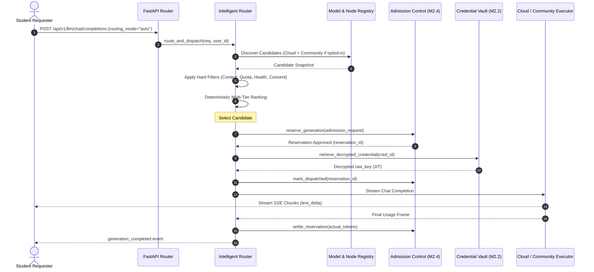
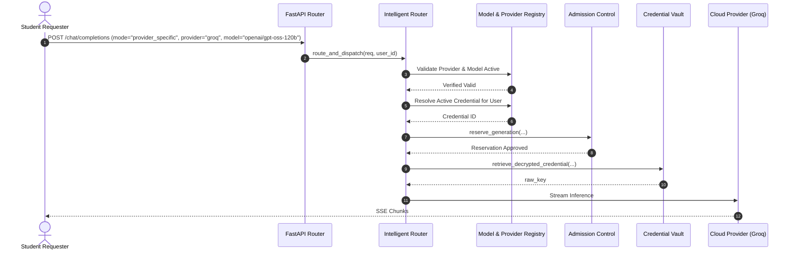
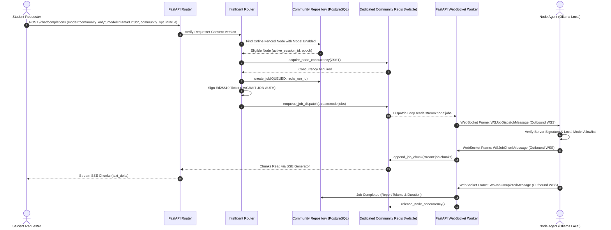
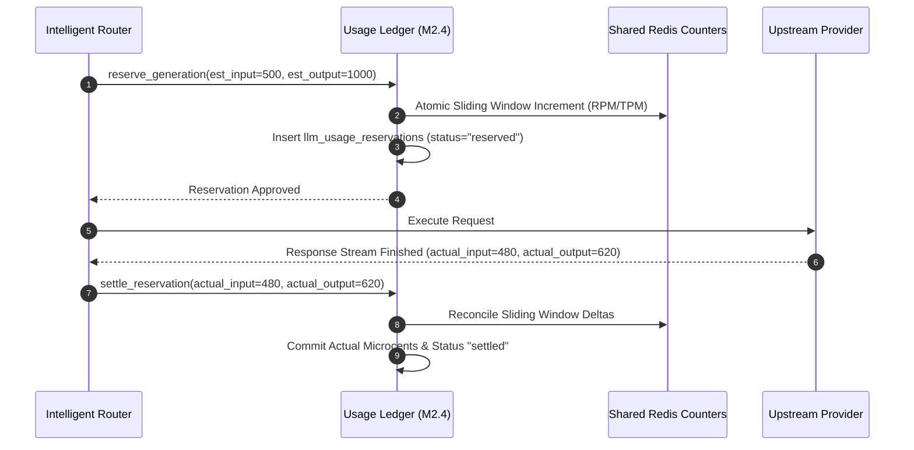
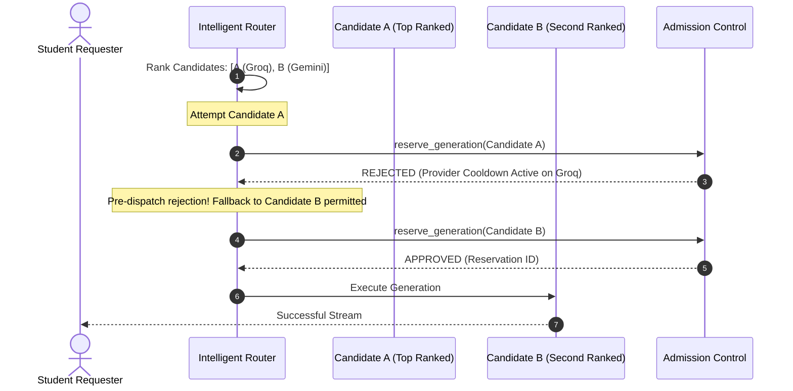

# RagBait M2.9 — Unified Intelligent Inference Routing Architecture & Implementation Plan

> **Status:** Pending Review  
> **Target Branch:** `phase2`  
> **Base Commit:** `473f3a1`  
> **Workflow Stage:** Inspect → **Plan** → Review (STOP) → Implement → Test → Inspect Diff → Commit → Final Report  

---

## 1. Executive Summary & Existing Architecture Findings

Milestone **M2.9 — Unified Intelligent Inference Routing** introduces a deterministic, privacy-aware, multi-source routing engine for RagBait. It unifies cloud API providers (M2.1–M2.5) and peer community Ollama nodes (M2.8) under a single, consistent API and routing policy, while keeping private local inference (M2.7) as an isolated, browser-to-loopback client flow.

### Authoritative Architecture Findings from Repository Inspection (Phase A)

1. **Cloud Registry & Adapters (M2.1, M2.5):**
   - Active cloud providers: `gemini`, `groq`, `openrouter`, `cerebras`.
   - Models are registered in `public.llm_models` with capabilities (`streaming`, `tools`, `vision`, `reasoning`), context windows, and integer pricing (`input_cost_per_million_cents`, `output_cost_per_million_cents`).
   - Dynamic alias support: `openrouter/free` has `is_routing_alias: true` and resolves dynamically to upstream models.
   - Provider adapters implement `BaseProviderAdapter` in `apps/api/app/modules/llm_gateway/interfaces.py`.

2. **Credential Vault & Sharing Policy (M2.2, M2.3):**
   - Credentials in `public.api_key_metadata` and `private.api_key_secrets` are encrypted using AES-256-GCM.
   - Credentials have `sharing_scope` (`owner_only` vs `community_shared`) and `shared_consent` (boolean).
   - Providers have `allows_community_sharing: bool`. Only providers with this flag enabled allow non-owners to use community-shared keys.
   - **Crucial Invariant:** Credential decryption occurs *strictly after* admission reservation succeeds. Plaintext secrets are never returned to clients or logged.

3. **Admission Control, Quotas & Cooldowns (M2.4):**
   - Rate limiting: User RPM, Credential RPM, Provider RPM/TPM/RPD/TPD via Redis sliding-window counters.
   - Concurrency: Tracked per-credential and globally.
   - Budget & Spending Caps: Daily and monthly limits in cents on `api_key_metadata`.
   - Provider Cooldowns: Recorded in Redis (`ragbait:cooldown:{scope}:{id}`) upon receiving HTTP 429 with `Retry-After`.
   - Durable reservations in `public.llm_usage_reservations`; conservative transition to `outcome_unknown` upon ambiguous failures.

4. **Community Local Inference (M2.8, M2.8.2.2):**
   - Volunteer student nodes register and connect via outbound-only WebSockets with Ed25519 authentication.
   - Authoritative session fencing in PostgreSQL (`active_session_id`, `session_epoch`).
   - Contributor consent: granular per-model sharing toggles in `public.community_node_models`.
   - Requester consent: explicit privacy disclosure required (`consent_accepted: true`).
   - Concurrency: Atomic Redis ZSET reservations (`acquire_node_concurrency`).
   - Dedicated volatile Redis (`community-redis` on port 6380, no persistent volume, `save ""` and `appendonly no`) for job dispatch and SSE result streaming.

5. **Private Local Inference (M2.7):**
   - Browser directly queries `http://127.0.0.1:11434/api/chat` via Chrome Local Network Access (LNA) loopback permissions.
   - Zero server-side traffic, zero credential storage, zero token storage.
   - Must remain completely decoupled from server-side routing.

---

## 2. Candidate Source Types

The routing engine classifies all executable inference targets into two server-addressable source types:

```
                          Server-Side Inference Sources
                                        |
               +------------------------+------------------------+
               |                                                 |
               v                                                 v
         [Source: Cloud]                               [Source: Community]
    - Google Gemini                                - Contributor Ollama Node
    - GroqCloud                                    - Outbound WSS + Ed25519
    - OpenRouter                                   - Dedicated Volatile Redis
    - Cerebras                                     - ZSET Concurrency Leases
    - AES-256 Decrypted JIT Key                    - Zero Upstream API Cost
```

*Note on Private Local Inference (M2.7):* Private local inference executes purely in the student's browser and cannot be addressed or orchestrated by backend servers. It remains a distinct client-side selection.

### Unified Internal Candidate Representation

```python
class SourceType(str, Enum):
    CLOUD = "cloud"
    COMMUNITY = "community"

@dataclass
class RoutingCandidate:
    source_type: SourceType
    provider_id: str                   # e.g., "gemini", "groq", "openrouter", "cerebras", "ollama"
    model_id: str                      # e.g., "gemini-3.8-flash", "llama3.2:3b"
    display_name: str
    family: str
    release_stage: str                 # "ga", "preview", "experimental"
    
    # Capabilities & Context Limits
    capabilities: list[str]
    context_window: int
    max_output_tokens: int
    
    # Cloud-Specific Properties (Safe Metadata ONLY - NO Secrets!)
    credential_id: UUID | None = None
    credential_owner_id: UUID | None = None
    is_shared_credential: bool = False
    pricing_input_cents_per_million: int | None = None
    pricing_output_cents_per_million: int | None = None
    pricing_provenance: str = "unknown"
    pricing_updated_at: datetime | None = None
    free_tier_eligible: bool = False
    
    # Community-Specific Properties (Safe Metadata ONLY - NO Contributor PII!)
    node_id: UUID | None = None
    node_display_name: str | None = None
    max_concurrent_jobs: int = 1
    active_concurrency: int = 0
    max_execution_duration: int = 300
    
    # Live Health & Telemetry
    is_cooling_down: bool = False
    cooldown_remaining_seconds: int = 0
    has_quota_capacity: bool = True
```

---

## 3. Routing Modes & Request Contract

The existing endpoint `POST /api/v1/llm/chat/completions` will be extended with backward-compatible routing attributes:

```python
RoutingMode = Literal["auto", "cloud_only", "community_only", "provider_specific"]

class ChatCompletionRequest(BaseModel):
    # Routing controls
    routing_mode: RoutingMode = Field(
        default="provider_specific",
        description="Routing policy mode: 'auto', 'cloud_only', 'community_only', or 'provider_specific'"
    )
    provider_id: str | None = Field(
        default=None,
        min_length=2,
        max_length=64,
        description="Required if routing_mode is 'provider_specific'. Optional target provider preference otherwise."
    )
    model_id: str | None = Field(
        default=None,
        min_length=2,
        max_length=128,
        description="Specific model identifier. If omitted in 'auto' or 'cloud_only', router chooses best eligible general model."
    )
    credential_id: UUID | None = Field(
        default=None,
        description="Explicit credential override for cloud providers. Checked for authorization."
    )
    
    # Privacy & Consent
    community_opt_in: bool = Field(
        default=False,
        description="Explicit user opt-in to consider peer community nodes for this request."
    )
    community_consent_version: str | None = Field(
        default=None,
        description="Consent disclosure policy version (must match server version if community_opt_in is true)."
    )

    # Payload & Parameters
    messages: list[ChatMessage] = Field(..., min_length=1, max_length=100)
    params: GenerationParams = Field(default_factory=GenerationParams)
    stream: bool = Field(default=True, description="Whether to stream response via SSE")
    idempotency_key: str = Field(..., min_length=4, max_length=128)
```

### Routing Mode Semantics

| Routing Mode | Cloud Sources Considered | Community Sources Considered | Community Opt-in Enforced | Behavior on Exhaustion / Unavailable |
| :--- | :---: | :---: | :---: | :--- |
| **`auto`** | Yes | Yes (ONLY if `community_opt_in: true`) | Yes | Evaluates eligible candidates across authorized sources; returns HTTP 409 if no source is eligible. Never routes to community without opt-in. |
| **`cloud_only`** | Yes | **Never** | N/A | Evaluates eligible cloud providers; returns HTTP 409 if cloud credentials/quotas exhausted. Never routes to community. |
| **`community_only`** | **Never** | Yes | **Mandatory** | Evaluates online community nodes with active models. Requires dual consent. If no node available, returns HTTP 409. **Never falls back to cloud.** |
| **`provider_specific`** | Targeted | Targeted (if `ollama`) | Yes (if `ollama`) | Preserves M2.5 behavior: verifies exact provider and model against registry, verifies credential/node, and executes. |

---

## 4. Candidate Eligibility Model (Hard Filtering)

Before ranking, every candidate is subjected to strict, non-negotiable hard filters. Candidates failing any filter are eliminated immediately with a structured internal rejection code:

```
[All Registered Candidates]
           |
           v
  1. Administrative Status Filter (Provider Enabled? Model Active & Not Shutdown?)
           |
           v
  2. Capability & Context Filter (Supports Streaming/Tools? Context >= Input + Output?)
           |
           v
  3. Source-Specific Security & Authorization Filter:
     ├── Cloud: Valid Active Credential? (Owner-only or Community-Shared permitted?)
     └── Community: Requester Opt-in Present? Node Online & Fenced? Model Shared?
           |
           v
  4. Admission & Cooldown Filter (Cooldown Active? Quota/Spending Cap Exhausted?)
           |
           v
  [Eligible Candidates Pool]
```

### Filter Rules & Reason Codes

1. `PROVIDER_DISABLED`: `provider.is_enabled == false`.
2. `MODEL_INACTIVE`: `model.availability_status != "active"` or `model.shutdown_at <= now()`.
3. `CONTEXT_WINDOW_EXCEEDED`: `estimated_input_tokens + requested_max_output > model.context_window`.
4. `OUTPUT_LIMIT_EXCEEDED`: `requested_max_output > model.max_output_tokens`.
5. `CAPABILITY_UNSUPPORTED`: Requested feature (e.g. streaming, reasoning) not in `model.capabilities`.
6. `NO_ELIGIBLE_CREDENTIAL` (Cloud): No active, validated credential owned by user, and no community-shared credential exists on a provider allowing sharing.
7. `PROVIDER_COOLDOWN_ACTIVE`: Active Redis cooldown exists for provider, model, credential, or account (`check_cooldown`).
8. `SPENDING_CAP_EXCEEDED`: Credential daily or monthly spending budget limit exceeded.
9. `QUOTA_EXHAUSTED`: Model or provider RPM/TPM/RPD limits exhausted in Redis counters.
10. `PRICING_UNAVAILABLE`: Credential has spending cap, but non-free model has 0 pricing metadata.
11. `COMMUNITY_CONSENT_MISSING` (Community): Request specifies community node or opted-in, but `community_opt_in` is false or policy version mismatched.
12. `COMMUNITY_NODE_OFFLINE` (Community): Node status is not `active`, `last_seen_at` is stale, or session is superseded.
13. `COMMUNITY_MODEL_UNSHARED` (Community): Model is not in node's allowlist or `enabled == false`.
14. `COMMUNITY_CONCURRENCY_EXHAUSTED` (Community): Node current ZSET lease count $\ge$ `max_concurrent_jobs`.
15. `COMMUNITY_REDIS_UNAVAILABLE` (Community): Dedicated `community-redis` service unreachable.

---

## 5. Deterministic Candidate Ranking Policy

Eligible candidates are ranked deterministically. **No machine learning, no random choice, and no speculative background execution.**

Each candidate is evaluated by a multi-tier comparator scoring tuple:

$$\text{Rank Score} = (\text{PreferenceTier}, \text{CostTier}, \text{HealthTier}, \text{CapabilityTier}, \text{TieBreaker})$$

Lower score indicates higher priority.

### Ranking Tiers Breakdown

1. **Tier 1: User Request Alignment (`PreferenceTier` $\in \{0, 1, 2\}$)**
   - `0`: Candidate exactly matches user's explicitly requested `model_id` or `provider_id`.
   - `1`: Candidate matches user's preferred family (e.g. `llama`, `gemini`, `qwen`).
   - `2`: General eligible candidate.

2. **Tier 2: Cost & Source Priority Preference (`CostTier` $\in \{0, 1, 2, 3\}$)**
   - `0`: Free Tier Cloud model (`free_tier_eligible: true` with verified 0 cost, e.g. `openrouter/free`).
   - `1`: Community inference node (peer volunteer compute; avoids cloud provider API billing; distinct source priority, not a fake zero cloud price).
   - `2`: User-owned paid cloud credential (spends user's own budget before community resources).
   - `3`: Community-shared paid cloud credential (preserves pooled shared funds).
   - *Sub-sort within Tier 2:* For cloud candidates with established pricing, ascending by exact integer microcents formula:
     $$\text{Estimated Microcents} = \text{estimated\_input\_tokens} \times \text{input\_cost\_cents} + \text{estimated\_output\_tokens} \times \text{output\_cost\_cents}$$
     *(Missing or stale prices are treated as `None`, never assumed to be zero, and never conflated with free-tier eligibility).*

3. **Tier 3: Capacity & Health (`HealthTier` $\in \{0, 1\}$)**
   - `0`: Available capacity with no recent cooldown triggers.
   - `1`: Approaching quota envelope (>80% sliding-window usage).
   - *Sub-sort for Community:* Descending by available concurrency slots (`max_concurrent_jobs - active_concurrency`).

4. **Tier 4: Model Release Quality & Context Headroom (`CapabilityTier` $\in \{0, 1, 2\}$)**
   - `0`: General Availability (`ga`).
   - `1`: Preview (`preview`).
   - `2`: Experimental (`experimental`).
   - *Sub-sort:* Descending by available context headroom (`context_window - (input + output)`).

5. **Tier 5: Deterministic Stable Tie-Breaker (`TieBreaker`)**
   - Alphabetical string sort:
     $$\text{key} = f"{provider\_id}:{model\_id}:{source\_id}"$$
   - Guarantees 100% deterministic, repeatable selection across identical system snapshots.

---

## 6. Execution, Admission & Settlement Lifecycle

Once the top-ranked candidate is selected, the router commits to execution. **One request $\rightarrow$ One executed candidate.** No speculative concurrent duplication.

### Cloud Source Execution Flow
1. Construct `AdmissionRequest` with candidate's `provider_id`, `model_id`, `credential_id`, and estimated tokens.
2. Call `reserve_generation()` (M2.4): atomics check rate limits, concurrency, quotas, and budget caps.
3. Call `retrieve_decrypted_credential()` (M2.2): decrypt raw key JIT from encrypted vault.
4. Call `mark_dispatched()`: lock reservation into dispatched state.
5. Invoke provider adapter (`gemini`, `groq`, `openrouter`, `cerebras`).
6. Stream SSE chunks (`text_delta`, `usage`, `generation_completed`).
7. Settle reservation via `settle_reservation()` with actual tokens and microcents.

### Community Source Execution Flow (Preserving Node Agent WSS Isolation)
1. Verify requester consent (`consent_accepted: true` and policy version match).
2. Acquire node concurrency lease in Redis ZSET (`acquire_node_concurrency`).
3. Create PostgreSQL job record in `public.community_inference_jobs` with `redis_run_id`.
4. Sign Ed25519 job authorization ticket with server private key.
5. Enqueue dispatch payload into dedicated volatile Redis Stream (`stream:node:{node_id}:jobs`).
6. FastAPI WebSocket dispatch loop claims entry and sends `WSJobDispatchMessage` to Node Agent over the outbound WSS connection.
7. Node Agent executes on local loopback Ollama and sends `WSJobChunkMessage` back over WSS.
8. FastAPI WebSocket worker appends chunks to `stream:job:{job_id}:chunks` in Community Redis.
9. FastAPI SSE generator reads chunks and streams to requester.
10. Settle device-reported tokens in usage ledger with `usage_provenance = 'device_reported'` and release concurrency lease.
*(The Node Agent never communicates directly with Redis, never receives Redis URLs or credentials, and never receives database or vault secrets).*

---

## 7. Failure Handling & Safe Fallback Rules

The router enforces strict boundaries regarding when fallback is permitted:

```
[Candidate Selected]
        |
        v
[Admission Check] ── Rejected (Quota/Cooldown) ──> [Safe Pre-Dispatch Fallback to Next Candidate]
        |
    Approved
        |
        v
[JIT Key Decryption] ── Decrypt Failed ──────────> [Safe Pre-Dispatch Fallback to Next Candidate]
        |
    Succeeded
        |
        v
[Mark Dispatched]
        |
        v
[Network Execution] ── Mid-stream Error / Timeout ─> [NO RETRY / NO FALLBACK]
                                                      - Mark outcome_unknown
                                                      - Hold reservation
                                                      - Return error to client
```

### Safe Fallback Invariants
1. **Pre-Dispatch Fallback Permitted:** If the #1 ranked candidate fails *before* dispatch commitment (e.g. admission rejected due to instantaneous race on quota, or credential decryption error), the router may evaluate candidate #2, provided candidate #2 satisfies all user mode and privacy constraints.
2. **Post-Dispatch Fallback STRICTLY FORBIDDEN:** Once `mark_dispatched()` is committed or an HTTP connection to the provider/node is initiated, the system must **NEVER** fall back to another candidate.
3. **Mid-Stream Fallback STRICTLY FORBIDDEN:** If streaming has begun (`generation_started` sent), the connection must never switch models or mix tokens.
4. **Privacy Boundary Invariants:**
   - A `cloud_only` request must **NEVER** fall back to community inference.
   - An `auto` request without `community_opt_in: true` must **NEVER** fall back to community inference.
   - A `community_only` request must **NEVER** fall back to cloud inference.
   - An ambiguous upstream timeout must **NEVER** trigger an automatic retry (prevents double-billing).

---

## 8. Observability & Telemetry

Safe route decision telemetry is injected into HTTP response headers and SSE initial events. **Zero prompts, completions, API keys, or contributor PII are exposed.**

### Safe Headers
- `X-RagBait-Routing-Mode`: Requested mode (`auto`, `cloud_only`, `community_only`, `provider_specific`).
- `X-RagBait-Selected-Source`: `cloud:{provider_id}` or `community:node`.
- `X-RagBait-Selected-Model`: Model ID selected.
- `X-RagBait-Decision-Reason`: Reason code (e.g. `exact_model_match`, `lowest_cost_eligible`, `free_tier_priority`).
- `X-RagBait-Reservation-Id`: Tracking UUID for admission and usage ledger.

---

## 9. Sequence Diagrams

### 1. Automatic Route Selection Flow



### 2. Explicit Provider Selection Flow



### 3. Community Node Selection with Dual Consent Flow (Strict WSS Isolation)



### 4. Admission, Execution & Settlement Flow



### 5. Failure and Safe Fallback Flow



---

## 10. Implementation Plan & File Structure

```
apps/api/app/modules/routing/
├── __init__.py                # Export router public service functions
├── schemas.py                 # RoutingMode, RoutingCandidate, RouteDecision, CandidateFilterResult
├── policy.py                  # Deterministic ranking comparator & scoring engine
├── discovery.py               # Candidate discovery (cloud providers + community nodes)
├── service.py                 # Orchestration: discover -> filter -> rank -> execute -> settle
└── router.py                  # Optional route preview endpoint: GET /api/v1/routing/preview

apps/api/app/modules/llm_gateway/
├── schemas.py                 # Extend ChatCompletionRequest with routing_mode, community_opt_in
├── router.py                  # Update POST /chat/completions to invoke routing engine
└── service.py                 # Refactor dispatch_chat_completion to delegate to router

apps/web/src/
├── app/(protected)/local-inference/page.tsx # Update mode selector to include Auto, Cloud-Only, Community, Private Local
├── components/CommunityConsentModal.tsx     # Reusable consent modal for routing opt-in
└── types/index.ts                           # Add RoutingMode and RouteDecision types
```

---

## 11. Testing & Verification Strategy

### 1. Router Policy Unit Tests (`apps/api/tests/test_routing_policy.py`)
- Deterministic candidate ranking: identical candidates produce identical ordering.
- Stable tie-breaker: verifies alphabetical sorting when scores are equal.
- Mode filtering:
  - `cloud_only` strictly eliminates community candidates.
  - `community_only` strictly eliminates cloud candidates.
  - `auto` excludes community candidates unless `community_opt_in: true`.
  - Incompatible model filtering (context window, output tokens, capabilities).
  - Cooldown filtering: candidate in cooldown is safely bypassed.

### 2. Security & Privacy Tests (`apps/api/tests/test_routing_security.py`)
- User A cannot use User B's private credential.
- Unshared community credentials cannot be used by non-owners.
- Community nodes without active, fenced sessions cannot be selected.
- Privacy boundaries: `cloud_only` request cannot fall back to community upon cloud failure.
- Route metadata does not leak prompts, completions, or raw API keys.

### 3. Execution & Settlement Integration Tests (`apps/api/tests/test_routing_execution.py`)
- Full execution of cloud route through M2.4 admission and JIT vault decryption.
- Full execution of community route through M2.8 concurrency and signed ticket.
- Pre-dispatch fallback on rate-limit 429 cooldown.
- Ambiguous execution failure halts without automatic retry.

### 4. Frontend Vitest Tests (`apps/web/tests/routing.test.ts`)
- Mode selector rendering: Auto, Cloud Only, Community Node, Private Local.
- Auto mode handles community opt-in toggle.
- Error handling displays clean error messages without raw stack traces.

---

## 12. Acceptance Criteria (M2.9 Completion Checklist)

- [ ] **Routing:** Deterministic ranking comparator implemented with zero ML and zero random behavior.
- [ ] **Cloud Selection:** Cloud providers (`gemini`, `groq`, `openrouter`, `cerebras`) selectable via `auto`, `cloud_only`, or `provider_specific`.
- [ ] **Community Selection:** Community nodes selectable via `community_only` or `auto` (with opt-in).
- [ ] **Privacy Consent:** Community inference requires explicit requester opt-in for that specific request.
- [ ] **Private Local:** M2.7 browser loopback inference remains separate and fully functional.
- [ ] **Admission Control:** M2.4 rate limits, budgets, and concurrency reservations reused without duplication.
- [ ] **Vault Decryption:** JIT decryption occurs strictly after admission approval.
- [ ] **Fallback Invariant:** Pre-dispatch fallback supported; mid-stream or post-dispatch fallback strictly forbidden; privacy boundaries never crossed.
- [ ] **Quality & Regressions:** 100% of existing pgTAP (142), API (209), Node Agent (10), and Web (56) tests pass cleanly. TypeScript compiles with 0 errors; ESLint reports 0 warnings.
- [ ] **Documentation:** `docs/M2_9_ROUTING.md` created with complete operational and architectural documentation.

---

## 13. Scope Exclusions (Strict M2.9 Boundaries)

- NO machine learning or predictive latency models.
- NO speculative concurrent parallel dispatch.
- NO new provider adapters (OpenAI and xAI remain deferred in M2.6).
- NO pooled paid credits or wallet systems.
- NO automatic privacy-boundary crossovers.
- NO backend proxying to student private localhost Ollama.
- NO changes to M2.1–M2.8 security architectures.

---

## STOP — Awaiting Review & Explicit Approval

This document represents the complete, inspected architecture and implementation plan for **RagBait M2.9**. In accordance with the mandatory workflow:
- No application source code has been modified.
- No database migrations have been altered.
- All technical investigations are verified against Git HEAD `473f3a1`.

**Awaiting your explicit approval to proceed with Phase C (Implementation).**
